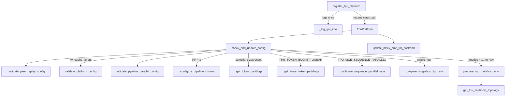
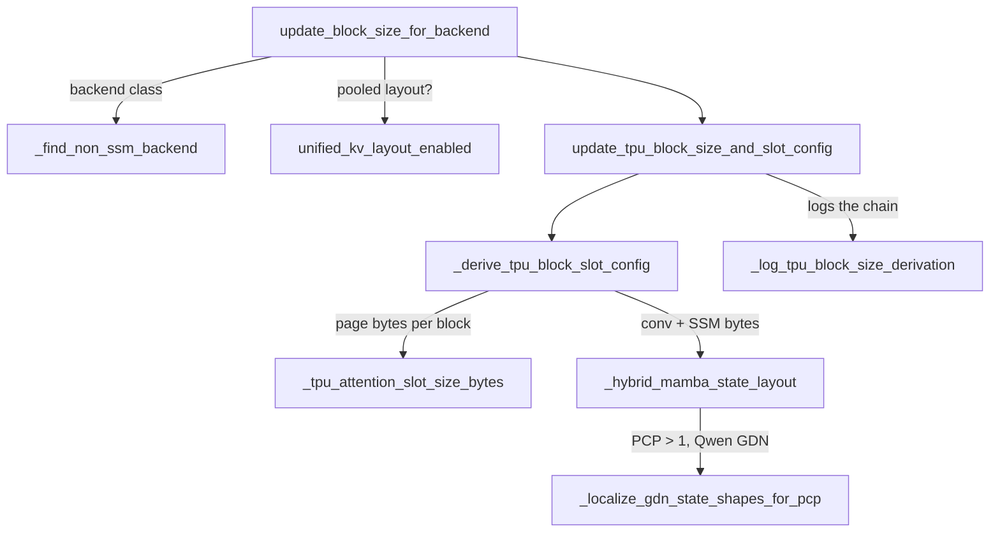

# TPU platform plugin: TpuPlatform, config resolution and KV block sizing

<!-- connect:up:begin -->
> **Cross-repo concept:** part of [kv-cache](../../../concepts/kv-cache.md), [pipeline-parallelism](../../../concepts/pipeline-parallelism.md) across this wiki's repos.
<!-- connect:up:end -->
## Overview

vLLM discovers hardware through *platform plugins*: while `vllm` is being imported it calls every registered `vllm.platform_plugins` entry point, and the one that returns a class path becomes `current_platform`. vllm-torchtpu registers [`register_tpu_platform`](../catalog/src/vllm_torchtpu/platforms/__init__.md#register_tpu_platform "src/vllm_torchtpu/platforms/__init__.py:L55") (`torchtpu = "vllm_torchtpu.platforms:register_tpu_platform"` in `pyproject.toml`), which returns the path of [`TpuPlatform`](../catalog/src/vllm_torchtpu/platforms/tpu_platform.md#TpuPlatform "src/vllm_torchtpu/platforms/tpu_platform.py:L453"). `TpuPlatform` is a class of classmethods - never instantiated - that vLLM calls at fixed points: device identity, distributed backend, attention backend, compile backend, and above all [`check_and_update_config`](../catalog/src/vllm_torchtpu/platforms/tpu_platform.md#TpuPlatform.check_and_update_config "src/vllm_torchtpu/platforms/tpu_platform.py:L785").

The key design idea is that **the platform is a startup-time config compiler, not a runtime layer**. `check_and_update_config` runs once in every process that builds a `VllmConfig` (API server, engine core, workers) and rewrites a GPU-shaped vLLM config into one the TPU path can serve: it forces whole-graph `VLLM_COMPILE`, replaces CUDA graph capture sizes with a ladder of **token buckets** (`compile_sizes`, one compiled TPU program each), forces bf16, picks the executor and seeds the `TORCH_TPU_*` bootstrap environment, and runs static validators ([`PcpStaticSupportValidator`](../catalog/src/vllm_torchtpu/platforms/pcp_validation.md#PcpStaticSupportValidator "src/vllm_torchtpu/platforms/pcp_validation.py:L37"), [`validate_pipeline_parallel_config`](../catalog/src/vllm_torchtpu/platforms/pp_validation.md#validate_pipeline_parallel_config "src/vllm_torchtpu/platforms/pp_validation.py:L99")) so that an unsupported combination dies at launch rather than after a multi-minute model load and precompile. A second hook, [`update_block_size_for_backend`](../catalog/src/vllm_torchtpu/platforms/tpu_platform.md#TpuPlatform.update_block_size_for_backend "src/vllm_torchtpu/platforms/tpu_platform.py:L1261"), fixes the KV-cache page (block) size from the attention backend's page geometry - and for hybrid GDN models, from how much recurrent state must fit inside one attention page.

For TPU inference performance, the knobs this subsystem owns are: the token-bucket ladder (padding waste vs. number of resident programs), KV block size (kernel page geometry, SMEM limits), the executor/process topology (uniproc vs. multiproc vs. Ray, multihost rendezvous), and the hard limits on which parallelism combinations (PCP, PP, sequence-parallel MoE, DP+EP) may be combined.

## Diagram

The config-resolution path, from plugin discovery to the KV block size:

Legend:
- `REG` - [`register_tpu_platform`](../catalog/src/vllm_torchtpu/platforms/__init__.md#register_tpu_platform "src/vllm_torchtpu/platforms/__init__.py:L55")
- `LOGI` - [`_log_tpu_info`](../catalog/src/vllm_torchtpu/platforms/__init__.md#_log_tpu_info "src/vllm_torchtpu/platforms/__init__.py:L29")
- `TP` - [`TpuPlatform`](../catalog/src/vllm_torchtpu/platforms/tpu_platform.md#TpuPlatform "src/vllm_torchtpu/platforms/tpu_platform.py:L453")
- `CUC` - [`check_and_update_config`](../catalog/src/vllm_torchtpu/platforms/tpu_platform.md#TpuPlatform.check_and_update_config "src/vllm_torchtpu/platforms/tpu_platform.py:L785")
- `PEER` - [`_validate_peer_replay_config`](../catalog/src/vllm_torchtpu/platforms/tpu_platform.md#_validate_peer_replay_config "src/vllm_torchtpu/platforms/tpu_platform.py:L321")
- `PCP` - [`validate_platform_config`](../catalog/src/vllm_torchtpu/platforms/pcp_validation.md#PcpStaticSupportValidator.validate_platform_config "src/vllm_torchtpu/platforms/pcp_validation.py:L78")
- `PP` - [`validate_pipeline_parallel_config`](../catalog/src/vllm_torchtpu/platforms/pp_validation.md#validate_pipeline_parallel_config "src/vllm_torchtpu/platforms/pp_validation.py:L99")
- `CHUNK` - [`_configure_pipeline_chunks`](../catalog/src/vllm_torchtpu/platforms/tpu_platform.md#_configure_pipeline_chunks "src/vllm_torchtpu/platforms/tpu_platform.py:L1441")
- `PAD` - [`_get_token_paddings`](../catalog/src/vllm_torchtpu/platforms/tpu_platform.md#_get_token_paddings "src/vllm_torchtpu/platforms/tpu_platform.py:L1474")
- `LIN` - [`_get_linear_token_paddings`](../catalog/src/vllm_torchtpu/platforms/tpu_platform.md#_get_linear_token_paddings "src/vllm_torchtpu/platforms/tpu_platform.py:L1413")
- `SPM` - [`_configure_sequence_parallel_moe`](../catalog/src/vllm_torchtpu/platforms/tpu_platform.md#_configure_sequence_parallel_moe "src/vllm_torchtpu/platforms/tpu_platform.py:L1505")
- `ENV` - [`_prepare_singlehost_tpu_env`](../catalog/src/vllm_torchtpu/platforms/tpu_platform.md#TpuPlatform._prepare_singlehost_tpu_env "src/vllm_torchtpu/platforms/tpu_platform.py:L624")
- `MH` - [`prepare_mp_multihost_env`](../catalog/src/vllm_torchtpu/distributed/tpu_mp_multihost.md#prepare_mp_multihost_env "src/vllm_torchtpu/distributed/tpu_mp_multihost.py:L128")
- `TOPO` - [`get_tpu_multihost_topology`](../catalog/src/vllm_torchtpu/platforms/tpu_platform.md#get_tpu_multihost_topology "src/vllm_torchtpu/platforms/tpu_platform.py:L155")
- `UBS` - [`update_block_size_for_backend`](../catalog/src/vllm_torchtpu/platforms/tpu_platform.md#TpuPlatform.update_block_size_for_backend "src/vllm_torchtpu/platforms/tpu_platform.py:L1261")

The KV block-size derivation (second hook), for the unified KV pool:

Legend:
- `UBS` - [`update_block_size_for_backend`](../catalog/src/vllm_torchtpu/platforms/tpu_platform.md#TpuPlatform.update_block_size_for_backend "src/vllm_torchtpu/platforms/tpu_platform.py:L1261")
- `FNS` - [`_find_non_ssm_backend`](../catalog/src/vllm_torchtpu/platforms/tpu_platform.md#TpuPlatform._find_non_ssm_backend "src/vllm_torchtpu/platforms/tpu_platform.py:L1249")
- `UKL` - [`unified_kv_layout_enabled`](../catalog/src/vllm_torchtpu/platforms/tpu_block_size_utils.md#unified_kv_layout_enabled "src/vllm_torchtpu/platforms/tpu_block_size_utils.py:L54")
- `UPD` - [`update_tpu_block_size_and_slot_config`](../catalog/src/vllm_torchtpu/platforms/tpu_block_size_utils.md#update_tpu_block_size_and_slot_config "src/vllm_torchtpu/platforms/tpu_block_size_utils.py:L528")
- `DER` - [`_derive_tpu_block_slot_config`](../catalog/src/vllm_torchtpu/platforms/tpu_block_size_utils.md#_derive_tpu_block_slot_config "src/vllm_torchtpu/platforms/tpu_block_size_utils.py:L350")
- `SLOT` - [`_tpu_attention_slot_size_bytes`](../catalog/src/vllm_torchtpu/platforms/tpu_block_size_utils.md#_tpu_attention_slot_size_bytes "src/vllm_torchtpu/platforms/tpu_block_size_utils.py:L118")
- `HYB` - [`_hybrid_mamba_state_layout`](../catalog/src/vllm_torchtpu/platforms/tpu_block_size_utils.md#_hybrid_mamba_state_layout "src/vllm_torchtpu/platforms/tpu_block_size_utils.py:L202")
- `LOC` - [`_localize_gdn_state_shapes_for_pcp`](../catalog/src/vllm_torchtpu/platforms/tpu_block_size_utils.md#_localize_gdn_state_shapes_for_pcp "src/vllm_torchtpu/platforms/tpu_block_size_utils.py:L160")
- `LOGD` - [`_log_tpu_block_size_derivation`](../catalog/src/vllm_torchtpu/platforms/tpu_block_size_utils.md#_log_tpu_block_size_derivation "src/vllm_torchtpu/platforms/tpu_block_size_utils.py:L485")

## Design rationale (why it's built this way)

- **Import order is part of the contract.** The package docstring explains that vLLM resolves its platform *while `vllm` itself is importing*, so `platforms/__init__.py` defines [`register_tpu_platform`](../catalog/src/vllm_torchtpu/platforms/__init__.md#register_tpu_platform "src/vllm_torchtpu/platforms/__init__.py:L55") before importing `vllm`, and only then imports the platform module. `tpu_platform.py` in turn imports the environment-override module first ("especially torch_tpu which might read them at import time") and imports `torch_tpu._internal.compile` so the `"tpu"` `torch.compile` backend exists before any `@torch.compile` decorator in vLLM runs.
- **Fail at launch, not mid-serving.** Most of `check_and_update_config` is validation that raises with a remedy string. [`_validate_peer_replay_config`](../catalog/src/vllm_torchtpu/platforms/tpu_platform.md#_validate_peer_replay_config "src/vllm_torchtpu/platforms/tpu_platform.py:L321") even reads `TPU_PRECOMPILE_PEER_WAIT_S` eagerly - "so a bad value fails the launch rather than the precompile that reads it after the model has loaded". The same intent drives the token-budget check (a decode server with `compile_sizes [256]` and a 16384-token budget "starts fine and then crashes on the first large step") and the PCP/PP validators.
- **One whole graph, no piecewise splitting.** `splitting_ops` is set to `[]`: TPU compiles the full backbone graph per bucket. The single exception is `TPU_KERNEL_ITER_MODE`, which splits at the Pallas ragged-paged-attention custom ops (`pallas::rpa_kernel_<i>` / `pallas::rpa_kernel_batched_<i>`, i < 64, because op instance ids are allocated at model build and splitting matches exact names) so a kernel edit reuses the cached backbone executables (see [compilation and graph capture](compilation-and-graph-capture.md)).
- **Token buckets are a memory/latency trade.** Every bucket is one compiled program that stays resident. The exponential ladder from [`_get_token_paddings`](../catalog/src/vllm_torchtpu/platforms/tpu_platform.md#_get_token_paddings "src/vllm_torchtpu/platforms/tpu_platform.py:L1474") doubles from 16 but caps the last bucket at exactly `max_num_batched_tokens` ("a bucket larger than that only wastes compile time and HBM"). Doubling pads a prefill pass by up to 1/2, so [`_get_linear_token_paddings`](../catalog/src/vllm_torchtpu/platforms/tpu_platform.md#_get_linear_token_paddings "src/vllm_torchtpu/platforms/tpu_platform.py:L1413") adds linear buckets above budget/4 in steps of budget/32 (at most 1/8 padding), but caps them at 7 because, per the source comment, each bucket cost about 13 GB of host memory per rank on a TP8 Qwen3.5-397B + MTP deployment and 13 buckets overran a 512 GiB pod during precompile.
- **The executor is chosen, not configured.** vLLM's `distributed_executor_backend` is overwritten from `TPU_MULTIHOST_BACKEND`, `--nnodes`, and the parallel sizes, because the TPU runtime (PjRt slice bootstrap) needs env vars computed *before* workers fork: slicebuilder addresses, `TORCH_TPU_TOPOLOGY`, master address/port.
- **Block size follows the kernel, then the state.** The page size comes from the attention backend's own geometry; for the unified hybrid pool a block must additionally be large enough to hold one request's pooled GDN conv + SSM state, since that state lives inside attention pages.

## Entry points

- [`register_tpu_platform`](../catalog/src/vllm_torchtpu/platforms/__init__.md#register_tpu_platform "src/vllm_torchtpu/platforms/__init__.py:L55") - the `vllm.platform_plugins` entry point; called by vLLM during `import vllm`. Logs TPU identity once via [`_log_tpu_info`](../catalog/src/vllm_torchtpu/platforms/__init__.md#_log_tpu_info "src/vllm_torchtpu/platforms/__init__.py:L29") (node name, TPU type, worker id, chips, cores per chip; an error log hints "Are you running on CPU?").
- [`check_and_update_config`](../catalog/src/vllm_torchtpu/platforms/tpu_platform.md#TpuPlatform.check_and_update_config "src/vllm_torchtpu/platforms/tpu_platform.py:L785") - called by vLLM's config post-init in every process that builds a `VllmConfig`. The heart of the subsystem (see Mechanism).
- [`update_block_size_for_backend`](../catalog/src/vllm_torchtpu/platforms/tpu_platform.md#TpuPlatform.update_block_size_for_backend "src/vllm_torchtpu/platforms/tpu_platform.py:L1261") - vLLM's hook for fixing `cache_config.block_size` once the attention backend is known.
- [`get_worker_distributed_backend`](../catalog/src/vllm_torchtpu/platforms/tpu_platform.md#TpuPlatform.get_worker_distributed_backend "src/vllm_torchtpu/platforms/tpu_platform.py:L612") - called from worker bootstrap ([`init_device`](../catalog/src/vllm_torchtpu/worker/tpu_worker.md#TPUWorker.init_device "src/vllm_torchtpu/worker/tpu_worker.py:L194")): returns [`dist_backend`](../catalog/src/vllm_torchtpu/platforms/tpu_platform.md#TpuPlatform.dist_backend "src/vllm_torchtpu/platforms/tpu_platform.py:L460") (`tpu_dist`), except `gloo` when `world_size == 1` because "single-rank `tpu_dist` bootstrap is unstable in CI".
- [`get_tpu_multihost_topology`](../catalog/src/vllm_torchtpu/platforms/tpu_platform.md#get_tpu_multihost_topology "src/vllm_torchtpu/platforms/tpu_platform.py:L155") - called by every multihost bootstrap path: [`prepare_mp_multihost_env`](../catalog/src/vllm_torchtpu/distributed/tpu_mp_multihost.md#prepare_mp_multihost_env "src/vllm_torchtpu/distributed/tpu_mp_multihost.py:L128"), [`prepare_mp_multihost_dp_env`](../catalog/src/vllm_torchtpu/distributed/tpu_mp_multihost.md#prepare_mp_multihost_dp_env "src/vllm_torchtpu/distributed/tpu_mp_multihost.py:L203"), the Ray executor's [`_init_workers_ray`](../catalog/src/vllm_torchtpu/executors/ray_distributed_executor.md#RayDistributedExecutor._init_workers_ray "src/vllm_torchtpu/executors/ray_distributed_executor.py:L245") and the Ray V2 executor's init, which puts the result into each worker's `TORCH_TPU_TOPOLOGY` and merges that over its [`driver_env_vars`](../catalog/src/vllm_torchtpu/executors/ray_distributed_executor_v2.md#RayDistributedExecutorV2.driver_env_vars "src/vllm_torchtpu/executors/ray_distributed_executor_v2.py:L284").
- [`unified_kv_layout_enabled`](../catalog/src/vllm_torchtpu/platforms/tpu_block_size_utils.md#unified_kv_layout_enabled "src/vllm_torchtpu/platforms/tpu_block_size_utils.py:L54") - the single question "does this deployment use the attention-shaped unified KV pool?", asked by the runner ([`_unified_kv_layout`](../catalog/src/vllm_torchtpu/runner/tpu_runner.md#TPUModelRunner._unified_kv_layout "src/vllm_torchtpu/runner/tpu_runner.py:L863")), the block-major pool ([`unified_block_major_enabled`](../catalog/src/vllm_torchtpu/block_major_pool.md#unified_block_major_enabled "src/vllm_torchtpu/block_major_pool.py:L45")) and host offload ([`resolve_attention_geometry`](../catalog/src/vllm_torchtpu/offload/raiden_store.md#resolve_attention_geometry "src/vllm_torchtpu/offload/raiden_store.py:L1521")).
- [`_find_non_ssm_backend`](../catalog/src/vllm_torchtpu/platforms/tpu_platform.md#TpuPlatform._find_non_ssm_backend "src/vllm_torchtpu/platforms/tpu_platform.py:L1249") - "First non-SSM attention backend in layer order, or None"; reused by the KV cache manager ([`get_kv_cache_spec`](../catalog/src/vllm_torchtpu/runner/kv_cache_manager.md#KVCacheManager.get_kv_cache_spec "src/vllm_torchtpu/runner/kv_cache_manager.py:L229"), [`initialize_kv_cache`](../catalog/src/vllm_torchtpu/runner/kv_cache_manager.md#KVCacheManager.initialize_kv_cache "src/vllm_torchtpu/runner/kv_cache_manager.py:L1360")) to find the backend whose page geometry the pool uses.
- [`from_vllm_config`](../catalog/src/vllm_torchtpu/platforms/pcp_validation.md#PcpStaticSupportValidator.from_vllm_config "src/vllm_torchtpu/platforms/pcp_validation.py:L39") - snapshots the PCP-relevant config into a [`PcpStaticConfig`](../catalog/src/vllm_torchtpu/platforms/pcp_validation.md#PcpStaticConfig "src/vllm_torchtpu/platforms/pcp_validation.py:L20"); also used outside the platform, e.g. by EAGLE-3's [`_validate_kv_sharing_supported`](../catalog/src/vllm_torchtpu/spec_decode/eagle3.md#Eagle3Proposer._validate_kv_sharing_supported "src/vllm_torchtpu/spec_decode/eagle3.py:L719") and the runner's [`_pcp_enabled`](../catalog/src/vllm_torchtpu/runner/tpu_runner.md#TPUModelRunner._pcp_enabled "src/vllm_torchtpu/runner/tpu_runner.py:L720").

## Mechanism (step-by-step)

1. **Plugin resolution and process-wide patches.** `import vllm` calls [`register_tpu_platform`](../catalog/src/vllm_torchtpu/platforms/__init__.md#register_tpu_platform "src/vllm_torchtpu/platforms/__init__.py:L55"), which returns `"vllm_torchtpu.platforms.tpu_platform.TpuPlatform"`. [`TpuPlatform`](../catalog/src/vllm_torchtpu/platforms/tpu_platform.md#TpuPlatform "src/vllm_torchtpu/platforms/tpu_platform.py:L453") declares the static identity: `device_type "tpu"`, dispatch key `PrivateUse1`, `dist_backend "tpu_dist"`, `TPU_VISIBLE_CHIPS` as the device-control env var, `"tpu"` as the simple compile backend, the supported quantization list (`tpu_int8`, `compressed-tensors`, `awq`, `fp8`, `mxfp4`, `modelopt_fp4`, `deepseek_v4_fp8`) and the `additional_env_vars` forwarded to workers (MoE kernel selectors, requantization knobs, topology, kernel-iteration mode, KV-transfer transport). The first thing `check_and_update_config` does after its legacy-flag asserts is apply the patch registry's `platform_activation` stage, which runs three platform-owned patches: switching TorchTPU eager mode to `DEFER_AND_FUSE` (left at the default under `TPU_KERNEL_ITER_MODE`, where fused eager regions would recompile on every kernel hot-swap), [`_unwrap_dynamic_compile_fns`](../catalog/src/vllm_torchtpu/platforms/tpu_platform.md#_unwrap_dynamic_compile_fns "src/vllm_torchtpu/platforms/tpu_platform.py:L239") (strips `@torch.compile(dynamic=True)` from five vLLM helpers such as `get_masked_input_and_mask`, `grouped_topk` and `compiled_random_sample` by restoring `__wrapped__`), and [`_patch_api_server_kernel_reload_endpoint`](../catalog/src/vllm_torchtpu/platforms/tpu_platform.md#_patch_api_server_kernel_reload_endpoint "src/vllm_torchtpu/platforms/tpu_platform.py:L268") (adds `POST /reload_kernel` in kernel-iteration mode; it drains in-flight requests then calls `reload_kernels` on every worker by collective RPC).

2. **Attention layout and PCP validation.** `check_and_update_config` resolves the attention backend class from `--attention-backend` (registered Pallas backend, `CUSTOM` -> batched RPA, default -> the Pallas RPA backend), asks vLLM to resolve the KV cache layout against that backend's supported layouts (DeepSeek-V4 is forced to `BLHNC`), and rejects `HND` (SEQ_ALONG_LANE) for head_dim 64 because the hd64 RPA kernel does not implement it. The resulting layout string goes to [`validate_platform_config`](../catalog/src/vllm_torchtpu/platforms/pcp_validation.md#PcpStaticSupportValidator.validate_platform_config "src/vllm_torchtpu/platforms/pcp_validation.py:L78"), which (via [`from_vllm_config`](../catalog/src/vllm_torchtpu/platforms/pcp_validation.md#PcpStaticSupportValidator.from_vllm_config "src/vllm_torchtpu/platforms/pcp_validation.py:L39")) enforces the prefill-context-parallel support boundary: with PCP on ([`enabled`](../catalog/src/vllm_torchtpu/platforms/pcp_validation.md#PcpStaticConfig.enabled "src/vllm_torchtpu/platforms/pcp_validation.py:L33") is `pcp_size > 1`), `HND` needs an interleave size that is a multiple of 128; DCP is not supported; an MoE model needs `--enable-expert-parallel` ("would shard MoE experts across the PCP ranks, which the TPU MoE kernels do not implement"); speculative decoding must be MTP with exactly one token. The log line notes PCP is a vLLM-native multiprocess world, "not represented as a JAX mesh axis".

3. **Pipeline-parallel gate and chunk scheduler.** [`validate_pipeline_parallel_config`](../catalog/src/vllm_torchtpu/platforms/pp_validation.md#validate_pipeline_parallel_config "src/vllm_torchtpu/platforms/pp_validation.py:L99") rejects, in order: TP inside a stage (stage collectives stall on the first serving step), multi-device stages on a torch_tpu that cannot build Pallas meshes over a stage's process group, non-raiden KV connectors with PCP stages ([`_non_raiden_connectors`](../catalog/src/vllm_torchtpu/platforms/pp_validation.md#_non_raiden_connectors "src/vllm_torchtpu/platforms/pp_validation.py:L67")), async scheduling, speculative decoding other than prefill-only MTP on a KV producer, a raiden connector with a stage that holds no full-attention layer, and the legacy Ray executor; it then bounds `TPU_PP_RING_DEPTH` for the ring hand-off. When PP is on, the platform also installs the PP hand-off executor patch and [`_configure_pipeline_chunks`](../catalog/src/vllm_torchtpu/platforms/tpu_platform.md#_configure_pipeline_chunks "src/vllm_torchtpu/platforms/tpu_platform.py:L1441"), which swaps in the time-budget chunk scheduler unless `TPU_PP_DYNAMIC_CHUNKS` is off, another scheduler or the DP scheduler is configured, or chunked prefill is disabled.

4. **Compilation config: whole graph, token buckets.** Unless `--enforce-eager` (mode `NONE`), the compilation mode becomes `VLLM_COMPILE` with `compile_ranges_split_points = []` and the CUDA-only inductor fusion passes (`fuse_norm_quant`, `fuse_act_quant`, `fuse_attn_quant`, `eliminate_noops`) disabled. If the user did not set `compile_sizes`, they become the exponential ladder from [`_get_token_paddings`](../catalog/src/vllm_torchtpu/platforms/tpu_platform.md#_get_token_paddings "src/vllm_torchtpu/platforms/tpu_platform.py:L1474") (16, 32, ... capped at `max_num_batched_tokens`), merged with `TPU_TOKEN_BUCKET_EXTRA` and, with `TPU_TOKEN_BUCKET_LINEAR`, the linear buckets from [`_get_linear_token_paddings`](../catalog/src/vllm_torchtpu/platforms/tpu_platform.md#_get_linear_token_paddings "src/vllm_torchtpu/platforms/tpu_platform.py:L1413") up to `max_model_len + max_num_seqs` (the longest pass one prompt plus the riding decode rows can make). User-provided sizes must be integers (the `cudagraph_capture_sizes` placeholder string is rejected) and are sorted. Under `TPU_MOE_SEQUENCE_PARALLEL`, [`_configure_sequence_parallel_moe`](../catalog/src/vllm_torchtpu/platforms/tpu_platform.md#_configure_sequence_parallel_moe "src/vllm_torchtpu/platforms/tpu_platform.py:L1505") keeps only buckets whose per-TP-rank share is 2, 4 or a multiple of 8 rows, and fails if that drops the largest bucket (validated only for Qwen3.5 MoE, MTP drafter only, no PP; it warns that without `USE_MOE_FUSED_EP_KERNEL=1` it "moves the same collective bytes as the default path"). The token budget is then checked to fit the largest bucket on PCP rank 0, and if bucket 1 is present the dynamic-shapes type is switched to `backed_size_oblivious` to avoid 0/1 specialization of the size-1 compile.

5. **Dtype, LoRA, and feature combinations.** fp16/fp32 models are switched to bf16 (and LoRA dtype with them); LoRA is then restricted to a single-chip dense non-speculative setup. Async scheduling is only allowed with EAGLE-style speculative methods (n-gram needs sampled tokens on host). Prefix caching on hybrid Mamba models requires `mamba_cache_mode='align'` and the unified pool - checked with [`unified_kv_layout_enabled`](../catalog/src/vllm_torchtpu/platforms/tpu_block_size_utils.md#unified_kv_layout_enabled "src/vllm_torchtpu/platforms/tpu_block_size_utils.py:L54") - because seed copies of the recurrent state "live on the pooled path only" and the per-layer layout "would silently generate from an unrelated slot". Prefix caching on attention-free models is rejected.

6. **Worker class, executor, and TorchTPU bootstrap env.** [`check_and_update_config`](../catalog/src/vllm_torchtpu/platforms/tpu_platform.md#TpuPlatform.check_and_update_config "src/vllm_torchtpu/platforms/tpu_platform.py:L785") sets `worker_cls` to the TPU worker and then overwrites vLLM's executor choice from `TPU_MULTIHOST_BACKEND`, `--nnodes` and the parallel sizes:

   | Condition | Executor | Env bootstrap |
   |---|---|---|
   | `nnodes > 1` and backend not `ray` | TPU multiproc executor | [`prepare_mp_multihost_env`](../catalog/src/vllm_torchtpu/distributed/tpu_mp_multihost.md#prepare_mp_multihost_env "src/vllm_torchtpu/distributed/tpu_mp_multihost.py:L128") (TCPStore rendezvous) |
   | backend `mp`/unset, DP > 1 | multiproc (or uni if TP=PP=1, PCP<=1 and DP collapses) | [`prepare_mp_multihost_dp_env`](../catalog/src/vllm_torchtpu/distributed/tpu_mp_multihost.md#prepare_mp_multihost_dp_env "src/vllm_torchtpu/distributed/tpu_mp_multihost.py:L203") or [`_prepare_singlehost_tpu_env`](../catalog/src/vllm_torchtpu/platforms/tpu_platform.md#TpuPlatform._prepare_singlehost_tpu_env "src/vllm_torchtpu/platforms/tpu_platform.py:L624") over the DP x TP world |
   | backend `mp`/unset, DP = 1 | `uni` if TP=PP=1 and no PCP, else TPU multiproc | `_prepare_singlehost_tpu_env(world_size x inherited TORCH_TPU_DP_SIZE)` |
   | backend `ray` | Ray V2 executor if `VLLM_USE_RAY_V2_EXECUTOR_BACKEND`, else legacy Ray (multihost DP requires V2; PCP + multihost DP rejected) | done by the Ray executor |

   `_prepare_singlehost_tpu_env` seeds `TORCH_TPU_XPROF_SESSION_ID`, and for `world_size > 1` sets `MASTER_ADDR/PORT` (PjRt needs a native endpoint even with a c10d FileStore), one `localhost:<port>` slicebuilder address per worker, and `TORCH_TPU_TOPOLOGY` from a PCI scan - but only if not already inherited, since a per-DP-engine child "only has world_size's local share of chips". With DP + EP the device-control env var is replaced by a placeholder so the worker spawn shim can expose a DP-adjusted chip ordinal ("EP's expert-combine collective genuinely spans every DP*TP worker"). Afterwards the attention-backend config is checked, `TpuDpScheduler` is installed under `DP_SCHED_ENABLED` with DP > 1, and KV connectors are restricted to the TPU set (CPU offloading of hybrid models additionally requires the unified pool, since the per-layer layout "lacks a common per-block stride for DMA copies").

7. **Multihost topology lookup.** [`get_tpu_multihost_topology`](../catalog/src/vllm_torchtpu/platforms/tpu_platform.md#get_tpu_multihost_topology "src/vllm_torchtpu/platforms/tpu_platform.py:L155") returns `TORCH_TPU_TOPOLOGY` if set (GKE sets it; `AxBxC` is normalized to `A,B,C`), otherwise looks up `world_size` in a per-generation fallback map chosen from [`get_device_name`](../catalog/src/vllm_torchtpu/platforms/tpu_platform.md#TpuPlatform.get_device_name "src/vllm_torchtpu/platforms/tpu_platform.py:L718"). The maps cannot be merged because "devices" means different things: v5e/v6e (2D torus, one core per chip, key = X*Y), v4/v5p (megacore presents two cores as one device, key = X*Y*Z), v7x (two cores exposed as two devices, key = 2x the chip count), and v8i (BoardFly, 4 chips per board, key = C*B*G). A world size not in the map raises and asks you to export `TORCH_TPU_TOPOLOGY`.

8. **KV block size.** [`update_block_size_for_backend`](../catalog/src/vllm_torchtpu/platforms/tpu_platform.md#TpuPlatform.update_block_size_for_backend "src/vllm_torchtpu/platforms/tpu_platform.py:L1261") takes the backend from [`_find_non_ssm_backend`](../catalog/src/vllm_torchtpu/platforms/tpu_platform.md#TpuPlatform._find_non_ssm_backend "src/vllm_torchtpu/platforms/tpu_platform.py:L1249") and, unless the user set a block size, uses the MLA page size for DeepSeek-V4 (its compressed latent record does not fit the backend's hardcoded preferred 256) or the backend's preferred block size for non-hybrid models. With the unified pool it calls [`update_tpu_block_size_and_slot_config`](../catalog/src/vllm_torchtpu/platforms/tpu_block_size_utils.md#update_tpu_block_size_and_slot_config "src/vllm_torchtpu/platforms/tpu_block_size_utils.py:L528"). Finally, a block smaller than the backend's minimum page size is raised to it with the warning "make sure there's no SMEM OOM".

9. **Unified-pool slot derivation.** [`_derive_tpu_block_slot_config`](../catalog/src/vllm_torchtpu/platforms/tpu_block_size_utils.md#_derive_tpu_block_slot_config "src/vllm_torchtpu/platforms/tpu_block_size_utils.py:L350") measures the attention pool row: how many tokens one pool row holds (1 for GQA/RPA pools; the MLA v2 cache packs 2 tokens for bf16 and 4 for fp8, detected by probing when page bytes become token-linear) and its physical bytes via [`_tpu_attention_slot_size_bytes`](../catalog/src/vllm_torchtpu/platforms/tpu_block_size_utils.md#_tpu_attention_slot_size_bytes "src/vllm_torchtpu/platforms/tpu_block_size_utils.py:L118"). For hybrid models [`_hybrid_mamba_state_layout`](../catalog/src/vllm_torchtpu/platforms/tpu_block_size_utils.md#_hybrid_mamba_state_layout "src/vllm_torchtpu/platforms/tpu_block_size_utils.py:L202") computes the TP-local (and, under PCP, [`_localize_gdn_state_shapes_for_pcp`](../catalog/src/vllm_torchtpu/platforms/tpu_block_size_utils.md#_localize_gdn_state_shapes_for_pcp "src/vllm_torchtpu/platforms/tpu_block_size_utils.py:L160")-localized) conv + SSM state bytes and the number of pool rows that state needs. The final block size is the max of that state fit, any user block size, and the backend's minimum page, aligned to the backend's supported kernel block sizes and to the pool-row packing. It asserts the slot is a multiple of 16 bytes and raises if the page is not token-linear or cannot hold the state. [`update_tpu_block_size_and_slot_config`](../catalog/src/vllm_torchtpu/platforms/tpu_block_size_utils.md#update_tpu_block_size_and_slot_config "src/vllm_torchtpu/platforms/tpu_block_size_utils.py:L528") writes back `block_size`, and for hybrids `mamba_block_size` (in align mode) and `mamba_page_size_padded`, and [`_log_tpu_block_size_derivation`](../catalog/src/vllm_torchtpu/platforms/tpu_block_size_utils.md#_log_tpu_block_size_derivation "src/vllm_torchtpu/platforms/tpu_block_size_utils.py:L485") logs the full chain (raw payload, layout padding, mamba fit, source of the final size).

## Key data structures

- **[`TpuPlatform`](../catalog/src/vllm_torchtpu/platforms/tpu_platform.md#TpuPlatform "src/vllm_torchtpu/platforms/tpu_platform.py:L453") class attributes** - static identity and the `additional_env_vars` list, which is the set of plugin env vars vLLM forwards to worker processes. Adding a new env-controlled knob that workers must see means adding it here.
- **[`PcpStaticConfig`](../catalog/src/vllm_torchtpu/platforms/pcp_validation.md#PcpStaticConfig "src/vllm_torchtpu/platforms/pcp_validation.py:L20")** - frozen snapshot of the fields PCP support depends on: [`pcp_size`](../catalog/src/vllm_torchtpu/platforms/pcp_validation.md#PcpStaticConfig.pcp_size "src/vllm_torchtpu/platforms/pcp_validation.py:L21"), [`interleave_size`](../catalog/src/vllm_torchtpu/platforms/pcp_validation.md#PcpStaticConfig.interleave_size "src/vllm_torchtpu/platforms/pcp_validation.py:L22"), [`dcp_size`](../catalog/src/vllm_torchtpu/platforms/pcp_validation.md#PcpStaticConfig.dcp_size "src/vllm_torchtpu/platforms/pcp_validation.py:L23"), [`pipeline_parallel_size`](../catalog/src/vllm_torchtpu/platforms/pcp_validation.md#PcpStaticConfig.pipeline_parallel_size "src/vllm_torchtpu/platforms/pcp_validation.py:L24"), [`async_scheduling`](../catalog/src/vllm_torchtpu/platforms/pcp_validation.md#PcpStaticConfig.async_scheduling "src/vllm_torchtpu/platforms/pcp_validation.py:L25"), [`speculative_enabled`](../catalog/src/vllm_torchtpu/platforms/pcp_validation.md#PcpStaticConfig.speculative_enabled "src/vllm_torchtpu/platforms/pcp_validation.py:L26"), [`speculative_method`](../catalog/src/vllm_torchtpu/platforms/pcp_validation.md#PcpStaticConfig.speculative_method "src/vllm_torchtpu/platforms/pcp_validation.py:L27"), [`num_speculative_tokens`](../catalog/src/vllm_torchtpu/platforms/pcp_validation.md#PcpStaticConfig.num_speculative_tokens "src/vllm_torchtpu/platforms/pcp_validation.py:L28"), [`is_moe`](../catalog/src/vllm_torchtpu/platforms/pcp_validation.md#PcpStaticConfig.is_moe "src/vllm_torchtpu/platforms/pcp_validation.py:L29"), [`expert_parallel`](../catalog/src/vllm_torchtpu/platforms/pcp_validation.md#PcpStaticConfig.expert_parallel "src/vllm_torchtpu/platforms/pcp_validation.py:L30"). `from_vllm_config(None)` returns an all-off config, so callers without a config get "PCP disabled".
- **`compilation_config.compile_sizes`** - the token-bucket ladder. Not a platform data structure, but the platform is its author; every later stage (runner padding, precompile, compile cache) reads it.
- **The block-slot derivation dict** (`_TpuBlockSlotDerivation`, returned by [`_derive_tpu_block_slot_config`](../catalog/src/vllm_torchtpu/platforms/tpu_block_size_utils.md#_derive_tpu_block_slot_config "src/vllm_torchtpu/platforms/tpu_block_size_utils.py:L350")) - records every intermediate of the block-size decision, including `block_size_source` (`input_block_size`, `user_block_size_floor`, `backend_min_page_size` or `mamba_state_fit`), so the startup log explains why a block size was chosen and how many bytes of each slot are padding.

## Dynamics (design intent)

- `check_and_update_config` is re-entered in child processes with per-engine config copies (vLLM collapses `data_parallel_size` to 1 per DP engine). State that must survive that collapse is carried in env vars: `TORCH_TPU_DP_SIZE` is written by the parent and popped by the child to size the bootstrap by the whole slice; `TORCH_TPU_TOPOLOGY` computed for the real multihost slice is inherited rather than recomputed.
- Every one-time patch it triggers is idempotent ([`_unwrap_dynamic_compile_fns`](../catalog/src/vllm_torchtpu/platforms/tpu_platform.md#_unwrap_dynamic_compile_fns "src/vllm_torchtpu/platforms/tpu_platform.py:L239") is "Safe to call multiple times; only the first call per process does work"; the reload endpoint patch marks the module), because the hook runs in multiple processes and possibly more than once per process.
- The `/reload_kernel` endpoint only takes effect in the API-server process ("worker processes never import it") and waits for in-flight requests to drain before swapping, so the next request pays the single kernel compile.
- Token buckets are a pure function of config + env, so every rank derives the same ladder - a prerequisite for ranks to stay in lockstep through collectives during precompile.

## Edge cases

- `TORCH_TPU_TOPOLOGY` wins over everything; a stale value inherited from another job silently overrides the fallback maps.
- On v7x, logical device ids can exceed the physical chip count in `TPU_VISIBLE_CHIPS`; the platform wraps them modulo the visible list. The platform's device count is the locally scanned chip count, not `torch.accelerator.device_count()`, which drops to 1 once a multihost `tpu_dist` group is active.
- `--attention-backend` naming a registered backend that is not a Pallas backend raises `TypeError`; MLA models ignore `--attention-backend` (MLA backend forced) and reject a registered one.
- `VLLM_KV_CACHE_LAYOUT=HND` with head_dim 64 raises (use `NHD`); PCP with `HND` needs `cp_kv_cache_interleave_size % 128 == 0`.
- `compile_sizes` containing strings raises; a token budget (`--max-num-batched-tokens`, or a smaller `--max-num-scheduled-tokens`) larger than what fits the largest bucket on PCP rank 0 raises with a suggested fix.
- Rejected outright: legacy `additional_config['sharding']`, legacy `additional_config['phased_profiling_dir']`, `USE_MOE_EP_KERNEL` (the fused EP kernel is `USE_MOE_FUSED_EP_KERNEL=1`), Pathways (`VLLM_TPU_USING_PATHWAYS`), `TPU_PRECOMPILE_PEER_REPLAY=1` with `VLLM_DISABLE_COMPILE_CACHE=1`, `USE_PHASED_PROFILER` without a torch profiler dir.
- Per-request sampling seeds are rejected at request validation, and only greedy/random sampling types are accepted. Pinned host memory is reported unavailable.
- Unknown `TPU_MULTIHOST_BACKEND` values log a warning and fall back to the uniproc executor rather than failing.
- On TPU v6e, FP8 KV caches use `float8_e5m2`; other generations use `float8_e4m3fn`.

## Open questions

- The packet subgraph omits several symbols central to this subsystem - the token-budget validator, the LoRA validator, the exponential-ladder helper, the TorchTPU eager-mode patch, the KV-connector registration, and the attention/compile-backend hooks - so their behavior is described above from source without catalog links.
- How the time-budget PP chunk scheduler sizes chunks is outside this subsystem (it lives under `vllm_torchtpu/core`); see [TPU schedulers](tpu-schedulers.md).
- No tests in the configured test paths reference this subgraph, so the precise ordering guarantees between `check_and_update_config` and `update_block_size_for_backend` across processes rest on vLLM's call order, not on anything asserted here.

## See also

- [Compilation and graph capture](compilation-and-graph-capture.md) - what happens to the `compile_sizes` ladder and the compile backend chosen here.
- [TPU model runner](tpu-model-runner.md) - pads every step to a bucket and runs the precompile ladder.
- [KV cache layout and HBM budget](kv-cache-layout-and-hbm-budget.md) - how the block size and unified pool become KV tensors.
- [Distributed parallelism and meshes](distributed-parallelism-and-meshes.md) - the multihost bootstrap and executors selected here.
- [KV transfer and disaggregated serving](kv-transfer-and-disaggregated-serving.md), [Host offload](host-offload.md) - the connectors validated here.
- [Speculative decoding](speculative-decoding.md), [vLLM model patches](vllm-model-patches.md), [Tracing annotations](tracing-annotations.md).
