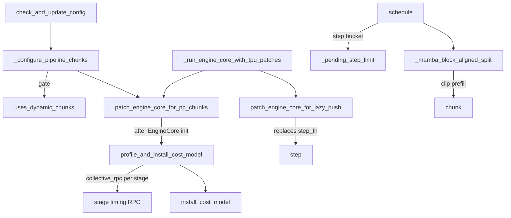

# TPU schedulers - time-budget pipeline chunks, lazy-push step loop and admission policies

<!-- connect:up:begin -->
> **Cross-repo concept:** part of [continuous-batching](../../../concepts/continuous-batching.md), [pipeline-parallelism](../../../concepts/pipeline-parallelism.md) across this wiki's repos.
<!-- connect:up:end -->
## Overview

The `core/` package does not replace vLLM's scheduler; it subclasses or monkey-patches it at a
few narrow seams so that what the scheduler emits matches what a TPU deployment can execute
efficiently. The central idea is that **a pipeline-parallel step should be budgeted in time, not
tokens**: stages advance in lockstep, so a wave lasts as long as its slowest step, and a prefill
chunk deep in a long prompt costs far more than a first chunk of the same token count. The
pipeline chunk scheduler fits a per-stage cost model from forwards each stage times at startup
([`profile_and_install_cost_model`](../catalog/src/vllm_torchtpu/core/pp_chunk_scheduler.md#profile_and_install_cost_model "src/vllm_torchtpu/core/pp_chunk_scheduler.py:L221"))
and clips every prefill chunk to the step's remaining time
([`chunk`](../catalog/src/vllm_torchtpu/core/pp_chunks.md#StepCostModel.chunk "src/vllm_torchtpu/core/pp_chunks.py:L219")).
A second engine-level piece, the lazy-push stepper, replaces vLLM's batch-queue step loop for deep
pipelines so a lone request does not fill the queue with empty steps. Around these sit opt-in
admission policies (shortest-remaining-prefill-first, prefix-warmth-first, DP-aligned prefill
admission) and two scheduler-init patches for disaggregated prefill/decode.

## Diagram

Legend:
- `CUC` - [`check_and_update_config`](../catalog/src/vllm_torchtpu/platforms/tpu_platform.md#TpuPlatform.check_and_update_config "src/vllm_torchtpu/platforms/tpu_platform.py:L785")
- `CPC` - [`_configure_pipeline_chunks`](../catalog/src/vllm_torchtpu/platforms/tpu_platform.md#_configure_pipeline_chunks "src/vllm_torchtpu/platforms/tpu_platform.py:L1441")
- `UDC` - [`uses_dynamic_chunks`](../catalog/src/vllm_torchtpu/core/pp_chunk_scheduler.md#uses_dynamic_chunks "src/vllm_torchtpu/core/pp_chunk_scheduler.py:L48")
- `PEC` - [`patch_engine_core_for_pp_chunks`](../catalog/src/vllm_torchtpu/core/pp_chunk_scheduler.md#patch_engine_core_for_pp_chunks "src/vllm_torchtpu/core/pp_chunk_scheduler.py:L242")
- `ECP` - [`_run_engine_core_with_tpu_patches`](../catalog/src/vllm_torchtpu/__init__.md#_run_engine_core_with_tpu_patches "src/vllm_torchtpu/__init__.py:L738")
- `PLP` - [`patch_engine_core_for_lazy_push`](../catalog/src/vllm_torchtpu/core/pp_lazy_step.md#patch_engine_core_for_lazy_push "src/vllm_torchtpu/core/pp_lazy_step.py:L440")
- `PIC` - [`profile_and_install_cost_model`](../catalog/src/vllm_torchtpu/core/pp_chunk_scheduler.md#profile_and_install_cost_model "src/vllm_torchtpu/core/pp_chunk_scheduler.py:L221")
- `PPC` - (concept) the runner-side timing RPC, documented on [tpu-model-runner](tpu-model-runner.md)
- `ICM` - [`install_cost_model`](../catalog/src/vllm_torchtpu/core/pp_chunk_scheduler.md#TpuPipelineChunkScheduler.install_cost_model "src/vllm_torchtpu/core/pp_chunk_scheduler.py:L80")
- `SCH` - [`schedule`](../catalog/src/vllm_torchtpu/core/pp_chunk_scheduler.md#TpuPipelineChunkScheduler.schedule "src/vllm_torchtpu/core/pp_chunk_scheduler.py:L90")
- `PSL` - [`_pending_step_limit`](../catalog/src/vllm_torchtpu/core/pp_chunk_scheduler.md#TpuPipelineChunkScheduler._pending_step_limit "src/vllm_torchtpu/core/pp_chunk_scheduler.py:L126")
- `MBS` - [`_mamba_block_aligned_split`](../catalog/src/vllm_torchtpu/core/pp_chunk_scheduler.md#TpuPipelineChunkScheduler._mamba_block_aligned_split "src/vllm_torchtpu/core/pp_chunk_scheduler.py:L164")
- `CH` - [`chunk`](../catalog/src/vllm_torchtpu/core/pp_chunks.md#StepCostModel.chunk "src/vllm_torchtpu/core/pp_chunks.py:L219")
- `STP` - [`step`](../catalog/src/vllm_torchtpu/core/pp_lazy_step.md#LazyPushStepper.step "src/vllm_torchtpu/core/pp_lazy_step.py:L165")

The schedulers and patches at a glance:

| Piece | Turned on by | What it changes |
|---|---|---|
| Pipeline chunk scheduler | `TPU_PP_DYNAMIC_CHUNKS` (default on) with PP > 1, chunked prefill on, no other scheduler class, DP scheduler off | Prefill chunk size per step, from a time model |
| Lazy-push step loop | `TPU_PP_LAZY_PUSH` with PP > 2 and the wave hand-off | Engine-core step loop for pipelines |
| SRPT prefill scheduler (experimental) | `--scheduler-cls vllm_torchtpu.core.experimental.srpt_prefill_scheduler.SrptPrefillScheduler` | Order and hold-back of running prefill chunks; optional attention-work cap |
| Prefix-aware scheduler | `--scheduler-cls vllm_torchtpu.core.prefix_aware_scheduler.PrefixAwareScheduler` | Admission order by uncached prompt tokens |
| DP scheduler | `DP_SCHED_ENABLED` with DP > 1 | Prefill admission aligned across DP ranks |
| Abort on preemption | KV consumer with `kv_load_failure_policy == "fail"`, or `additional_config["abort_on_preemption"]` | Capacity-preempted decodes finish with an error instead of recomputing |
| Raiden P send completion | opt-in, validated by [`send_completion_enabled`](../catalog/src/vllm_torchtpu/distributed/kv_transfer/raiden_pd_completion.md#send_completion_enabled "src/vllm_torchtpu/distributed/kv_transfer/raiden_pd_completion.py:L28") | Prefill-side responses held open until the KV send finishes |

## Design rationale (why it's built this way)

- **Equal tokens are not equal time.** The `pp_chunks` module docstring models one stage's step as
  `t = linear(padded tokens) + attn * sum_i (chunk_i * prefix_i + chunk_i^2 / 2)`: a bucket-indexed
  linear part plus causal attention that grows with each chunk's context. The target is a full
  prefix-free step plus [`TPU_PP_CHUNK_SLACK`](../catalog/src/vllm_torchtpu/envs.md#TPU_PP_CHUNK_SLACK "src/vllm_torchtpu/envs.py:L112")
  (default 0.1), "so a step that fills the bucket with first chunks is never shortened" - only deep
  chunks get clipped.
- **Clip at vLLM's one existing chunk-cut point.** Upstream clips a request's chunk in exactly one
  place, the Mamba block-aligned split. The pipeline scheduler forces that hook on for every
  request (setting the "need split" flag to true) and does its own clipping there, then reapplies
  the base alignment only if the model really has a Mamba cache. No other upstream logic is
  touched.
- **Bound the kernel's SMEM schedule too.** The batched attention kernel schedules one
  (query block, KV block) pair per entry of a fixed-capacity SMEM table, so a very deep chunk could
  overrun it. The cost model carries that capacity and backs chunks off a granule at a time until
  their pair count fits; the runner refuses to start if even one full step from one request would
  not fit.
- **Shrink steps when the pipeline would otherwise trail.** "When the pending prefill work cannot
  fill every stage with a full step, the step shrinks to that work spread over the pipeline, so a
  lone prompt runs as one small step per stage instead of trailing itself through the pipeline one
  full step at a time." [`_pending_step_limit`](../catalog/src/vllm_torchtpu/core/pp_chunk_scheduler.md#TpuPipelineChunkScheduler._pending_step_limit "src/vllm_torchtpu/core/pp_chunk_scheduler.py:L126")
  picks, among spreads over 1..PP steps, the one with the earliest modeled completion.
- **Granules so shortened steps stay compiled.** Chunks are cut at multiples of
  [`chunk_granularity`](../catalog/src/vllm_torchtpu/core/pp_chunks.md#chunk_granularity "src/vllm_torchtpu/core/pp_chunks.py:L61")
  (an eighth of a step, rounded to whole KV blocks when Mamba chunk ends must be block aligned),
  and the runner compiles a token bucket at every granule multiple
  ([`chunk_buckets`](../catalog/src/vllm_torchtpu/core/pp_chunks.md#chunk_buckets "src/vllm_torchtpu/core/pp_chunks.py:L72"),
  added by [`_add_pipeline_chunk_buckets`](../catalog/src/vllm_torchtpu/runner/tpu_runner.md#TPUModelRunner._add_pipeline_chunk_buckets "src/vllm_torchtpu/runner/tpu_runner.py:L6203"))
  so a clipped step pads to its own size rather than to the full bucket.
- **Lazy push.** vLLM's batch-queue loop, behind a lone request, fills its queue with token-less
  steps and then waits, and "that wait settles, so the next request opens a new burst". The
  lazy-push loop drops empty steps that change no worker state, never blocks on a result, and
  pushes the pipeline only once stage 0 "has idled for a while", so a request that arrives first
  takes the push's place.

## Entry points

- [`check_and_update_config`](../catalog/src/vllm_torchtpu/platforms/tpu_platform.md#TpuPlatform.check_and_update_config "src/vllm_torchtpu/platforms/tpu_platform.py:L785") -
  the platform's config hook. For PP > 1 it calls
  [`_configure_pipeline_chunks`](../catalog/src/vllm_torchtpu/platforms/tpu_platform.md#_configure_pipeline_chunks "src/vllm_torchtpu/platforms/tpu_platform.py:L1441")
  (which sets the scheduler class and installs the engine-core hook) and the lazy-push patch for
  in-process engines; it also installs the DP scheduler when `DP_SCHED_ENABLED` and DP > 1.
- [`_run_engine_core_with_tpu_patches`](../catalog/src/vllm_torchtpu/__init__.md#_run_engine_core_with_tpu_patches "src/vllm_torchtpu/__init__.py:L738") -
  the engine-core *process* entry point; reinstalls
  [`patch_engine_core_for_pp_chunks`](../catalog/src/vllm_torchtpu/core/pp_chunk_scheduler.md#patch_engine_core_for_pp_chunks "src/vllm_torchtpu/core/pp_chunk_scheduler.py:L242")
  and [`patch_engine_core_for_lazy_push`](../catalog/src/vllm_torchtpu/core/pp_lazy_step.md#patch_engine_core_for_lazy_push "src/vllm_torchtpu/core/pp_lazy_step.py:L440")
  there, since a separate engine process does not inherit the platform-side patches. Both are
  idempotent.
- [`uses_dynamic_chunks`](../catalog/src/vllm_torchtpu/core/pp_chunk_scheduler.md#uses_dynamic_chunks "src/vllm_torchtpu/core/pp_chunk_scheduler.py:L48") -
  the single predicate both sides consult (PP > 1 and the scheduler class is the pipeline chunk
  scheduler); the runner uses it to decide whether to add chunk buckets and to size the hand-off
  reserve in [`pp_handoff_hbm_reserve_bytes`](../catalog/src/vllm_torchtpu/runner/tpu_runner.md#TPUModelRunner.pp_handoff_hbm_reserve_bytes "src/vllm_torchtpu/runner/tpu_runner.py:L6900").
- [`patch_scheduler_init`](../catalog/src/vllm_torchtpu/core/abort_on_preemption.md#patch_scheduler_init "src/vllm_torchtpu/core/abort_on_preemption.py:L166")
  (via [`_patch_vllm_abort_on_preemption`](../catalog/src/vllm_torchtpu/__init__.md#_patch_vllm_abort_on_preemption "src/vllm_torchtpu/__init__.py:L1973"))
  and the Raiden [`patch_scheduler_init`](../catalog/src/vllm_torchtpu/core/raiden_pd.md#patch_scheduler_init "src/vllm_torchtpu/core/raiden_pd.py:L173") -
  wrap `Scheduler.__init__` so the per-instance behavior is decided from the config at construction.
- The SRPT [`schedule`](../catalog/src/vllm_torchtpu/core/experimental/srpt_prefill_scheduler.md#SrptPrefillScheduler.schedule "src/vllm_torchtpu/core/experimental/srpt_prefill_scheduler.py:L124")
  and the prefix-aware [`_promote_warmest`](../catalog/src/vllm_torchtpu/core/prefix_aware_scheduler.md#PrefixAwareScheduler._promote_warmest "src/vllm_torchtpu/core/prefix_aware_scheduler.py:L112") -
  reached every step once selected with `--scheduler-cls`.

## Mechanism (step-by-step)

1. **Install the pipeline scheduler.** [`_configure_pipeline_chunks`](../catalog/src/vllm_torchtpu/platforms/tpu_platform.md#_configure_pipeline_chunks "src/vllm_torchtpu/platforms/tpu_platform.py:L1441")
   backs off with a warning if another scheduler class is configured, the DP scheduler is on, or
   chunked prefill is disabled, and rejects a negative slack. Otherwise it sets the scheduler class
   and calls [`patch_engine_core_for_pp_chunks`](../catalog/src/vllm_torchtpu/core/pp_chunk_scheduler.md#patch_engine_core_for_pp_chunks "src/vllm_torchtpu/core/pp_chunk_scheduler.py:L242"),
   which wraps `EngineCore.__init__` so the cost model is built "once its executor and scheduler
   exist". Until then the scheduler logs that it is waiting and cuts chunks by token count only
   ([`_cost`](../catalog/src/vllm_torchtpu/core/pp_chunk_scheduler.md#TpuPipelineChunkScheduler._cost "src/vllm_torchtpu/core/pp_chunk_scheduler.py:L65")
   is `None`).

2. **Profile every stage and fit the model.** [`profile_and_install_cost_model`](../catalog/src/vllm_torchtpu/core/pp_chunk_scheduler.md#profile_and_install_cost_model "src/vllm_torchtpu/core/pp_chunk_scheduler.py:L221")
   runs a collective RPC so each stage times dummy forwards at the points chosen by
   [`profile_points`](../catalog/src/vllm_torchtpu/core/pp_chunks.md#profile_points "src/vllm_torchtpu/core/pp_chunks.py:L110"):
   every bucket with no prefix, and buckets of at least a quarter of the max also behind one and two
   steps of prefix (skipping points the kernel's SMEM schedule cannot run). The fit derives each
   stage's attention slope from the two prefixed points per bucket (median across buckets),
   subtracts the bucket's own causal attention to get the linear ladder, then keeps the slowest
   ladder entry and largest slope across stages. The coarsest granularity and the smallest kernel
   schedule across workers win. [`install_cost_model`](../catalog/src/vllm_torchtpu/core/pp_chunk_scheduler.md#TpuPipelineChunkScheduler.install_cost_model "src/vllm_torchtpu/core/pp_chunk_scheduler.py:L80")
   logs it via [`describe`](../catalog/src/vllm_torchtpu/core/pp_chunks.md#StepCostModel.describe "src/vllm_torchtpu/core/pp_chunks.py:L272")
   ("linear ms per bucket {...}, attention ... ms per token pair, target ... ms").

3. **Seed the step with decodes.** Each [`schedule`](../catalog/src/vllm_torchtpu/core/pp_chunk_scheduler.md#TpuPipelineChunkScheduler.schedule "src/vllm_torchtpu/core/pp_chunk_scheduler.py:L90")
   call resets the step's running sums (tokens, chunk x prefix products, squared chunk lengths,
   attention pairs), sets the step bucket from
   [`_pending_step_limit`](../catalog/src/vllm_torchtpu/core/pp_chunk_scheduler.md#TpuPipelineChunkScheduler._pending_step_limit "src/vllm_torchtpu/core/pp_chunk_scheduler.py:L126")
   (pending prefill across running, waiting and KV-holding queues), and accounts one token for
   every running request past its prefill - "Decode requests count toward the step before any
   prefill chunk is sized, whatever their position in the running queue" - before delegating to
   the base scheduler.

4. **Clip each prefill chunk.** The base scheduler calls
   [`_mamba_block_aligned_split`](../catalog/src/vllm_torchtpu/core/pp_chunk_scheduler.md#TpuPipelineChunkScheduler._mamba_block_aligned_split "src/vllm_torchtpu/core/pp_chunk_scheduler.py:L164")
   for each request. For a prefill, [`chunk`](../catalog/src/vllm_torchtpu/core/pp_chunks.md#StepCostModel.chunk "src/vllm_torchtpu/core/pp_chunks.py:L219")
   searches every allowed bucket for the largest chunk whose modeled time fits the spare budget
   (solving `attn * (x * prefix + x^2 / 2) <= spare`), keeps an unfinished chunk at least a quarter
   step when room allows ("a run of tiny steps costs more than the balance it buys"), aligns the step
   total to the granule, and backs off until the attention pairs fit the SMEM capacity. If nothing
   fits and no prefill chunk is in the step yet, the chunk is set to one granule (or the remaining
   tokens, if fewer), so the first prefill chunk of a step always advances and nothing starves.
   Clips and waits are tallied in internal counters, and each clip is logged at debug level.

5. **Run the lazy-push loop (when enabled).** [`patch_engine_core_for_lazy_push`](../catalog/src/vllm_torchtpu/core/pp_lazy_step.md#patch_engine_core_for_lazy_push "src/vllm_torchtpu/core/pp_lazy_step.py:L440")
   requires PP > 2, the wave hand-off (it warns and stays off when
   [`ring_handoff`](../catalog/src/vllm_torchtpu/distributed/pp_push.md#ring_handoff "src/vllm_torchtpu/distributed/pp_push.py:L303")
   is selected), and its wrapped [`__init__`](../catalog/src/vllm_torchtpu/core/pp_lazy_step.md#patch_engine_core_for_lazy_push.__init__ "src/vllm_torchtpu/core/pp_lazy_step.py:L464")
   checks a list of blockers (DP, spec decode, KV/encoder connectors, async scheduling, pooling,
   the last stage on the engine's host, stages that do not drain before hand-off). If none apply,
   the engine's batch queue becomes the stepper's
   [`in_flight`](../catalog/src/vllm_torchtpu/core/pp_lazy_step.md#LazyPushStepper.in_flight "src/vllm_torchtpu/core/pp_lazy_step.py:L152")
   deque and its step function becomes [`step`](../catalog/src/vllm_torchtpu/core/pp_lazy_step.md#LazyPushStepper.step "src/vllm_torchtpu/core/pp_lazy_step.py:L165").
   Each step [`_drain`](../catalog/src/vllm_torchtpu/core/pp_lazy_step.md#LazyPushStepper._drain "src/vllm_torchtpu/core/pp_lazy_step.py:L196")s
   arrived replies, [`_process`](../catalog/src/vllm_torchtpu/core/pp_lazy_step.md#LazyPushStepper._process "src/vllm_torchtpu/core/pp_lazy_step.py:L216")es
   the oldest finished step, [`_dispatch`](../catalog/src/vllm_torchtpu/core/pp_lazy_step.md#LazyPushStepper._dispatch "src/vllm_torchtpu/core/pp_lazy_step.py:L238")es
   a new one if fewer than [`stages`](../catalog/src/vllm_torchtpu/core/pp_lazy_step.md#LazyPushStepper.stages "src/vllm_torchtpu/core/pp_lazy_step.py:L145")
   real steps are in flight (dropping token-less, stateless steps), then either
   [`_settle`](../catalog/src/vllm_torchtpu/core/pp_lazy_step.md#LazyPushStepper._settle "src/vllm_torchtpu/core/pp_lazy_step.py:L302")s
   the [`wave`](../catalog/src/vllm_torchtpu/core/pp_lazy_step.md#LazyPushStepper.wave "src/vllm_torchtpu/core/pp_lazy_step.py:L144")
   when nothing real is in flight or [`_push`](../catalog/src/vllm_torchtpu/core/pp_lazy_step.md#LazyPushStepper._push "src/vllm_torchtpu/core/pp_lazy_step.py:L316")es
   when [`_push_due`](../catalog/src/vllm_torchtpu/core/pp_lazy_step.md#LazyPushStepper._push_due "src/vllm_torchtpu/core/pp_lazy_step.py:L287")
   says stage 0 has idled for half the other stages' longest expected forward.

6. **Estimate hand-off times.** The stepper keeps the newest `stages` [`slots`](../catalog/src/vllm_torchtpu/core/pp_lazy_step.md#LazyPushStepper.slots "src/vllm_torchtpu/core/pp_lazy_step.py:L155")
   ([`_add_slot`](../catalog/src/vllm_torchtpu/core/pp_lazy_step.md#LazyPushStepper._add_slot "src/vllm_torchtpu/core/pp_lazy_step.py:L322")).
   [`_handoff`](../catalog/src/vllm_torchtpu/core/pp_lazy_step.md#LazyPushStepper._handoff "src/vllm_torchtpu/core/pp_lazy_step.py:L330")
   reads hand-off `k` from the last stage's reply to step `k - stages + 1`
   ([`_started_last`](../catalog/src/vllm_torchtpu/core/pp_lazy_step.md#LazyPushStepper._started_last "src/vllm_torchtpu/core/pp_lazy_step.py:L354"))
   or, before that exists, estimates it from dispatch times and expected forwards
   ([`_others`](../catalog/src/vllm_torchtpu/core/pp_lazy_step.md#LazyPushStepper._others "src/vllm_torchtpu/core/pp_lazy_step.py:L345")).
   Expected forwards come from the cost model scaled by a running measured/modeled ratio that
   [`_sampled`](../catalog/src/vllm_torchtpu/core/pp_lazy_step.md#LazyPushStepper._sampled "src/vllm_torchtpu/core/pp_lazy_step.py:L358")
   updates (weight 0.25, each sample clamped to within 2x of the estimate), or from measured times
   alone when no model is installed.

7. **SRPT ordering and hold-back (experimental).** The SRPT
   [`schedule`](../catalog/src/vllm_torchtpu/core/experimental/srpt_prefill_scheduler.md#SrptPrefillScheduler.schedule "src/vllm_torchtpu/core/experimental/srpt_prefill_scheduler.py:L124")
   reorders RUNNING as decodes first, then prefill chunks by fewest remaining tokens (stalled
   chunks first), and [`_select_chunks_to_hold`](../catalog/src/vllm_torchtpu/core/experimental/srpt_prefill_scheduler.md#SrptPrefillScheduler._select_chunks_to_hold "src/vllm_torchtpu/core/experimental/srpt_prefill_scheduler.py:L401")
   removes the longest running prefill chunks for this step when that lets the next waiting
   request with fewer uncached tokens fit - only if free KV blocks cover kept requests plus the
   target, so a hold never causes preemption. Held chunks keep their blocks, and running/active
   limits are lowered by the hold count during the step. With `VLLM_TPU_SRPT_ATTN_WORK_CAP` set,
   [`_reserve_prefill_lookahead`](../catalog/src/vllm_torchtpu/core/experimental/srpt_prefill_scheduler.md#SrptPrefillScheduler._reserve_prefill_lookahead "src/vllm_torchtpu/core/experimental/srpt_prefill_scheduler.py:L227")
   shrinks chunks so `sum(n * (c + n / 2))` stays under the cap, ending them on the attention
   query tile, but only while some rank is decoding.

8. **Prefix-warmth admission.** [`_promote_warmest`](../catalog/src/vllm_torchtpu/core/prefix_aware_scheduler.md#PrefixAwareScheduler._promote_warmest "src/vllm_torchtpu/core/prefix_aware_scheduler.py:L112")
   scores up to 64 queued requests by (preempted first, fewest uncached prompt tokens, arrival
   time) using the KV manager's longest-cache-hit lookup, and moves the best to the head of the
   FCFS queue. Only admission order changes; memory, eviction and preemption are untouched, and a
   scoring failure falls back to FCFS.

9. **Disaggregated-serving patches.** Under abort-on-preemption,
   [`init`](../catalog/src/vllm_torchtpu/core/abort_on_preemption.md#patch_scheduler_init.init "src/vllm_torchtpu/core/abort_on_preemption.py:L172")
   swaps in [`preempt_request`](../catalog/src/vllm_torchtpu/core/abort_on_preemption.md#_CapacityPreemption.preempt_request "src/vllm_torchtpu/core/abort_on_preemption.py:L62"),
   which routes a capacity preemption of a RUNNING decode to
   [`abort`](../catalog/src/vllm_torchtpu/core/abort_on_preemption.md#_CapacityPreemption.abort "src/vllm_torchtpu/core/abort_on_preemption.py:L91")
   (finish with `FinishReason.ERROR`, `stop_reason="kv_cache_preempted"`, a 500
   `model.KVCachePreempt` transfer error, blocks freed immediately) instead of re-queuing it to
   recompute the prompt locally. [`reset_prefix_cache`](../catalog/src/vllm_torchtpu/core/abort_on_preemption.md#_CapacityPreemption.reset_prefix_cache "src/vllm_torchtpu/core/abort_on_preemption.py:L77")
   keeps administrative preemption intact, and
   [`update_from_output`](../catalog/src/vllm_torchtpu/core/abort_on_preemption.md#_CapacityPreemption.update_from_output "src/vllm_torchtpu/core/abort_on_preemption.py:L135")
   emits the terminal output only with the step that reports the request finished. The Raiden
   [`init`](../catalog/src/vllm_torchtpu/core/raiden_pd.md#patch_scheduler_init.init "src/vllm_torchtpu/core/raiden_pd.py:L179")
   installs a producer-side
   [`update_from_output`](../catalog/src/vllm_torchtpu/core/raiden_pd.md#_ProducerCompletion.update_from_output "src/vllm_torchtpu/core/raiden_pd.py:L80")
   that parks model-finished responses marked `kv_transfer_pending` in
   [`pending_responses`](../catalog/src/vllm_torchtpu/core/raiden_pd.md#_ProducerCompletion.pending_responses "src/vllm_torchtpu/core/raiden_pd.py:L76")
   and releases them (success, or a send-failure / transfer-timeout error) only at vLLM's
   `finished_sending` barrier.

## Key data structures

| State | What it represents |
|---|---|
| Step cost model | `buckets`, `linear_ms` per bucket, `attn_ms_per_token_pair`, `target_ms`, `granularity`, optional `(pairs, bq, bkv)` kernel schedule. |
| Pipeline scheduler step sums | Tokens, chunk x prefix products, squared chunk lengths, prefill tokens and attention pairs accumulated while one `schedule()` runs. |
| [`in_flight`](../catalog/src/vllm_torchtpu/core/pp_lazy_step.md#LazyPushStepper.in_flight "src/vllm_torchtpu/core/pp_lazy_step.py:L152") | Dispatched steps oldest first; doubles as the engine core's batch queue. |
| [`slots`](../catalog/src/vllm_torchtpu/core/pp_lazy_step.md#LazyPushStepper.slots "src/vllm_torchtpu/core/pp_lazy_step.py:L155") | The burst's newest `stages` steps (pushes included) with dispatch time, expected forward and observed last-stage start. |
| [`pending_responses`](../catalog/src/vllm_torchtpu/core/raiden_pd.md#_ProducerCompletion.pending_responses "src/vllm_torchtpu/core/raiden_pd.py:L76") | Producer responses held until the KV send barrier, with merged send outcome. |

## Dynamics (design intent)

- **Who wins on conflicts.** The pipeline chunk scheduler only installs when no other
  `--scheduler-cls` is set and the DP scheduler is off; the lazy-push loop silently keeps vLLM's
  loop (with a warning naming the blocker) in any unsupported setup, so enabling an env var is not
  proof it is active - check the `Pipeline chunk scheduler:` and `PP lazy push:` log lines.
- **Lockstep stages.** Because the cost model takes the slowest stage's ladder and largest slope,
  the budget is conservative for faster stages; the lazy-push loop corrects its expectations from
  measured last-stage forwards.
- **DP-aligned prefill.** The DP scheduler uses vLLM's DP-synchronized `throttle_prefills` signal
  only to open a window in which accumulated prefills drain, and otherwise schedules with new
  prefills paused, so DP ranks admit prefills together.
- **SRPT starvation guard.** A running prefill chunk that goes `VLLM_TPU_SRPT_MAX_CONSECUTIVE_HOLDS`
  steps (default 8) without a KV block of progress is marked stalled, moved ahead of other prefill
  chunks and never held until it progresses; a hold whose target is not admitted backs off
  exponentially for that target.

## Edge cases

- With PP and a Mamba cache in "align" mode, the granule is rounded up to whole KV blocks; a KV
  block larger than a step leaves the base split to stop a chunk at the block boundary.
- The lazy-push loop requires the last stage on a different host than the engine (it reads
  replies only once they have arrived via a remote reader); single-host pipelines keep vLLM's
  loop.
- Under KV pressure upstream preempts `running[-1]`, which under SRPT is the longest non-stalled
  prefill chunk, so a long prompt can be preempted repeatedly (stated in the module docstring).
- Abort-on-preemption asserts the victim is RUNNING and that its blocks are released immediately;
  enabling it explicitly without `kv_role="kv_consumer"` is a config error.
- Raiden P send completion rejects multi-engine finished-request bookkeeping and requires a
  `Scheduler` instance.

## Open questions

- The scheduler classes themselves (pipeline chunk scheduler, SRPT, prefix-aware, DP scheduler)
  and the step cost model class are not in this packet's subgraph; their methods are cited instead,
  and the `--scheduler-cls` strings above are the user-facing selection values.
- The EAGLE/MTP block-drop module in this package (env-gated retention of trailing prefix-cache
  blocks) has no symbols in the subgraph and is not covered here beyond this mention.
- [`TPU_KV_RESHARD_TRANSPORT`](../catalog/src/vllm_torchtpu/envs.md#TPU_KV_RESHARD_TRANSPORT "src/vllm_torchtpu/envs.py:L58")
  appears in the subgraph, but its relation to scheduling is not visible in the scheduler modules.

## See also

- [tpu-model-runner](tpu-model-runner.md) - the runner side: chunk buckets, stage profiling, SMEM request caps.
- [kv-cache-layout-and-hbm-budget](kv-cache-layout-and-hbm-budget.md) - the KV blocks the scheduler allocates.
- [distributed-parallelism-and-meshes](distributed-parallelism-and-meshes.md) - pipeline wave / ring hand-off and DP lockstep.
- [kv-transfer-and-disaggregated-serving](kv-transfer-and-disaggregated-serving.md) - Raiden and the KV connectors these patches serve.
- [batched-ragged-paged-attention-kernel](batched-ragged-paged-attention-kernel.md) - the kernel whose SMEM schedule bounds deep chunks.
- [speculative-decoding](speculative-decoding.md) - why spec decode disables the lazy-push loop.
