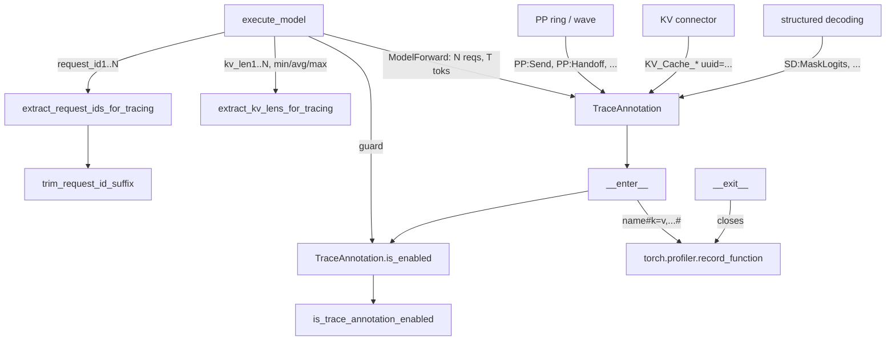
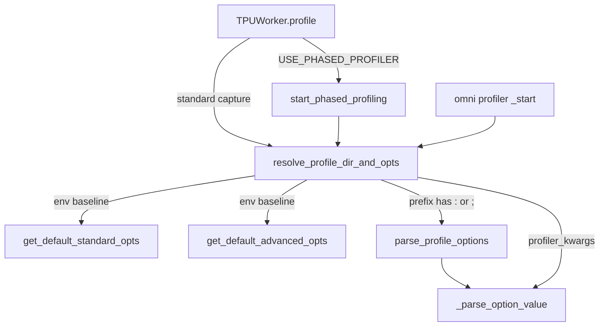

# Tracing annotations: TraceAnnotation, per-step trace labels and profiler option resolution

## Overview

The `vllm_torchtpu.tracing` package ("PyTorch Kineto and TorchTPU profiler tracing module") is the small, shared vocabulary every other subsystem uses to make a profiler trace readable. It has two halves. The **annotation half** is [`TraceAnnotation`](../catalog/src/vllm_torchtpu/tracing/annotation.md#TraceAnnotation "src/vllm_torchtpu/tracing/annotation.py:L27"), a context manager / decorator that opens a `torch.profiler.record_function` region - but only when a profiler session is actually recording - plus helpers ([`extract_request_ids_for_tracing`](../catalog/src/vllm_torchtpu/tracing/utils.md#extract_request_ids_for_tracing "src/vllm_torchtpu/tracing/utils.py:L29"), [`extract_kv_lens_for_tracing`](../catalog/src/vllm_torchtpu/tracing/utils.md#extract_kv_lens_for_tracing "src/vllm_torchtpu/tracing/utils.py:L48")) that turn the current batch into compact key/value labels. The **options half** is [`resolve_profile_dir_and_opts`](../catalog/src/vllm_torchtpu/tracing/options.md#resolve_profile_dir_and_opts "src/vllm_torchtpu/tracing/options.py:L101"), which turns a vLLM `start_profile` request into a trace directory plus the tracer levels and TPU-specific trace options handed to the TorchTPU profiler.

The key design idea is **free when off, self-describing when on**: annotations check `torch.autograd._profiler_enabled()` at every entry, so they cost one function call per region in normal serving, while a captured trace carries enough metadata per step (padded token count, number of requests, request ids, min/avg/max KV length, and with the phased profiler the inference phase) to tie a device-time slice back to the batch that produced it - which is what a TPU inference perf investigation (prefill vs. decode mix, padding waste, PP bubbles, KV-transfer stalls) needs.

## Diagram

Where annotations come from and how a region is emitted:

Legend:
- `EM` - [`execute_model`](../catalog/src/vllm_torchtpu/runner/tpu_runner.md#TPUModelRunner.execute_model "src/vllm_torchtpu/runner/tpu_runner.py:L3884")
- `ISEN` - [`is_enabled`](../catalog/src/vllm_torchtpu/tracing/annotation.md#TraceAnnotation.is_enabled "src/vllm_torchtpu/tracing/annotation.py:L34")
- `ERI` - [`extract_request_ids_for_tracing`](../catalog/src/vllm_torchtpu/tracing/utils.md#extract_request_ids_for_tracing "src/vllm_torchtpu/tracing/utils.py:L29")
- `TRIM` - [`trim_request_id_suffix`](../catalog/src/vllm_torchtpu/tracing/utils.md#trim_request_id_suffix "src/vllm_torchtpu/tracing/utils.py:L22")
- `EKV` - [`extract_kv_lens_for_tracing`](../catalog/src/vllm_torchtpu/tracing/utils.md#extract_kv_lens_for_tracing "src/vllm_torchtpu/tracing/utils.py:L48")
- `TA` - [`TraceAnnotation`](../catalog/src/vllm_torchtpu/tracing/annotation.md#TraceAnnotation "src/vllm_torchtpu/tracing/annotation.py:L27")
- `PP` - [`_send`](../catalog/src/vllm_torchtpu/distributed/pp_ring.md#PPRing._send "src/vllm_torchtpu/distributed/pp_ring.py:L592"), [`settle`](../catalog/src/vllm_torchtpu/distributed/pp_wave.md#PPWave.settle "src/vllm_torchtpu/distributed/pp_wave.py:L522") and the other pipeline hand-off methods
- `KV` - [`_submit_stage3_loads`](../catalog/src/vllm_torchtpu/distributed/kv_transfer/tpu_connector.md#TPURaidenConnectorWorker._submit_stage3_loads "src/vllm_torchtpu/distributed/kv_transfer/tpu_connector.py:L5534"), [`_poll_finished`](../catalog/src/vllm_torchtpu/distributed/kv_transfer/tpu_connector.md#TPURaidenConnectorWorker._poll_finished "src/vllm_torchtpu/distributed/kv_transfer/tpu_connector.py:L6597")
- `SD` - [`mask_logits`](../catalog/src/vllm_torchtpu/structured_decoding/structured_decoding_manager.md#StructuredDecodingManager.mask_logits "src/vllm_torchtpu/structured_decoding/structured_decoding_manager.py:L244"), [`mask_spec_logits`](../catalog/src/vllm_torchtpu/structured_decoding/structured_decoding_manager.md#StructuredDecodingManager.mask_spec_logits "src/vllm_torchtpu/structured_decoding/structured_decoding_manager.py:L273")
- `ENTER` - [`__enter__`](../catalog/src/vllm_torchtpu/tracing/annotation.md#TraceAnnotation.__enter__ "src/vllm_torchtpu/tracing/annotation.py:L37")
- `PROF` - [`is_trace_annotation_enabled`](../catalog/src/vllm_torchtpu/tracing/annotation.md#is_trace_annotation_enabled "src/vllm_torchtpu/tracing/annotation.py:L22")
- `RF` - (concept) PyTorch's `record_function` region, recorded by Kineto and the TorchTPU host tracer
- `EXIT` - [`__exit__`](../catalog/src/vllm_torchtpu/tracing/annotation.md#TraceAnnotation.__exit__ "src/vllm_torchtpu/tracing/annotation.py:L47")

How a profile request becomes profiler options:

Legend:
- `WP` - [`profile`](../catalog/src/vllm_torchtpu/worker/tpu_worker.md#TPUWorker.profile "src/vllm_torchtpu/worker/tpu_worker.py:L667")
- `SPP` - [`start_phased_profiling`](../catalog/src/vllm_torchtpu/runner/tpu_runner.md#TPUModelRunner.start_phased_profiling "src/vllm_torchtpu/runner/tpu_runner.py:L1173")
- `OMNI` - [`_start`](../catalog/src/vllm_torchtpu/omni/profiler.md#TpuOmniTorchProfilerWrapper._start "src/vllm_torchtpu/omni/profiler.py:L102")
- `RPD` - [`resolve_profile_dir_and_opts`](../catalog/src/vllm_torchtpu/tracing/options.md#resolve_profile_dir_and_opts "src/vllm_torchtpu/tracing/options.py:L101")
- `GSO` - [`get_default_standard_opts`](../catalog/src/vllm_torchtpu/tracing/options.md#get_default_standard_opts "src/vllm_torchtpu/tracing/options.py:L85")
- `GAO` - [`get_default_advanced_opts`](../catalog/src/vllm_torchtpu/tracing/options.md#get_default_advanced_opts "src/vllm_torchtpu/tracing/options.py:L93")
- `PPO` - [`parse_profile_options`](../catalog/src/vllm_torchtpu/tracing/options.md#parse_profile_options "src/vllm_torchtpu/tracing/options.py:L48")
- `POV` - [`_parse_option_value`](../catalog/src/vllm_torchtpu/tracing/options.md#_parse_option_value "src/vllm_torchtpu/tracing/options.py:L32")

## Design rationale (why it's built this way)

- **Gate at entry, not at construction.** [`__enter__`](../catalog/src/vllm_torchtpu/tracing/annotation.md#TraceAnnotation.__enter__ "src/vllm_torchtpu/tracing/annotation.py:L37") asks [`is_enabled`](../catalog/src/vllm_torchtpu/tracing/annotation.md#TraceAnnotation.is_enabled "src/vllm_torchtpu/tracing/annotation.py:L34") each time, and only then builds the name string and opens a `record_function`. Annotated regions sit on the per-step serving path (every forward, every PP hand-off, every KV-transfer completion), so the off-path cost has to be a single cheap check. The heavier part - computing labels from the batch - is guarded separately by the caller: [`execute_model`](../catalog/src/vllm_torchtpu/runner/tpu_runner.md#TPUModelRunner.execute_model "src/vllm_torchtpu/runner/tpu_runner.py:L3884") only calls the extract helpers inside `if TraceAnnotation.is_enabled():`.
- **Metadata travels in the region name.** With kwargs, the recorded name becomes `name#k1=v1,k2=v2#`. This keeps the annotation API a plain `record_function` (no profiler-specific metadata API), while the trace viewer can still show per-region arguments.
- **Labels are bounded and flat.** Request ids are trimmed and numbered (`request_id1`, `request_id2`, ...), KV lengths are listed per request plus `min_kv_len` / `max_kv_len` / `avg_kv_len`, so a label is a flat set of scalars rather than a nested structure.
- **One parser for every profiler entry point.** The standard per-worker capture, the phased profiler and the vLLM-Omni profiler wrapper all call [`resolve_profile_dir_and_opts`](../catalog/src/vllm_torchtpu/tracing/options.md#resolve_profile_dir_and_opts "src/vllm_torchtpu/tracing/options.py:L101"), so the precedence rules and value validation are identical whichever path captures the trace.

> [!inferred]
> The `name#k=v,...#` suffix matches the TraceMe metadata-encoding convention that the TPU profiler / xprof trace viewer decodes into per-event arguments; the source itself does not state which viewer consumes it.

## Entry points

- [`TraceAnnotation`](../catalog/src/vllm_torchtpu/tracing/annotation.md#TraceAnnotation "src/vllm_torchtpu/tracing/annotation.py:L27") - constructed by the model runner around each forward, by the pipeline-parallel ring and wave hand-off code (`PP:Send`, `PP:RingFull`, `PP:PostReceives`, `PP:PostThrottled`, `PP:WaitPosted`, `PP:Handoff`, `PP:Drain`, `PP:Prologue`, `PP:Push`, `PP:Settle` - e.g. [`start_forward`](../catalog/src/vllm_torchtpu/distributed/pp_ring.md#PPRing.start_forward "src/vllm_torchtpu/distributed/pp_ring.py:L495"), [`_queue_send`](../catalog/src/vllm_torchtpu/distributed/pp_ring.md#PPRing._queue_send "src/vllm_torchtpu/distributed/pp_ring.py:L573"), [`push`](../catalog/src/vllm_torchtpu/distributed/pp_wave.md#PPWave.push "src/vllm_torchtpu/distributed/pp_wave.py:L505"), [`_open_burst`](../catalog/src/vllm_torchtpu/distributed/pp_wave.md#PPWave._open_burst "src/vllm_torchtpu/distributed/pp_wave.py:L441")), by the disaggregation connector worker (`KV_Cache_Prefill_Register_Blocks`, `KV_Cache_Decode_Submit_Load`, `KV_Cache_Decode_Recv_Complete`, `KV_Cache_Prefill_Send_Complete`, each tagged with the transfer `uuid` - e.g. [`_register_stage3_request_blocks`](../catalog/src/vllm_torchtpu/distributed/kv_transfer/tpu_connector.md#TPURaidenConnectorWorker._register_stage3_request_blocks "src/vllm_torchtpu/distributed/kv_transfer/tpu_connector.py:L4239")) and by structured decoding (`SD:PrepareInput`, `SD:MaskLogits`, `SD:PrepareSpecInput`, `SD:MaskSpecLogits`, tagged with `num_reqs`).
- [`is_enabled`](../catalog/src/vllm_torchtpu/tracing/annotation.md#TraceAnnotation.is_enabled "src/vllm_torchtpu/tracing/annotation.py:L34") - called directly by callers that want to skip building labels when no profiler is recording; delegates to [`is_trace_annotation_enabled`](../catalog/src/vllm_torchtpu/tracing/annotation.md#is_trace_annotation_enabled "src/vllm_torchtpu/tracing/annotation.py:L22") ("Checks whether PyTorch Kineto profiler session is active").
- [`extract_request_ids_for_tracing`](../catalog/src/vllm_torchtpu/tracing/utils.md#extract_request_ids_for_tracing "src/vllm_torchtpu/tracing/utils.py:L29") / [`extract_kv_lens_for_tracing`](../catalog/src/vllm_torchtpu/tracing/utils.md#extract_kv_lens_for_tracing "src/vllm_torchtpu/tracing/utils.py:L48") - called once per forward by [`execute_model`](../catalog/src/vllm_torchtpu/runner/tpu_runner.md#TPUModelRunner.execute_model "src/vllm_torchtpu/runner/tpu_runner.py:L3884") over the slice `[start_index, start_index + num_reqs)` of the input batch.
- [`resolve_profile_dir_and_opts`](../catalog/src/vllm_torchtpu/tracing/options.md#resolve_profile_dir_and_opts "src/vllm_torchtpu/tracing/options.py:L101") - called when profiling starts: by the worker's [`profile`](../catalog/src/vllm_torchtpu/worker/tpu_worker.md#TPUWorker.profile "src/vllm_torchtpu/worker/tpu_worker.py:L667") (standard capture), by [`start_phased_profiling`](../catalog/src/vllm_torchtpu/runner/tpu_runner.md#TPUModelRunner.start_phased_profiling "src/vllm_torchtpu/runner/tpu_runner.py:L1173") ("Arms the phase-based profiler. Called from TPUWorker.profile()"), and by the omni profiler's [`_start`](../catalog/src/vllm_torchtpu/omni/profiler.md#TpuOmniTorchProfilerWrapper._start "src/vllm_torchtpu/omni/profiler.py:L102").

## Mechanism (step-by-step)

1. **Building the forward label.** Inside [`execute_model`](../catalog/src/vllm_torchtpu/runner/tpu_runner.md#TPUModelRunner.execute_model "src/vllm_torchtpu/runner/tpu_runner.py:L3884"), after the step has been padded to its token bucket, the runner checks [`is_enabled`](../catalog/src/vllm_torchtpu/tracing/annotation.md#TraceAnnotation.is_enabled "src/vllm_torchtpu/tracing/annotation.py:L34") and, if a profiler is recording, merges [`extract_request_ids_for_tracing`](../catalog/src/vllm_torchtpu/tracing/utils.md#extract_request_ids_for_tracing "src/vllm_torchtpu/tracing/utils.py:L29") and [`extract_kv_lens_for_tracing`](../catalog/src/vllm_torchtpu/tracing/utils.md#extract_kv_lens_for_tracing "src/vllm_torchtpu/tracing/utils.py:L48") into the trace kwargs. When the phase-based profiler is armed it also copies batch-composition stats (`num_prefill_tokens`, `num_decode_tokens`, `phase`, `batch_id`, scheduled and padded token totals, `min_kv_length`). The region name is `ModelForward: <num_reqs> reqs, <padded tokens> toks`, extended with `kv_len min=.. avg=.. max=..` when KV lengths are present - so even the name alone shows padding and context length without expanding the arguments.

2. **Request ids.** [`extract_request_ids_for_tracing`](../catalog/src/vllm_torchtpu/tracing/utils.md#extract_request_ids_for_tracing "src/vllm_torchtpu/tracing/utils.py:L29") slices the active ids (`num_reqs = -1` means all), drops `None`, and shortens each with [`trim_request_id_suffix`](../catalog/src/vllm_torchtpu/tracing/utils.md#trim_request_id_suffix "src/vllm_torchtpu/tracing/utils.py:L22"), which keeps only the first six dash-separated parts of ids that start with `cmpl`. Any exception is logged as a warning and an empty dict returned - tracing never fails a step.

3. **KV lengths.** [`extract_kv_lens_for_tracing`](../catalog/src/vllm_torchtpu/tracing/utils.md#extract_kv_lens_for_tracing "src/vllm_torchtpu/tracing/utils.py:L48") reads the per-request computed-token counts (the runner passes the CPU-side `num_computed_tokens` array, so no device sync is involved) and emits `kv_len<i>` for each plus `min_kv_len`, `max_kv_len` and an integer-floored `avg_kv_len`; an empty slice returns `{}`.

4. **Emitting the region.** [`TraceAnnotation`](../catalog/src/vllm_torchtpu/tracing/annotation.md#TraceAnnotation "src/vllm_torchtpu/tracing/annotation.py:L27") stores [`name`](../catalog/src/vllm_torchtpu/tracing/annotation.md#TraceAnnotation.name "src/vllm_torchtpu/tracing/annotation.py:L29") and [`kwargs`](../catalog/src/vllm_torchtpu/tracing/annotation.md#TraceAnnotation.kwargs "src/vllm_torchtpu/tracing/annotation.py:L30") at construction ([`__init__`](../catalog/src/vllm_torchtpu/tracing/annotation.md#TraceAnnotation.__init__ "src/vllm_torchtpu/tracing/annotation.py:L28")). On [`__enter__`](../catalog/src/vllm_torchtpu/tracing/annotation.md#TraceAnnotation.__enter__ "src/vllm_torchtpu/tracing/annotation.py:L37"), if the profiler is enabled it formats `name#k=v,...#` (just `name` without kwargs), opens `torch.profiler.record_function(name)` and keeps it in [`_rf`](../catalog/src/vllm_torchtpu/tracing/annotation.md#TraceAnnotation._rf "src/vllm_torchtpu/tracing/annotation.py:L31"); otherwise it does nothing. [`__exit__`](../catalog/src/vllm_torchtpu/tracing/annotation.md#TraceAnnotation.__exit__ "src/vllm_torchtpu/tracing/annotation.py:L47") closes `_rf` only if one was opened and resets it to `None`. Because the class is a `contextlib.ContextDecorator`, it can also decorate a function; the check then happens on every call.

5. **Resolving profiler options.** [`resolve_profile_dir_and_opts`](../catalog/src/vllm_torchtpu/tracing/options.md#resolve_profile_dir_and_opts "src/vllm_torchtpu/tracing/options.py:L101") starts from env baselines: [`get_default_standard_opts`](../catalog/src/vllm_torchtpu/tracing/options.md#get_default_standard_opts "src/vllm_torchtpu/tracing/options.py:L85") (`host_tracer_level` from [`HOST_TRACER_LEVEL`](../catalog/src/vllm_torchtpu/envs.md#HOST_TRACER_LEVEL "src/vllm_torchtpu/envs.py:L39"), default 2; `device_tracer_level` from [`DEVICE_TRACER_LEVEL`](../catalog/src/vllm_torchtpu/envs.md#DEVICE_TRACER_LEVEL "src/vllm_torchtpu/envs.py:L40"), default 1; `python_tracer_level` from [`PYTHON_TRACER_LEVEL`](../catalog/src/vllm_torchtpu/envs.md#PYTHON_TRACER_LEVEL "src/vllm_torchtpu/envs.py:L38"), default 1) and [`get_default_advanced_opts`](../catalog/src/vllm_torchtpu/tracing/options.md#get_default_advanced_opts "src/vllm_torchtpu/tracing/options.py:L93") (`tpu_trace_mode` from [`TPU_TRACE_MODE`](../catalog/src/vllm_torchtpu/envs.md#TPU_TRACE_MODE "src/vllm_torchtpu/envs.py:L41"), default `TRACE_COMPUTE`; `tpu_num_sparse_cores_to_trace` and `tpu_num_sparse_core_tiles_to_trace` from [`TPU_NUM_SPARSE_CORES_TO_TRACE`](../catalog/src/vllm_torchtpu/envs.md#TPU_NUM_SPARSE_CORES_TO_TRACE "src/vllm_torchtpu/envs.py:L42") / [`TPU_NUM_SPARSE_CORE_TILES_TO_TRACE`](../catalog/src/vllm_torchtpu/envs.md#TPU_NUM_SPARSE_CORE_TILES_TO_TRACE "src/vllm_torchtpu/envs.py:L43"), default 1 each). The `profile_prefix` (positional, or `profiler_kwargs["profile_prefix"]` if the positional one is empty) is then interpreted one of two ways: if it contains `:` or `;` it is parsed by [`parse_profile_options`](../catalog/src/vllm_torchtpu/tracing/options.md#parse_profile_options "src/vllm_torchtpu/tracing/options.py:L48") as `key:value;key:value` and merged over the baselines (the directory stays the base directory); otherwise it is a subdirectory name appended to the base directory. Last, every other `profiler_kwargs` entry overrides both. Keys in [`_STANDARD_KEYS`](../catalog/src/vllm_torchtpu/tracing/options.md#_STANDARD_KEYS "src/vllm_torchtpu/tracing/options.py:L20") (the three tracer levels) go to the standard dict; any other key goes to the advanced dict.

6. **Value parsing and validation.** [`_parse_option_value`](../catalog/src/vllm_torchtpu/tracing/options.md#_parse_option_value "src/vllm_torchtpu/tracing/options.py:L32") maps `true`/`false` to booleans, integers to `int`, and otherwise accepts a string only if it matches [`_ALLOWED_VALUE_CHARS`](../catalog/src/vllm_torchtpu/tracing/options.md#_ALLOWED_VALUE_CHARS "src/vllm_torchtpu/tracing/options.py:L28") (letters, digits, `_ . / , : -` and whitespace). [`parse_profile_options`](../catalog/src/vllm_torchtpu/tracing/options.md#parse_profile_options "src/vllm_torchtpu/tracing/options.py:L48") rejects non-ASCII prefixes and any segment not matching [`_OPTION_PATTERN`](../catalog/src/vllm_torchtpu/tracing/options.md#_OPTION_PATTERN "src/vllm_torchtpu/tracing/options.py:L29") (`identifier : value`). Booleans and ints passed in `profiler_kwargs` bypass the string check.

7. **Handing off to the profiler.** The worker's [`profile`](../catalog/src/vllm_torchtpu/worker/tpu_worker.md#TPUWorker.profile "src/vllm_torchtpu/worker/tpu_worker.py:L667") creates the resolved directory, gives each rank its own capture sandbox under it, and builds a TorchTPU profiler config whose three tracer levels come from the standard dict and whose `experimental_options` is the advanced dict; the `torch.profiler.profile` session records CPU and `PrivateUse1` (TPU) activity. It is this session that flips [`is_trace_annotation_enabled`](../catalog/src/vllm_torchtpu/tracing/annotation.md#is_trace_annotation_enabled "src/vllm_torchtpu/tracing/annotation.py:L22") to true for the duration of the capture. On stop, rank captures are merged into the run directory. Under `USE_PHASED_PROFILER`, [`start_phased_profiling`](../catalog/src/vllm_torchtpu/runner/tpu_runner.md#TPUModelRunner.start_phased_profiling "src/vllm_torchtpu/runner/tpu_runner.py:L1173") instead passes the same dicts to the phase-based profiler, which captures one trace per detected inference phase.

## Key data structures

- **[`TraceAnnotation`](../catalog/src/vllm_torchtpu/tracing/annotation.md#TraceAnnotation "src/vllm_torchtpu/tracing/annotation.py:L27") instance** - `name`, `kwargs`, and `_rf` (the open `record_function`, or `None`). `_rf` is the only state and is cleared on exit.
- **Standard / advanced option dicts** - the two return values of [`resolve_profile_dir_and_opts`](../catalog/src/vllm_torchtpu/tracing/options.md#resolve_profile_dir_and_opts "src/vllm_torchtpu/tracing/options.py:L101"). Standard holds exactly the keys in [`_STANDARD_KEYS`](../catalog/src/vllm_torchtpu/tracing/options.md#_STANDARD_KEYS "src/vllm_torchtpu/tracing/options.py:L20"); advanced is open-ended and is passed through to the TPU profiler as experimental options, so any profiler option the TorchTPU profiler understands can be set per capture without a code change (the docstring's example is `e2e_enable_fw_throttle`).
- **Trace label dicts** - flat `str -> str|int` maps (`request_id<i>`, `kv_len<i>`, `min_kv_len`, `max_kv_len`, `avg_kv_len`, plus phased-profiler fields) that become the `#k=v#` suffix.
- **[`__all__`](../catalog/src/vllm_torchtpu/tracing/__init__.md#__all__ "src/vllm_torchtpu/tracing/__init__.py:L26")** - the package's public surface: `TraceAnnotation`, `is_trace_annotation_enabled`, and the three label helpers. The options module is imported by path, not re-exported.

## Dynamics (design intent)

- The enable check is evaluated at region entry, so a profiler started or stopped mid-region affects only regions entered afterwards; a region entered before the start is not recorded, and one entered during a capture is closed normally even if the capture ends first.
- Labels are computed from host-side batch state (`req_ids`, CPU `num_computed_tokens`), so turning annotations on adds host work per step but no device synchronization.
- Pipeline-parallel annotations are entered on helper threads as well as the main thread (`PP:Drain`, `PP:Handoff` inside the wave's async loop [`_async_loop`](../catalog/src/vllm_torchtpu/distributed/pp_wave.md#PPWave._async_loop "src/vllm_torchtpu/distributed/pp_wave.py:L341"); `PP:PostReceives` in the ring's posting loop [`_post_loop`](../catalog/src/vllm_torchtpu/distributed/pp_ring.md#PPRing._post_loop "src/vllm_torchtpu/distributed/pp_ring.py:L445")), so their regions appear on the corresponding host threads of the trace.

## Edge cases

- A plain subdirectory name containing `:` or `;` is treated as an option string, and the trace lands in the base directory, not a subdirectory.
- Option strings with characters outside the allowed set (for example `=`, quotes, or non-ASCII) raise `ValueError` at profile start.
- The same `TraceAnnotation` instance must not be entered re-entrantly: a nested enter overwrites `_rf`, and the outer exit would close the inner region.
- `avg_kv_len` is floor-divided; `trim_request_id_suffix` only touches ids beginning with `cmpl` that have at least six dash-separated parts.
- The omni profiler forces `python_tracer_level` to 0 unless its TPU Python tracer is enabled, overriding whatever the env baseline says.
- Of these tracing env vars, only `PYTHON_TRACER_LEVEL` (and `USE_PHASED_PROFILER`) are on the compile-cache ignore list; `HOST_TRACER_LEVEL`, `DEVICE_TRACER_LEVEL`, `TPU_TRACE_MODE` and the sparse-core trace counts are registry entries that are not ignored, so per the cache-key rules in [compilation and graph capture](compilation-and-graph-capture.md) changing them via env changes the compilation hash. Passing them per capture through `profile_prefix` / `profiler_kwargs` does not.

## Open questions

- Which trace viewer decodes the `#k=v#` suffix into event arguments is not stated in source (see the inferred note above).
- Whether hashing the device/host tracer env vars into the compile cache key is intended is not settled by any comment in source.
- No tests in the configured test paths reference this subgraph.

## See also

- [TPU model runner](tpu-model-runner.md) - the `ModelForward` region and the phase-based profiler.
- [KV transfer and disaggregated serving](kv-transfer-and-disaggregated-serving.md) - the `KV_Cache_*` regions.
- [Distributed parallelism and meshes](distributed-parallelism-and-meshes.md) - the `PP:*` hand-off regions.
- [Compilation and graph capture](compilation-and-graph-capture.md) - why tracer env vars can invalidate the compile cache.
- [TPU platform](tpu-platform.md) - validates phased-profiling settings at startup.
- [Omni diffusion support](omni-diffusion-support.md) - the omni profiler wrapper.
