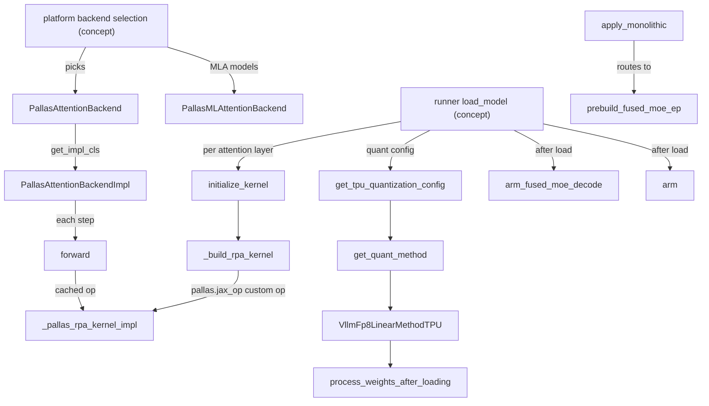

# vLLM layer adapters (layers/adapter)

<!-- connect:up:begin -->
> **Cross-repo concept:** part of [expert-parallelism](../../../concepts/expert-parallelism.md), [kv-cache](../../../concepts/kv-cache.md), [pallas-kernel](../../../concepts/pallas-kernel.md) across this wiki's repos.
<!-- connect:up:end -->
## Overview
`src/vllm_torchtpu/layers/adapter` is the seam between upstream vLLM's model code (torch modules, `AttentionBackend`, `QuantizationConfig`, `MoERunner`) and the JAX/Pallas kernels in `layers/core` and `kernels/`. This layer does not fork vLLM's models (the plugin's few native model implementations live separately under `models/vllm/`); it *registers replacements* at vLLM's extension points - a Pallas attention backend under vLLM's `FLASH_ATTN` / `CUSTOM` / `FLASH_ATTN_MLA` enum slots, a TPU quantization config family that hands out TPU linear and MoE methods, and custom-op wrappers for MLA, GDN and the sparse indexer. The single most important design idea is **resolve everything before tracing**: kernels are built and registered as torch custom ops, weights are converted to their runtime layout, and optional fused MoE kernels are "armed" once after load, so that the per-step forward the torch.compile graph captures is just a call into an already-built op.

## Diagram

Legend:
- `PLAT` - (concept) platform-side backend resolution in [`check_and_update_config`](../catalog/src/vllm_torchtpu/platforms/tpu_platform.md#TpuPlatform.check_and_update_config "src/vllm_torchtpu/platforms/tpu_platform.py:L785")
- `BE` - [`PallasAttentionBackend`](../catalog/src/vllm_torchtpu/layers/adapter/attention.md#PallasAttentionBackend "src/vllm_torchtpu/layers/adapter/attention.py:L562")
- `MLAB` - [`PallasMLAttentionBackend`](../catalog/src/vllm_torchtpu/layers/adapter/attention.md#PallasMLAttentionBackend "src/vllm_torchtpu/layers/adapter/attention.py:L1669")
- `IMPL` - [`PallasAttentionBackendImpl`](../catalog/src/vllm_torchtpu/layers/adapter/attention.md#PallasAttentionBackendImpl "src/vllm_torchtpu/layers/adapter/attention.py:L803")
- `RUN` - (concept) the model runner's load/initialization sequence
- `INIT` - [`initialize_kernel`](../catalog/src/vllm_torchtpu/layers/adapter/attention.md#PallasAttentionBackendImpl.initialize_kernel "src/vllm_torchtpu/layers/adapter/attention.py:L1329")
- `BUILD` - [`_build_rpa_kernel`](../catalog/src/vllm_torchtpu/layers/adapter/attention.md#PallasAttentionBackendImpl._build_rpa_kernel "src/vllm_torchtpu/layers/adapter/attention.py:L930")
- `CORE` - [`_pallas_rpa_kernel_impl`](../catalog/src/vllm_torchtpu/layers/adapter/attention.md#_pallas_rpa_kernel_impl "src/vllm_torchtpu/layers/adapter/attention.py:L223")
- `FWD` - [`forward`](../catalog/src/vllm_torchtpu/layers/adapter/attention.md#PallasAttentionBackendImpl.forward "src/vllm_torchtpu/layers/adapter/attention.py:L1423")
- `QCFG` - [`get_tpu_quantization_config`](../catalog/src/vllm_torchtpu/layers/adapter/quantization/__init__.md#get_tpu_quantization_config "src/vllm_torchtpu/layers/adapter/quantization/__init__.py:L51")
- `QM` - [`get_quant_method`](../catalog/src/vllm_torchtpu/layers/adapter/quantization/unquantized.md#VllmUnquantizedConfig.get_quant_method "src/vllm_torchtpu/layers/adapter/quantization/unquantized.py:L181")
- `FP8` - [`VllmFp8LinearMethodTPU`](../catalog/src/vllm_torchtpu/layers/adapter/quantization/fp8.md#VllmFp8LinearMethodTPU "src/vllm_torchtpu/layers/adapter/quantization/fp8.py:L1343")
- `PWAL` - [`process_weights_after_loading`](../catalog/src/vllm_torchtpu/layers/adapter/quantization/fp8.md#VllmFp8LinearMethodTPU.process_weights_after_loading "src/vllm_torchtpu/layers/adapter/quantization/fp8.py:L1535")
- `ARM` - [`arm_fused_moe_decode`](../catalog/src/vllm_torchtpu/layers/adapter/fused_moe_decode.md#arm_fused_moe_decode "src/vllm_torchtpu/layers/adapter/fused_moe_decode.py:L513")
- `ARM2` - [`arm`](../catalog/src/vllm_torchtpu/layers/adapter/moe_tp_decode.md#arm "src/vllm_torchtpu/layers/adapter/moe_tp_decode.py:L519")
- `MOEFWD` - [`apply_monolithic`](../catalog/src/vllm_torchtpu/layers/adapter/quantization/fp8.md#VllmFp8MoEMethodTPU.apply_monolithic "src/vllm_torchtpu/layers/adapter/quantization/fp8.py:L1108")
- `EP` - [`prebuild_fused_moe_ep`](../catalog/src/vllm_torchtpu/layers/adapter/fused_moe_ep.md#prebuild_fused_moe_ep "src/vllm_torchtpu/layers/adapter/fused_moe_ep.py:L759")

## Design rationale (why it's built this way)
- **Kernels are torch custom ops, built ahead of tracing.** [`_build_rpa_kernel`](../catalog/src/vllm_torchtpu/layers/adapter/attention.md#PallasAttentionBackendImpl._build_rpa_kernel "src/vllm_torchtpu/layers/adapter/attention.py:L930") wraps the JAX kernel entry with `pallas.jax_op` "to mark it as an op boundary in Dynamo. This prevents torch.compile from tracing into the Pallas kernel internals." [`initialize_kernel`](../catalog/src/vllm_torchtpu/layers/adapter/attention.md#PallasAttentionBackendImpl.initialize_kernel "src/vllm_torchtpu/layers/adapter/attention.py:L1329") exists ("Pre-build the RPA kernel before torch.compile traces the model.") because resolving a PCP mesh or allocating op names inside Dynamo's fullgraph capture is not allowed; the same rule is stated for MoE: [`prebuild_fused_moe_ep`](../catalog/src/vllm_torchtpu/layers/adapter/fused_moe_ep.md#prebuild_fused_moe_ep "src/vllm_torchtpu/layers/adapter/fused_moe_ep.py:L759") notes that "a `Mesh` cannot survive Dynamo's tracing".
- **One op per distinct config, shared across layers.** A class-level registry keys ops by (prefix, sliding window, scale, soft cap, mesh, FP8 scales, `skip_kv_update`, PCP flags, KV layout, decode query size, block-major). Identical layers therefore emit one shared op node instead of duplicating JAX tracing and MLIR compilation per layer; KV-sharing (read-only) layers get their own variant because `skip_kv_update` is in the key.
- **In-place KV update through donation + `copy_`.** The op donates the KV cache argument and the torch side does `kv_cache.copy_(new_kv_cache)`; the source explains that "XLA lifts the copy_ input mutation and aliases the op output onto the donated pool, so this compiles to an in-place pool update." Donation is disabled in kernel-iteration mode (`TPU_KERNEL_ITER_MODE`), where the op runs eagerly and donation would kill the buffer the write-back targets.
- **The SMEM budget drives max batch size.** [`get_max_num_seqs_for_pages`](../catalog/src/vllm_torchtpu/layers/adapter/attention.md#PallasAttentionBackend.get_max_num_seqs_for_pages "src/vllm_torchtpu/layers/adapter/attention.py:L694") ("Budget the page table actually prefetched into SMEM.") returns `1024 * 1024 // 2 // pages_per_req // 4`: the block table is prefetched into the 1 MiB scalar memory, and the backend keeps it under half of that. Page size is chosen so max-model-len splits into ~16 pages, clamped to [16, 256], and forced to 16 above 8192 tokens to avoid VMEM spill.
- **Weights are transposed once, at load.** Dense linear weights are flipped from vLLM's `[n_out, n_in]` to the `(k, n)` layout the runtime matmul wants inside `process_weights_after_loading`, after quantization, instead of per step. [`WEIGHT_FLIPPED_ATTR`](../catalog/src/vllm_torchtpu/layers/adapter/linear_common.md#WEIGHT_FLIPPED_ATTR "src/vllm_torchtpu/layers/adapter/linear_common.py:L53") is a stored idempotence flag because vLLM's reload paths re-enter that hook, "where a second flip would transpose back and silently corrupt the values", and the flip cannot be inferred from shape (square projections).
- **Fused MoE paths are armed per deployment, collectively.** The TP-decode and fused-decode kernels replace vLLM's shared-expert + routed + all-reduce sequence (the fused-EP kernel instead replaces the routed path and both EP collectives); because each kernel contains a collective, every rank must arm the same layers. [`arm`](../catalog/src/vllm_torchtpu/layers/adapter/moe_tp_decode.md#arm "src/vllm_torchtpu/layers/adapter/moe_tp_decode.py:L519") hashes an arming signature and checks all ranks agree, then self-tests the all-reduce once. The fused-EP module documents its motivation with a measured profile: the default path's reduce-scatter was fully exposed, while the fused kernel overlaps transport with the expert matmuls (33,304 vs 30,888 tok/s on its cited Qwen3.5-397B DP8+EP configuration).

## Entry points
- [`PallasAttentionBackend`](../catalog/src/vllm_torchtpu/layers/adapter/attention.md#PallasAttentionBackend "src/vllm_torchtpu/layers/adapter/attention.py:L562") - the default attention backend, registered over vLLM's `FLASH_ATTN` enum; vLLM's KV-cache allocator calls its static geometry methods (`get_kv_cache_shape`, page size, stride order, max seqs) from both the scheduler and worker processes. The batched-RPA backend registered as `CUSTOM` overrides [`get_kv_cache_shape`](../catalog/src/vllm_torchtpu/layers/adapter/attention.md#PallasBatchedRPAAttentionBackend.get_kv_cache_shape "src/vllm_torchtpu/layers/adapter/attention.py:L749") for its `SEQ_ALONG_LANE` layout.
- [`PallasMLAttentionBackend`](../catalog/src/vllm_torchtpu/layers/adapter/attention.md#PallasMLAttentionBackend "src/vllm_torchtpu/layers/adapter/attention.py:L1669") - "TPU attention backend utilizing customized Pallas kernels for DeepSeek MLA." Registered over `FLASH_ATTN_MLA`; its [`get_kv_cache_shape`](../catalog/src/vllm_torchtpu/layers/adapter/attention.md#PallasMLAttentionBackend.get_kv_cache_shape "src/vllm_torchtpu/layers/adapter/attention.py:L1718") and [`get_sparse_kv_cache_specs`](../catalog/src/vllm_torchtpu/layers/adapter/attention.md#PallasMLAttentionBackend.get_sparse_kv_cache_specs "src/vllm_torchtpu/layers/adapter/attention.py:L1768") are queried by the KV cache manager ([`get_kv_cache_spec`](../catalog/src/vllm_torchtpu/runner/kv_cache_manager.md#KVCacheManager.get_kv_cache_spec "src/vllm_torchtpu/runner/kv_cache_manager.py:L229"), [`initialize_kv_cache`](../catalog/src/vllm_torchtpu/runner/kv_cache_manager.md#KVCacheManager.initialize_kv_cache "src/vllm_torchtpu/runner/kv_cache_manager.py:L1360")).
- [`initialize_kernel`](../catalog/src/vllm_torchtpu/layers/adapter/attention.md#PallasAttentionBackendImpl.initialize_kernel "src/vllm_torchtpu/layers/adapter/attention.py:L1329") - called by the runner (and the DFlash drafter's [`load_model`](../catalog/src/vllm_torchtpu/spec_decode/dflash.md#DFlashProposer.load_model "src/vllm_torchtpu/spec_decode/dflash.py:L198")) after weights load and before compile, once per attention layer.
- [`forward`](../catalog/src/vllm_torchtpu/layers/adapter/attention.md#PallasAttentionBackendImpl.forward "src/vllm_torchtpu/layers/adapter/attention.py:L1423") - "Forward pass with Pallas attention."; vLLM's `Attention` layer calls it every step inside the compiled graph.
- [`get_tpu_quantization_config`](../catalog/src/vllm_torchtpu/layers/adapter/quantization/__init__.md#get_tpu_quantization_config "src/vllm_torchtpu/layers/adapter/quantization/__init__.py:L51") - "Get TPU-specific quantization configuration."; called by the runner at model init (and by the export adapter) to replace vLLM's quant config with a [`VllmQuantConfig`](../catalog/src/vllm_torchtpu/layers/adapter/quantization/configs.md#VllmQuantConfig "src/vllm_torchtpu/layers/adapter/quantization/configs.py:L110") subclass.
- [`arm_fused_moe_decode`](../catalog/src/vllm_torchtpu/layers/adapter/fused_moe_decode.md#arm_fused_moe_decode "src/vllm_torchtpu/layers/adapter/fused_moe_decode.py:L513") and [`arm`](../catalog/src/vllm_torchtpu/layers/adapter/moe_tp_decode.md#arm "src/vllm_torchtpu/layers/adapter/moe_tp_decode.py:L519") - post-load hooks that swap eligible MoE layers onto fused decode kernels.
- [`forward`](../catalog/src/vllm_torchtpu/layers/adapter/sample/rejection_sampler.md#RejectionSampler.forward "src/vllm_torchtpu/layers/adapter/sample/rejection_sampler.py:L97") - "Performs rejection sampling for speculative decoding."; called from the runner's [`_sample_spec_verify_chunk`](../catalog/src/vllm_torchtpu/runner/tpu_runner.md#TPUModelRunner._sample_spec_verify_chunk "src/vllm_torchtpu/runner/tpu_runner.py:L4698").

## Mechanism (step-by-step)
1. **Backend and KV geometry selection.** The platform resolves the attention backend class during config checking (to pick the KV layout): an explicitly registered backend must subclass [`PallasAttentionBackend`](../catalog/src/vllm_torchtpu/layers/adapter/attention.md#PallasAttentionBackend "src/vllm_torchtpu/layers/adapter/attention.py:L562"), `CUSTOM` maps to the batched-RPA backend, anything else to the default; separately, the platform's backend selector forces MLA models onto `FLASH_ATTN_MLA`, i.e. [`PallasMLAttentionBackend`](../catalog/src/vllm_torchtpu/layers/adapter/attention.md#PallasMLAttentionBackend "src/vllm_torchtpu/layers/adapter/attention.py:L1669"). The default KV cache is 5D `[num_blocks, block_size, kv_heads_x2 / kv_packing, kv_packing, padded_head_dim]`: the v3 kernel packs K and V along heads (`num_kv_heads * 2`) while the head-dim-64 kernel packs them along head dim, and sub-32-bit dtypes pack several heads per 32-bit word. The MLA cache packs the latent vector (and, for `fp8_ds_mla`, `[nope fp8 | rope bf16 | UE8M0 scales]` per token) padded to a 128-aligned minor dim; sparse MLA splits it into separate nope/rope caches.
2. **Impl construction.** [`PallasAttentionBackendImpl`](../catalog/src/vllm_torchtpu/layers/adapter/attention.md#PallasAttentionBackendImpl "src/vllm_torchtpu/layers/adapter/attention.py:L803") rejects ALiBi and non-decoder attention, records [`kv_cache_quantized_dtype`](../catalog/src/vllm_torchtpu/layers/adapter/attention.md#PallasAttentionBackendImpl.kv_cache_quantized_dtype "src/vllm_torchtpu/layers/adapter/attention.py:L866") only for FP8 caches, and caches config-derived values (KV layout, whether the block-major unified pool is in use via [`_bm_kernel`](../catalog/src/vllm_torchtpu/layers/adapter/attention.md#PallasAttentionBackendImpl._bm_kernel "src/vllm_torchtpu/layers/adapter/attention.py:L888")) at construction time because "compiled forwards have no active vLLM config and must not look it up".
3. **Kernel prebuild.** [`initialize_kernel`](../catalog/src/vllm_torchtpu/layers/adapter/attention.md#PallasAttentionBackendImpl.initialize_kernel "src/vllm_torchtpu/layers/adapter/attention.py:L1329") picks FP8 K/V scales from the loaded layer, then branches: with prefill context parallelism it validates the layer ([`_validate_pcp_streaming_support`](../catalog/src/vllm_torchtpu/layers/adapter/attention.md#PallasAttentionBackendImpl._validate_pcp_streaming_support "src/vllm_torchtpu/layers/adapter/attention.py:L1180") rejects sinks, soft cap, KV sharing, and HND layout without the batched backend + FP8 cache) and builds the PCP-streaming op; with decode context parallelism it builds the two DCP passes via [`build_dcp_kernels`](../catalog/src/vllm_torchtpu/layers/adapter/cp_attention.md#build_dcp_kernels "src/vllm_torchtpu/layers/adapter/cp_attention.py:L189") ("Build and cache the CACHE_ONLY and NEW_TOKENS_ONLY jax_ops."); otherwise it builds the plain op with [`_build_rpa_kernel`](../catalog/src/vllm_torchtpu/layers/adapter/attention.md#PallasAttentionBackendImpl._build_rpa_kernel "src/vllm_torchtpu/layers/adapter/attention.py:L930"). That builder checks a per-instance cache, then the class-wide registry, and only then allocates a new `pallas::rpa_kernel_<n>` op, registers a fake implementation (needed because vLLM uses dynamic query dims), and returns a closure that calls the op and copies the new cache back. For the block-major bundled cache, [`_build_bundled_kernel`](../catalog/src/vllm_torchtpu/layers/adapter/attention.md#PallasAttentionBackendImpl._build_bundled_kernel "src/vllm_torchtpu/layers/adapter/attention.py:L1211") ("Constructs and caches the bundled RPA custom op via `pallas.jax_op`.") builds the whole-model-bundle variant and refuses to fall back to the default bundled kernel when a subclass overrides the layer-major entry.
4. **Per-step attention.** [`forward`](../catalog/src/vllm_torchtpu/layers/adapter/attention.md#PallasAttentionBackendImpl.forward "src/vllm_torchtpu/layers/adapter/attention.py:L1423") returns early for the empty profiling cache, synthesizes zero K/V for KV-shared layers, pads Q/K/V up to the pool's head width when a narrower layer (e.g. a draft layer) shares a wider pool (scale comes from the real [`head_size`](../catalog/src/vllm_torchtpu/layers/adapter/attention.md#PallasAttentionBackendImpl.head_size "src/vllm_torchtpu/layers/adapter/attention.py:L847"), so output is unchanged), and quantizes K/V to FP8 with static per-tensor scales when the cache is FP8. It then routes to DCP, to the bundled op when a KV bundle is mounted on the context, or to the cached per-layer op with the metadata's four tensors; on the block-major pool the block table is remapped to flat kernel ids first. The JAX side, [`_pallas_rpa_kernel_impl`](../catalog/src/vllm_torchtpu/layers/adapter/attention.md#_pallas_rpa_kernel_impl "src/vllm_torchtpu/layers/adapter/attention.py:L223"), folds shared/packed pool layouts into the kernel's native page shape with zero-copy reshapes (scaling block-table entries by the page stride when one pool page spans several native pages), wraps the tensors in an attention-metadata object and calls the core `attention` function.
5. **Quantization config and method dispatch.** [`get_tpu_quantization_config`](../catalog/src/vllm_torchtpu/layers/adapter/quantization/__init__.md#get_tpu_quantization_config "src/vllm_torchtpu/layers/adapter/quantization/__init__.py:L51") maps the checkpoint's quant method (none, FP8, MXFP4, NVFP4, compressed-tensors, DeepSeek-V4 FP8) to a TPU config class, stores the vLLM config on the class ([`VllmQuantConfig`](../catalog/src/vllm_torchtpu/layers/adapter/quantization/configs.md#VllmQuantConfig "src/vllm_torchtpu/layers/adapter/quantization/configs.py:L110") "Base class for all TPU quantization configurations."), re-registers the method under a TPU-specific name, and attaches the optional online-FP8 policy. Each config's `get_quant_method` hands vLLM a TPU method per layer: the unquantized [`get_quant_method`](../catalog/src/vllm_torchtpu/layers/adapter/quantization/unquantized.md#VllmUnquantizedConfig.get_quant_method "src/vllm_torchtpu/layers/adapter/quantization/unquantized.py:L181") returns an FP8 linear method for layers selected for quantize-on-load (skipping MLA's `kv_b_proj`), the DeepSeek-V4 [`get_quant_method`](../catalog/src/vllm_torchtpu/layers/adapter/quantization/deepseek_v4_fp8.md#VllmDeepseekV4Fp8Config.get_quant_method "src/vllm_torchtpu/layers/adapter/quantization/deepseek_v4_fp8.py:L73") its own family, and FP8 checkpoints are routed through [`_get_checkpoint_quant_method`](../catalog/src/vllm_torchtpu/layers/adapter/quantization/fp8.md#VllmFp8Config._get_checkpoint_quant_method "src/vllm_torchtpu/layers/adapter/quantization/fp8.py:L732"). [`resolve_online_fp8`](../catalog/src/vllm_torchtpu/layers/adapter/quantization/fp8.md#resolve_online_fp8 "src/vllm_torchtpu/layers/adapter/quantization/fp8.py:L1707") swaps an unquantized linear for an online-FP8 method when the policy selects its prefix.
6. **Weight conversion at load.** [`VllmFp8LinearMethodTPU`](../catalog/src/vllm_torchtpu/layers/adapter/quantization/fp8.md#VllmFp8LinearMethodTPU "src/vllm_torchtpu/layers/adapter/quantization/fp8.py:L1343") reuses vLLM's FP8 `create_weights` (so the loader shards correctly) but skips the GPU-specific init. Its [`process_weights_after_loading`](../catalog/src/vllm_torchtpu/layers/adapter/quantization/fp8.md#VllmFp8LinearMethodTPU.process_weights_after_loading "src/vllm_torchtpu/layers/adapter/quantization/fp8.py:L1535") ("Convert dense linear checkpoint weights to runtime FP8.") converges three sources - FP8 checkpoints (dequantized and requantized to the runtime block layout), online FP8 from BF16, and configured load-time requantization - into one runtime FP8 weight + scale, transposes to `(k, n)` once, gives both tensors fresh buffers so the matmul boundary needs no per-step strided-view program, and sets [`WEIGHT_FLIPPED_ATTR`](../catalog/src/vllm_torchtpu/layers/adapter/linear_common.md#WEIGHT_FLIPPED_ATTR "src/vllm_torchtpu/layers/adapter/linear_common.py:L53"). MoE methods do the equivalent for expert weights: [`process_weights_after_loading`](../catalog/src/vllm_torchtpu/layers/adapter/quantization/fp8.md#VllmFp8MoEMethodTPU.process_weights_after_loading "src/vllm_torchtpu/layers/adapter/quantization/fp8.py:L982") ("Process MoE weights into the runtime FP8 layout used by the GMM kernel."), plus NVFP4 ([`process_weights_after_loading`](../catalog/src/vllm_torchtpu/layers/adapter/quantization/nvfp4.md#VllmNvfp4MoEMethod.process_weights_after_loading "src/vllm_torchtpu/layers/adapter/quantization/nvfp4.py:L388")), MXFP4 ([`process_weights_after_loading`](../catalog/src/vllm_torchtpu/layers/adapter/quantization/mxfp4.md#VllmDeepseekV4Mxfp4MoEMethod.process_weights_after_loading "src/vllm_torchtpu/layers/adapter/quantization/mxfp4.py:L620")) and compressed-tensors W4 MXFP4 ([`process_weights_after_loading`](../catalog/src/vllm_torchtpu/layers/adapter/quantization/compressed_tensors/compressed_tensors_moe/compressed_tensors_moe_w4an_mxfp4.md#VllmCompressedTensorsW4ANMxfp4MoEMethod.process_weights_after_loading "src/vllm_torchtpu/layers/adapter/quantization/compressed_tensors/compressed_tensors_moe/compressed_tensors_moe_w4an_mxfp4.py:L173")). Finally [`validate_online_fp8`](../catalog/src/vllm_torchtpu/layers/adapter/quantization/online_fp8.md#validate_online_fp8 "src/vllm_torchtpu/layers/adapter/quantization/online_fp8.py:L164") ("Audit once after loading, before compilation or accepting requests.") verifies every selected layer was actually dispatched and processed with the expected scale shape.
7. **MoE forward dispatch and arming.** [`apply_monolithic`](../catalog/src/vllm_torchtpu/layers/adapter/quantization/fp8.md#VllmFp8MoEMethodTPU.apply_monolithic "src/vllm_torchtpu/layers/adapter/quantization/fp8.py:L1108") ("Forward pass using TPU-native GMM kernel with FP8 weights.") is a priority chain: the adaptive fused MoE kernel, then the fused-EP op if [`prebuild_fused_moe_ep`](../catalog/src/vllm_torchtpu/layers/adapter/fused_moe_ep.md#prebuild_fused_moe_ep "src/vllm_torchtpu/layers/adapter/fused_moe_ep.py:L759") built one for this layer at load ([`_build_split_ops`](../catalog/src/vllm_torchtpu/layers/adapter/fused_moe_ep.md#_build_split_ops "src/vllm_torchtpu/layers/adapter/fused_moe_ep.py:L391") supplies its sorted-gather variant), then the TP-decode kernel if [`arm`](../catalog/src/vllm_torchtpu/layers/adapter/moe_tp_decode.md#arm "src/vllm_torchtpu/layers/adapter/moe_tp_decode.py:L519") admitted the layer, and finally the generic route -> zero padded-token weights -> grouped-GEMM path. [`_admit`](../catalog/src/vllm_torchtpu/layers/adapter/moe_tp_decode.md#_admit "src/vllm_torchtpu/layers/adapter/moe_tp_decode.py:L177") ("What arming needs for this runner, or why it keeps the usual path.") returns either an admission record or a human-readable refusal (wrong quant method, non-SiLU, EP on, biases, non-sigmoid routing, ...), and refusals are tallied rather than raised. [`arm_fused_moe_decode`](../catalog/src/vllm_torchtpu/layers/adapter/fused_moe_decode.md#arm_fused_moe_decode "src/vllm_torchtpu/layers/adapter/fused_moe_decode.py:L513") does the same for the `FUSED_MOE_DECODE_KERNEL` path, checking VMEM for the configured `FUSED_MOE_DECODE_KERNEL_MAX_TOKENS`. Armed layers tell the runner they own the shared expert and the reduction, so vLLM skips both.
8. **Other custom-op layers.** The GDN layer's [`forward`](../catalog/src/vllm_torchtpu/layers/adapter/custom_ops/gdn_attention_op.md#VllmGatedDeltaNetAttention.forward "src/vllm_torchtpu/layers/adapter/custom_ops/gdn_attention_op.py:L1118") runs the input projections in torch and the core recurrence through an op built by [`_build_gdn_op`](../catalog/src/vllm_torchtpu/layers/adapter/custom_ops/gdn_attention_op.md#VllmGatedDeltaNetAttention._build_gdn_op "src/vllm_torchtpu/layers/adapter/custom_ops/gdn_attention_op.py:L553") (PCP prefill gets its own op on an op-local `pcp x tp` mesh) or, for the fused projection + pooled PCP path, [`_build_pooled_pcp_gdn_op`](../catalog/src/vllm_torchtpu/layers/adapter/custom_ops/gdn_attention_op.md#VllmGatedDeltaNetAttention._build_pooled_pcp_gdn_op "src/vllm_torchtpu/layers/adapter/custom_ops/gdn_attention_op.py:L849"). The MLA wrapper's [`forward`](../catalog/src/vllm_torchtpu/layers/adapter/custom_ops/mla_attention_op.md#VllmTPUMultiHeadLatentAttentionWrapper.forward "src/vllm_torchtpu/layers/adapter/custom_ops/mla_attention_op.py:L1209") fuses the Q/KV-A projections (and an optional Kimi preprocess) before the latent attention; [`process_weights_after_loading`](../catalog/src/vllm_torchtpu/layers/adapter/custom_ops/mla_attention_op.md#VllmTPUMLAAttention.process_weights_after_loading "src/vllm_torchtpu/layers/adapter/custom_ops/mla_attention_op.py:L967") slices and quantizes the absorbed `W_UK`/`W_UV` matrices; the sparse indexer's [`_build_streamidx_dcp_op`](../catalog/src/vllm_torchtpu/layers/adapter/custom_ops/mla_attention_op.md#VllmTPUSparseAttnIndexer._build_streamidx_dcp_op "src/vllm_torchtpu/layers/adapter/custom_ops/mla_attention_op.py:L550") is "The DCP twin of `_build_streamidx_op`."
9. **Rejection sampling.** The TPU rejection sampler's [`forward`](../catalog/src/vllm_torchtpu/layers/adapter/sample/rejection_sampler.md#RejectionSampler.forward "src/vllm_torchtpu/layers/adapter/sample/rejection_sampler.py:L97") verifies draft tokens against target logits in segment-grouped form. When the speculative config selects the `synthetic` method, [`synthetic_mode`](../catalog/src/vllm_torchtpu/layers/adapter/sample/rejection_sampler.md#RejectionSampler.synthetic_mode "src/vllm_torchtpu/layers/adapter/sample/rejection_sampler.py:L55") is set and acceptance follows configured conditional rates instead of the target distribution - a benchmarking knob for modelling a given acceptance rate.

## Key data structures
- **Kernel op registry** (class-level dicts on [`PallasAttentionBackendImpl`](../catalog/src/vllm_torchtpu/layers/adapter/attention.md#PallasAttentionBackendImpl "src/vllm_torchtpu/layers/adapter/attention.py:L803")) - config tuple -> torch-callable closure; plus a per-instance config cache so `forward` reuses the op prebuilt by `initialize_kernel` without touching the mesh.
- **KV cache shapes** - default 5D packed layout; `SEQ_ALONG_LANE` (vLLM `HND`) puts `page_size` on the last axis for the batched kernel ([`KVLayout`](../catalog/src/vllm_torchtpu/kernels/experimental/batched_rpa/configs.md#KVLayout "src/vllm_torchtpu/kernels/experimental/batched_rpa/configs.py:L84"), [`SEQ_ALONG_LANE`](../catalog/src/vllm_torchtpu/kernels/experimental/batched_rpa/configs.md#KVLayout.SEQ_ALONG_LANE "src/vllm_torchtpu/kernels/experimental/batched_rpa/configs.py:L92")); block-major adds a leading 6D bundle shape that the kernel folds back with a zero-copy view.
- **Weight layout flags** - [`WEIGHT_FLIPPED_ATTR`](../catalog/src/vllm_torchtpu/layers/adapter/linear_common.md#WEIGHT_FLIPPED_ATTR "src/vllm_torchtpu/layers/adapter/linear_common.py:L53") (idempotence) and a sibling keep-vLLM-layout marker set by consumers that read `.weight` raw (embeddings, tied LM heads).
- **Online FP8 policy** - attached to the [`VllmQuantConfig`](../catalog/src/vllm_torchtpu/layers/adapter/quantization/configs.md#VllmQuantConfig "src/vllm_torchtpu/layers/adapter/quantization/configs.py:L110") class; selects target prefixes (through packed-module aliases) and records which were converted.

## Dynamics (design intent)
- **Dynamo guards drive bundle retracing.** During the profile run the KV bundle is not mounted, so `forward` takes the per-layer path; the source notes that "Dynamo guards on this check trigger retracing once the bundle is initialized".
- **Arming is a collective barrier.** Both arming paths compare a per-rank signature across the TP/EP group and raise on mismatch because a rank that skips the kernel would leave its peers waiting inside the kernel's collective.
- **Branches inside one exported program.** The fused-decode and TP-decode MoE ops handle their admitted token counts in the kernel and fall back to the regular grouped-GEMM path + shared expert + all-reduce *inside the same op*, because the token count is static per bucket; branching in torch would give the two sides different graph inputs, which vLLM's per-bucket graph specialization refuses.
- **No sync inside compile.** Outside compilation `forward` issues a non-blocking `synchronize_tensors` on the cache; inside a compiled graph it does not.

## Edge cases
- KV cache dtype `"auto"` returns a placeholder shape from `get_kv_cache_shape` so vLLM's offloading connector can probe the `num_blocks` dim without resolving a dtype.
- `VLLM_KV_CACHE_LAYOUT=HND` with a kernel entry that cannot take a KV layout raises rather than silently misreading pages; DCP with HND requires the `CUSTOM` backend and head size != 64.
- Batched-RPA page sizes are multiples of 128 (default 256); under HND without PCP only 128 is accepted. With speculative decoding the batched impl runs `K + 1` verify tokens in the decode stage (`decode_query_size`), except for head dim 64.
- FP8 KV caches require non-zero `k_scale` / `v_scale`; `forward` raises on zero.
- Fused output quantization (`output_scale`, `output_block_scale`) is not supported.
- The fused-EP path refuses hash-routed layers unless the calling quant method promises to pass hash ids every forward - otherwise tokens would be routed by top-k "silently".

## Open questions
- The DCP forward helper, the bundled-cache setup, and the block-major pool helpers are referenced from these classes but not in this packet's subgraph; see [kv-cache-layout-and-hbm-budget](kv-cache-layout-and-hbm-budget.md) and [distributed-parallelism-and-meshes](distributed-parallelism-and-meshes.md).
- Linear-layer `apply` paths (W8A8 vs the small-bucket W8A16 opt-in) and the router top-k kernels live in `linear.py` / `router_topk.py`, outside this subgraph; [quantization-methods](quantization-methods.md) covers them.

## See also
- [attention-and-layer-core](attention-and-layer-core.md) - the JAX attention/MoE functions these adapters call.
- [custom-ops](custom-ops.md) - how torch custom ops wrap the JAX kernels.
- [tpu-platform](tpu-platform.md), [tpu-model-runner](tpu-model-runner.md), [compilation-and-graph-capture](compilation-and-graph-capture.md)
- [quantization-methods](quantization-methods.md), [fused-moe-kernels](fused-moe-kernels.md), [adaptive-fused-moe-kernel](adaptive-fused-moe-kernel.md)
- [ragged-paged-attention-kernel](ragged-paged-attention-kernel.md), [batched-ragged-paged-attention-kernel](batched-ragged-paged-attention-kernel.md), [mla-attention-kernels](mla-attention-kernels.md), [gated-deltanet-kernels](gated-deltanet-kernels.md)
- [kv-cache-layout-and-hbm-budget](kv-cache-layout-and-hbm-budget.md), [speculative-decoding](speculative-decoding.md)
