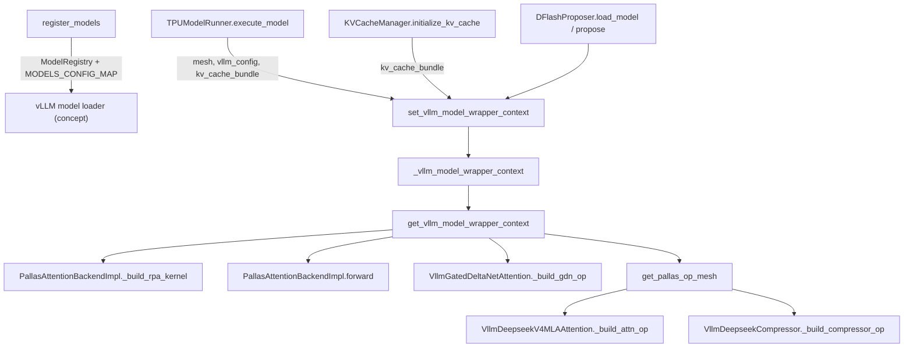

# vLLM model layer - out-of-tree model registration, model-specific TPU patches, and the model wrapper context

## Overview

`src/vllm_torchtpu/models/vllm/` is where the plugin changes *which model code vLLM runs*. It does
three distinct things. First, [`register_models`](../catalog/src/vllm_torchtpu/models/vllm/__init__.md#register_models "src/vllm_torchtpu/models/vllm/__init__.py:L45")
adds TPU-native implementations to vLLM's `ModelRegistry` (DeepSeek-V4, Kimi-Linear / Kimi-K3,
Qwen4Exp, the DSpark and Qwen3.5 MTP drafters) and per-architecture config hooks to
`MODELS_CONFIG_MAP`. Second, a set of `*_patch.py` modules rewrite upstream vLLM / transformers
classes in place for model families that otherwise run upstream code (Qwen2 GQA head padding,
Qwen3-VL vision ops, Qwen3.5 sequence-parallel and attention/MoE-overlap forwards). Third,
`vllm_model_wrapper_context.py` defines the one piece of shared state everything else reads: a
process-global [`_vllm_model_wrapper_context`](../catalog/src/vllm_torchtpu/models/vllm/vllm_model_wrapper_context.md#_vllm_model_wrapper_context._vllm_model_wrapper_context "src/vllm_torchtpu/models/vllm/vllm_model_wrapper_context.py:L36")
installed by the runner around model load and every forward, which is how a Pallas custom-op
builder deep inside a layer finds the JAX mesh, the vLLM config and the bundled KV cache without
threading them through vLLM's model signatures.

## Diagram

Legend:
- `REG` - [`register_models`](../catalog/src/vllm_torchtpu/models/vllm/__init__.md#register_models "src/vllm_torchtpu/models/vllm/__init__.py:L45")
- `VLLM` - (concept) upstream vLLM `ModelRegistry` / model loader
- `EXEC` - [`execute_model`](../catalog/src/vllm_torchtpu/runner/tpu_runner.md#TPUModelRunner.execute_model "src/vllm_torchtpu/runner/tpu_runner.py:L3884")
- `INIT` - [`initialize_kv_cache`](../catalog/src/vllm_torchtpu/runner/kv_cache_manager.md#KVCacheManager.initialize_kv_cache "src/vllm_torchtpu/runner/kv_cache_manager.py:L1360")
- `SPEC` - [`load_model`](../catalog/src/vllm_torchtpu/spec_decode/dflash.md#DFlashProposer.load_model "src/vllm_torchtpu/spec_decode/dflash.py:L198")
- `SET` - [`set_vllm_model_wrapper_context`](../catalog/src/vllm_torchtpu/models/vllm/vllm_model_wrapper_context.md#set_vllm_model_wrapper_context "src/vllm_torchtpu/models/vllm/vllm_model_wrapper_context.py:L71")
- `CTX` - [`_vllm_model_wrapper_context`](../catalog/src/vllm_torchtpu/models/vllm/vllm_model_wrapper_context.md#_vllm_model_wrapper_context._vllm_model_wrapper_context "src/vllm_torchtpu/models/vllm/vllm_model_wrapper_context.py:L36")
- `GET` - [`get_vllm_model_wrapper_context`](../catalog/src/vllm_torchtpu/models/vllm/vllm_model_wrapper_context.md#get_vllm_model_wrapper_context "src/vllm_torchtpu/models/vllm/vllm_model_wrapper_context.py:L39")
- `RPA` - [`_build_rpa_kernel`](../catalog/src/vllm_torchtpu/layers/adapter/attention.md#PallasAttentionBackendImpl._build_rpa_kernel "src/vllm_torchtpu/layers/adapter/attention.py:L930")
- `FWD` - [`forward`](../catalog/src/vllm_torchtpu/layers/adapter/attention.md#PallasAttentionBackendImpl.forward "src/vllm_torchtpu/layers/adapter/attention.py:L1423")
- `GDN` - [`_build_gdn_op`](../catalog/src/vllm_torchtpu/layers/adapter/custom_ops/gdn_attention_op.md#VllmGatedDeltaNetAttention._build_gdn_op "src/vllm_torchtpu/layers/adapter/custom_ops/gdn_attention_op.py:L553")
- `MESHF` - [`get_pallas_op_mesh`](../catalog/src/vllm_torchtpu/models/vllm/vllm_model_wrapper_context.md#get_pallas_op_mesh "src/vllm_torchtpu/models/vllm/vllm_model_wrapper_context.py:L48")
- `DSV4` - [`_build_attn_op`](../catalog/src/vllm_torchtpu/models/vllm/deepseek_v4/attention.md#VllmDeepseekV4MLAAttention._build_attn_op "src/vllm_torchtpu/models/vllm/deepseek_v4/attention.py:L304")
- `CMP` - [`_build_compressor_op`](../catalog/src/vllm_torchtpu/layers/adapter/custom_ops/deepseek_v4/deepseek_v4_compressor.md#VllmDeepseekCompressor._build_compressor_op "src/vllm_torchtpu/layers/adapter/custom_ops/deepseek_v4/deepseek_v4_compressor.py:L476")

## Design rationale (why it's built this way)

**A side-channel context instead of new forward arguments.** vLLM binds KV caches to attention
layers and passes only tensors through `forward`; TPU kernels additionally need a JAX `Mesh` (for
`shard_map` / partition specs) and, on the block-major path, one model-wide KV buffer. The
dataclass carries [`mesh`](../catalog/src/vllm_torchtpu/models/vllm/vllm_model_wrapper_context.md#VllmModelWrapperContext.mesh "src/vllm_torchtpu/models/vllm/vllm_model_wrapper_context.py:L26"),
[`vllm_config`](../catalog/src/vllm_torchtpu/models/vllm/vllm_model_wrapper_context.md#VllmModelWrapperContext.vllm_config "src/vllm_torchtpu/models/vllm/vllm_model_wrapper_context.py:L29")
and [`kv_cache_bundle`](../catalog/src/vllm_torchtpu/models/vllm/vllm_model_wrapper_context.md#VllmModelWrapperContext.kv_cache_bundle "src/vllm_torchtpu/models/vllm/vllm_model_wrapper_context.py:L33")
(plus legacy `kv_caches` / `layer_name_to_kvcache_index`); its own comment flags the tension: "ullm
use this context to manager kv_caches while vllm binds the KV cache to the attention layer". The
setter is a context manager that saves the previous value and restores it in a `finally`, so a
nested install hands the outer context back on exit.

**Single-device meshes are deliberately hidden from Pallas.**
[`get_pallas_op_mesh`](../catalog/src/vllm_torchtpu/models/vllm/vllm_model_wrapper_context.md#get_pallas_op_mesh "src/vllm_torchtpu/models/vllm/vllm_model_wrapper_context.py:L48")
returns `None` when the wrapper mesh has one device. Its docstring explains that torch_tpu "rejects
a kernel mesh that does not span the whole torch.distributed world", so passing the per-worker
one-device mesh "fails every multi-chip run at op build time", and that without a mesh torch_tpu
"ignores the partition specs and runs the kernel on this rank's device" - which is what the
one-device mesh meant anyway. Op builders that might run either per-worker or SPMD (DeepSeek-V4
attention, compressor, indexer, mHC) go through this helper rather than reading `ctx.mesh`.

**Patch upstream classes rather than fork whole models.** For families where upstream vLLM is close
to right (Qwen2, Qwen3-VL, Qwen3.5 / Qwen3-Next), the plugin replaces one class or method and keeps
the rest of upstream. The patches are registered in the ordered `PATCHES` tuple of
`src/vllm_torchtpu/patch_registry.py` at the `platform_activation` and `model_load` lifecycle stages
(see `docs/developers_guide/tpu_patch_mechanism.md`). The Qwen2, Qwen3-VL and Qwen3.5
attention/MoE-overlap callbacks are registered with `model_config=True` and return `False` until a
matching `model_config` is available, so they retry at the later stage; the Qwen3-Next
(Qwen3.5 MoE sequence-parallel) callback takes no `model_config` and is gated only by the
`TPU_MOE_SEQUENCE_PARALLEL` env var. Families
whose execution differs fundamentally (MLA with SparseCore top-k, KDA hybrids, hyper-connections)
get a dedicated implementation registered by name instead.

**Registration happens in every process.** `register_models` is called from the
`vllm.general_plugins` entry point (`vllm_torchtpu.layers:register_layers` in `pyproject.toml`),
which vLLM runs in each process, so spawned workers and the engine core all see the same
architecture -> class mapping.

> [!inferred]
> Op builders read `vllm_config` from the context (not from `get_current_vllm_config`) because they
> are often invoked lazily on the first forward, inside the runner's `execute_model` context, where
> the wrapper context is guaranteed to be set; the assertion in `get_vllm_model_wrapper_context`
> turns a builder invoked outside that window into a loud failure.

## Entry points

- [`register_models`](../catalog/src/vllm_torchtpu/models/vllm/__init__.md#register_models "src/vllm_torchtpu/models/vllm/__init__.py:L45")
  runs at plugin load in every vLLM process. It maps `KimiLinearForCausalLM`,
  `KimiK3ForConditionalGeneration`, `DeepseekV4ForCausalLM`, `K3DSparkModel`, `DSparkDraftModel`,
  `Qwen3_5MTP` / `Qwen3_5MoeMTP` and `Qwen4ExpForCausalLM` (also under the
  `Qwen4ExpForConditionalGeneration` name the released checkpoint declares, "serve it with the
  text-only model") to plugin classes, and installs config hooks for Kimi-K3 ("Keep K3 MXFP4
  checkpoints on TPU's packed-weight loader"), Qwen4Exp and Qwen2 (GQA head padding).
- [`set_vllm_model_wrapper_context`](../catalog/src/vllm_torchtpu/models/vllm/vllm_model_wrapper_context.md#set_vllm_model_wrapper_context "src/vllm_torchtpu/models/vllm/vllm_model_wrapper_context.py:L71")
  is entered by the runner around model construction and around every decoder forward in
  [`execute_model`](../catalog/src/vllm_torchtpu/runner/tpu_runner.md#TPUModelRunner.execute_model "src/vllm_torchtpu/runner/tpu_runner.py:L3884"),
  by [`initialize_kv_cache`](../catalog/src/vllm_torchtpu/runner/kv_cache_manager.md#KVCacheManager.initialize_kv_cache "src/vllm_torchtpu/runner/kv_cache_manager.py:L1360")
  when pre-building bundled RPA kernels, by the speculative proposers
  ([`propose`](../catalog/src/vllm_torchtpu/spec_decode/dflash.md#DFlashProposer.propose "src/vllm_torchtpu/spec_decode/dflash.py:L597"),
  [`_forward_draft`](../catalog/src/vllm_torchtpu/spec_decode/eagle3.md#Eagle3Proposer._forward_draft "src/vllm_torchtpu/spec_decode/eagle3.py:L2074"),
  [`_build_mtp_fused_loop`](../catalog/src/vllm_torchtpu/spec_decode/eagle3.md#Eagle3Proposer._build_mtp_fused_loop "src/vllm_torchtpu/spec_decode/eagle3.py:L561")),
  and by the experimental export adapter's
  [`load_vllm_model`](../catalog/src/vllm_torchtpu/experimental/export/universal_adapter.md#load_vllm_model "src/vllm_torchtpu/experimental/export/universal_adapter.py:L406").
- [`get_vllm_model_wrapper_context`](../catalog/src/vllm_torchtpu/models/vllm/vllm_model_wrapper_context.md#get_vllm_model_wrapper_context "src/vllm_torchtpu/models/vllm/vllm_model_wrapper_context.py:L39")
  is called by kernel builders and forwards inside layers (RPA attention, MLA, GDN, DeepSeek-V4);
  it asserts the context is set.
- [`get_pallas_op_mesh`](../catalog/src/vllm_torchtpu/models/vllm/vllm_model_wrapper_context.md#get_pallas_op_mesh "src/vllm_torchtpu/models/vllm/vllm_model_wrapper_context.py:L48")
  is called whenever a DeepSeek-V4 Pallas op is built, e.g. in
  [`_build_attn_op`](../catalog/src/vllm_torchtpu/models/vllm/deepseek_v4/attention.md#VllmDeepseekV4MLAAttention._build_attn_op "src/vllm_torchtpu/models/vllm/deepseek_v4/attention.py:L304"),
  [`qnorm_rope_op`](../catalog/src/vllm_torchtpu/models/vllm/deepseek_v4/attention.md#VllmDeepseekV4MLAAttention.qnorm_rope_op "src/vllm_torchtpu/models/vllm/deepseek_v4/attention.py:L477"),
  [`kv_rope_op`](../catalog/src/vllm_torchtpu/models/vllm/deepseek_v4/attention.md#VllmDeepseekV4MLAAttention.kv_rope_op "src/vllm_torchtpu/models/vllm/deepseek_v4/attention.py:L503"),
  [`o_proj_op`](../catalog/src/vllm_torchtpu/models/vllm/deepseek_v4/attention.md#VllmDeepseekV4MLAAttention.o_proj_op "src/vllm_torchtpu/models/vllm/deepseek_v4/attention.py:L753"),
  [`_build_compressor_op`](../catalog/src/vllm_torchtpu/layers/adapter/custom_ops/deepseek_v4/deepseek_v4_compressor.md#VllmDeepseekCompressor._build_compressor_op "src/vllm_torchtpu/layers/adapter/custom_ops/deepseek_v4/deepseek_v4_compressor.py:L476")
  and [`_build_indexer_op`](../catalog/src/vllm_torchtpu/layers/adapter/custom_ops/deepseek_v4/deepseek_v4_indexer.md#VllmDeepseekV4Indexer._build_indexer_op "src/vllm_torchtpu/layers/adapter/custom_ops/deepseek_v4/deepseek_v4_indexer.py:L215").
- [`_scoped_qwen3_vl_torch_ops`](../catalog/src/vllm_torchtpu/models/vllm/qwen3_vl_patch.md#_scoped_qwen3_vl_torch_ops "src/vllm_torchtpu/models/vllm/qwen3_vl_patch.py:L151")
  is entered on every Qwen3-VL vision-encoder forward, vision-attention forward and RoPE-index
  computation once the Qwen3-VL patch has wrapped those methods.
- [`__init__`](../catalog/src/vllm_torchtpu/models/vllm/qwen2.md#TPUTPPaddedQwen2Attention.__init__ "src/vllm_torchtpu/models/vllm/qwen2.py:L46")
  of `TPUTPPaddedQwen2Attention` runs for every Qwen2 attention layer once the Qwen2 patch has
  replaced upstream `Qwen2Attention` with it.

## Mechanism (step-by-step)

1. **Registration at plugin load.** [`register_models`](../catalog/src/vllm_torchtpu/models/vllm/__init__.md#register_models "src/vllm_torchtpu/models/vllm/__init__.py:L45")
   calls `ModelRegistry.register_model` with lazy `module:Class` strings, so no model module is
   imported until vLLM resolves the architecture, and writes `MODELS_CONFIG_MAP` entries whose
   `verify_and_update_config` hooks run during config validation. The Qwen2 hook rewrites the head
   count used for validation to the padded value when `num_heads % tp_size != 0`.

2. **Model construction inside the context.** The runner loads the model inside
   `set_vllm_model_wrapper_context(mesh=..., vllm_config=...)`, so anything that reads the context
   during construction already sees
   [`vllm_config`](../catalog/src/vllm_torchtpu/models/vllm/vllm_model_wrapper_context.md#VllmModelWrapperContext.vllm_config "src/vllm_torchtpu/models/vllm/vllm_model_wrapper_context.py:L29")
   and [`mesh`](../catalog/src/vllm_torchtpu/models/vllm/vllm_model_wrapper_context.md#VllmModelWrapperContext.mesh "src/vllm_torchtpu/models/vllm/vllm_model_wrapper_context.py:L26").
   Not every eager builder uses it: the Kimi SP-prefill collectives
   ([`prefill_group`](../catalog/src/vllm_torchtpu/models/vllm/kimi_k3/attention.md#MultiHeadLatentAttention.prefill_group "src/vllm_torchtpu/models/vllm/kimi_k3/attention.py:L345"),
   built in the constructor when `TPU_K3_SP_PREFILL` is set) construct their own EP mesh instead.
   Upstream classes that were patched before load (Qwen2 attention, Qwen3-VL vision methods, Qwen3.5
   decoder forwards) are picked up transparently because the patches replaced attributes on the
   upstream modules.

3. **Bundled KV cache setup.** When the block-major KV bundle is allocated,
   [`initialize_kv_cache`](../catalog/src/vllm_torchtpu/runner/kv_cache_manager.md#KVCacheManager.initialize_kv_cache "src/vllm_torchtpu/runner/kv_cache_manager.py:L1360")
   enters the context with `kv_cache_bundle=<bundle>` and calls `setup_bundled` on every eligible
   Pallas attention layer "before torch.compile tracing", so each layer pre-builds its bundled RPA
   kernel against the one model-wide buffer.

4. **Every step re-installs the context.** [`execute_model`](../catalog/src/vllm_torchtpu/runner/tpu_runner.md#TPUModelRunner.execute_model "src/vllm_torchtpu/runner/tpu_runner.py:L3884")
   enters, alongside vLLM's `set_forward_context`, `set_vllm_model_wrapper_context(mesh=self.mesh,
   vllm_config=self.vllm_config, kv_cache_bundle=self._kv_cache_bundle)` for the decoder forward
   (the code comment: "set_forward_context: vLLM's native context for attention metadata;
   set_vllm_model_wrapper_context: TPU-specific context for mesh info").

5. **Layers consult the context.** The RPA backend's
   [`_build_rpa_kernel`](../catalog/src/vllm_torchtpu/layers/adapter/attention.md#PallasAttentionBackendImpl._build_rpa_kernel "src/vllm_torchtpu/layers/adapter/attention.py:L930")
   reads `ctx.vllm_config` (for example `max_model_len` for PCP streaming), and its
   [`forward`](../catalog/src/vllm_torchtpu/layers/adapter/attention.md#PallasAttentionBackendImpl.forward "src/vllm_torchtpu/layers/adapter/attention.py:L1423")
   routes to the bundled kernel with in-place buffer donation when `ctx.kv_cache_bundle` is set
   ("bypassing the per-layer tensor views bound by vLLM"), rejecting the combination with DCP. GDN
   op builders ([`_build_gdn_op`](../catalog/src/vllm_torchtpu/layers/adapter/custom_ops/gdn_attention_op.md#VllmGatedDeltaNetAttention._build_gdn_op "src/vllm_torchtpu/layers/adapter/custom_ops/gdn_attention_op.py:L553"),
   [`_build_pooled_pcp_gdn_op`](../catalog/src/vllm_torchtpu/layers/adapter/custom_ops/gdn_attention_op.md#VllmGatedDeltaNetAttention._build_pooled_pcp_gdn_op "src/vllm_torchtpu/layers/adapter/custom_ops/gdn_attention_op.py:L849"))
   read the context's `vllm_config` for their PCP parallel settings, and DeepSeek-V4's lazily built ops obtain their mesh from
   [`get_pallas_op_mesh`](../catalog/src/vllm_torchtpu/models/vllm/vllm_model_wrapper_context.md#get_pallas_op_mesh "src/vllm_torchtpu/models/vllm/vllm_model_wrapper_context.py:L48").

6. **Qwen2 GQA head padding.** When TP does not divide the query-head count,
   [`__init__`](../catalog/src/vllm_torchtpu/models/vllm/qwen2.md#TPUTPPaddedQwen2Attention.__init__ "src/vllm_torchtpu/models/vllm/qwen2.py:L46")
   computes a padded head count per KV group, constructs upstream `Qwen2Attention` with the padded
   layout (so `head_dim`, `q_size`, scaling, RoPE and the attention module are sized for it), then
   rebuilds `qkv_proj` / `o_proj` with the true hidden size and installs loaders that scatter the
   checkpoint's heads into the padded positions, leaving the padding heads zero. When TP divides the
   head count, it forwards to upstream unchanged.

7. **Qwen3-VL scoped op overrides.** The Qwen3-VL patch wraps `get_rope_index` (evaluating 3D RoPE
   indices on host CPU and normalizing 1-D grid tensors), the vision attention forward (moving
   `cu_seqlens` to CPU) and the vision transformer forward. Each wrapper runs inside
   [`_scoped_qwen3_vl_torch_ops`](../catalog/src/vllm_torchtpu/models/vllm/qwen3_vl_patch.md#_scoped_qwen3_vl_torch_ops "src/vllm_torchtpu/models/vllm/qwen3_vl_patch.py:L151"),
   a reference-counted, lock-protected context that swaps `torch.masked_scatter` (and the tensor
   methods) for a flat-index decomposition and sends integer/bool `repeat_interleave` and `cumsum`
   on TPU tensors to CPU, saving the originals in
   [`_orig_torch_ops`](../catalog/src/vllm_torchtpu/models/vllm/qwen3_vl_patch.md#_orig_torch_ops._orig_torch_ops "src/vllm_torchtpu/models/vllm/qwen3_vl_patch.py:L35")
   and restoring them when the outermost scope exits - "scoped strictly to vision-encoder execution
   instead of process-wide mutation".

8. **Dedicated model families plug into the same machinery.** The DeepSeek-V4 model
   ([`forward`](../catalog/src/vllm_torchtpu/models/vllm/deepseek_v4/model.md#DeepseekV4Model.forward "src/vllm_torchtpu/models/vllm/deepseek_v4/model.py:L424"),
   decoder [`forward`](../catalog/src/vllm_torchtpu/models/vllm/deepseek_v4/model.md#DeepseekV4DecoderLayer.forward "src/vllm_torchtpu/models/vllm/deepseek_v4/model.py:L168")
   with per-layer [`mhc_ops`](../catalog/src/vllm_torchtpu/models/vllm/deepseek_v4/model.md#DeepseekV4DecoderLayer.mhc_ops "src/vllm_torchtpu/models/vllm/deepseek_v4/model.py:L135")
   "built once outside the trace"), the Kimi model
   ([`forward`](../catalog/src/vllm_torchtpu/models/vllm/kimi_k3/model.md#KimiModel.forward "src/vllm_torchtpu/models/vllm/kimi_k3/model.py:L264"),
   KDA [`forward`](../catalog/src/vllm_torchtpu/models/vllm/kimi_k3/attention.md#KimiDeltaAttention.forward "src/vllm_torchtpu/models/vllm/kimi_k3/attention.py:L695")),
   their DSpark drafters ([`forward`](../catalog/src/vllm_torchtpu/models/vllm/deepseek_v4/dspark.md#DSparkDeepseekV4Model.forward "src/vllm_torchtpu/models/vllm/deepseek_v4/dspark.py:L281"),
   [`precompute_and_store_context_kv`](../catalog/src/vllm_torchtpu/models/vllm/kimi_k3/dspark.md#K3DSparkModel.precompute_and_store_context_kv "src/vllm_torchtpu/models/vllm/kimi_k3/dspark.py:L180"))
   and Qwen4Exp's per-layer n-gram embedding
   ([`forward`](../catalog/src/vllm_torchtpu/models/vllm/qwen4_exp/ple.md#Qwen4ExpPLELayer.forward "src/vllm_torchtpu/models/vllm/qwen4_exp/ple.py:L526"))
   are ordinary vLLM `nn.Module`s whose TPU-specific pieces are Pallas custom ops. DeepSeek-V4's are
   built lazily (first forward, or prebuilt by the runner before the first compiled forward) with
   their mesh from the wrapper context; Kimi's SP-prefill collectives
   ([`prefill_group`](../catalog/src/vllm_torchtpu/models/vllm/kimi_k3/attention.md#MultiHeadLatentAttention.prefill_group "src/vllm_torchtpu/models/vllm/kimi_k3/attention.py:L345"))
   are instead built in the constructor over their own EP mesh. The DeepSeek-V4 attention layer also
   declares its own backend,
   [`DeepseekV4TPUAttentionBackend`](../catalog/src/vllm_torchtpu/models/vllm/deepseek_v4/attention.md#DeepseekV4TPUAttentionBackend "src/vllm_torchtpu/models/vllm/deepseek_v4/attention.py:L72"),
   whose [`supported_kv_cache_layouts`](../catalog/src/vllm_torchtpu/models/vllm/deepseek_v4/attention.md#DeepseekV4TPUAttentionBackend.supported_kv_cache_layouts "src/vllm_torchtpu/models/vllm/deepseek_v4/attention.py:L74")
   returns only `BLHNC`. The layout itself is resolved before model load by the platform, which
   forces `BLHNC` for `DeepseekV4ForCausalLM` by architecture name; the backend's declaration is what
   the worker checks the published layout against once the backends are loaded.

## Key data structures

- **`VllmModelWrapperContext`** (dataclass): [`mesh`](../catalog/src/vllm_torchtpu/models/vllm/vllm_model_wrapper_context.md#VllmModelWrapperContext.mesh "src/vllm_torchtpu/models/vllm/vllm_model_wrapper_context.py:L26")
  (the runner's JAX mesh; a one-device mesh per worker in non-SPMD runs),
  [`vllm_config`](../catalog/src/vllm_torchtpu/models/vllm/vllm_model_wrapper_context.md#VllmModelWrapperContext.vllm_config "src/vllm_torchtpu/models/vllm/vllm_model_wrapper_context.py:L29")
  (typed `object`, cast by consumers), [`kv_cache_bundle`](../catalog/src/vllm_torchtpu/models/vllm/vllm_model_wrapper_context.md#VllmModelWrapperContext.kv_cache_bundle "src/vllm_torchtpu/models/vllm/vllm_model_wrapper_context.py:L33")
  ("Full-model block-major KV cache bundle shared across layers"), and the legacy `kv_caches` /
  `layer_name_to_kvcache_index` pair.
- **The global slot** [`_vllm_model_wrapper_context`](../catalog/src/vllm_torchtpu/models/vllm/vllm_model_wrapper_context.md#_vllm_model_wrapper_context._vllm_model_wrapper_context "src/vllm_torchtpu/models/vllm/vllm_model_wrapper_context.py:L36"):
  module-level, not thread-local; `None` outside any install.
- **Qwen3-VL op save area** [`_orig_torch_ops`](../catalog/src/vllm_torchtpu/models/vllm/qwen3_vl_patch.md#_orig_torch_ops._orig_torch_ops "src/vllm_torchtpu/models/vllm/qwen3_vl_patch.py:L35")
  plus a nesting depth counter and an `RLock`; populated on the first entry, cleared on the last exit.
- **Registration tables**: vLLM's `ModelRegistry` (architecture name -> lazy class path) and
  `MODELS_CONFIG_MAP` (architecture name -> `VerifyAndUpdateConfig` subclass).

## Dynamics (design intent)

- The context is set and restored with try/finally semantics, so an exception in a forward cannot
  leak a stale mesh or bundle into the next step; nested installs see the innermost values only
  (fields are not merged, so an inner install without `kv_cache_bundle` hides the outer bundle).
- `kv_cache_bundle` is `None` during the profiling run, so the first memory-profiling forward always
  takes the per-layer RPA path; the bundled path appears only after `initialize_kv_cache`.
- The model patches run at `platform_activation` and again at `model_load`; completion is keyed by
  patch target, so a patch that already applied for one model does not re-run for another model in
  the same process (per the patch-mechanism doc).
- Two of the Qwen patches are env-gated: the Qwen3-Next / Qwen3.5 trace-stable sequence-parallel
  forwards install only under `TPU_MOE_SEQUENCE_PARALLEL=1`, and the Qwen3.5 MoE attention/MoE
  all-reduce overlap only under `TPU_ATTN_MOE_OVERLAP=1` (which also requires TP > 1 and no
  replicated shared expert).

## Edge cases

- Calling any op builder outside an installed context trips the assertion in
  [`get_vllm_model_wrapper_context`](../catalog/src/vllm_torchtpu/models/vllm/vllm_model_wrapper_context.md#get_vllm_model_wrapper_context "src/vllm_torchtpu/models/vllm/vllm_model_wrapper_context.py:L39")
  ("VllmModelWrapperContext is not set") - relevant for offline tools and tests that build layers
  directly.
- [`get_pallas_op_mesh`](../catalog/src/vllm_torchtpu/models/vllm/vllm_model_wrapper_context.md#get_pallas_op_mesh "src/vllm_torchtpu/models/vllm/vllm_model_wrapper_context.py:L48")
  returns `None` both for a missing mesh and for a one-device mesh; ops built that way ignore their
  partition specs, so a builder that genuinely needs cross-chip semantics must run under an SPMD
  (multi-device) mesh.
- The Qwen2 padding only activates when the padded head count divides TP and differs from the
  original; `hf_config.num_attention_heads` is left unpadded on purpose so upstream
  `Qwen2DecoderLayer` still passes the original head count.
- The Qwen3-VL patch identifies the model by `model_type`, architecture name or the model path
  string; a renamed checkpoint that matches none of these runs unpatched.
- The Qwen4Exp mapping registers the vision-language architecture name to the text-only model, so
  image inputs are not served for that checkpoint.

## Open questions

- The `maybe_patch_*` callbacks (`qwen2_patch.py`, `qwen3_vl_patch.py`, `qwen3_next_patch.py`,
  `qwen3_5_patch.py`), the `patch_registry.py` `PATCHES` tuple and the Qwen3.5 MTP draft overrides
  (`qwen3_5_mtp.py`) are not in this packet's subgraph, so they are described from source without
  citations.
- Several subgraph symbols (DeepSeek-V4 [`forward_mqa`](../catalog/src/vllm_torchtpu/models/vllm/deepseek_v4/attention.md#VllmDeepseekV4MLAAttention.forward_mqa "src/vllm_torchtpu/models/vllm/deepseek_v4/attention.py:L604"),
  [`_dp_gather_hash_moe_input_ids`](../catalog/src/vllm_torchtpu/models/vllm/deepseek_v4/model.md#DeepseekV4Model._dp_gather_hash_moe_input_ids "src/vllm_torchtpu/models/vllm/deepseek_v4/model.py:L375"),
  Kimi [`_forward_expert_parallel`](../catalog/src/vllm_torchtpu/models/vllm/kimi_k3/moe.md#KimiMoE._forward_expert_parallel "src/vllm_torchtpu/models/vllm/kimi_k3/moe.py:L275"))
  belong to the per-model mechanisms and are covered on the model pages rather than here.
- The context is a plain module global; whether any code path runs two forwards concurrently in one
  process (which would race on it) is not settled by this package.
- The "ullm" comment on `VllmModelWrapperContext` suggests the legacy `kv_caches` fields serve a
  different consumer than vLLM; no current reader of those two fields was traced for this page.

## See also

- [deepseek-v4-model](deepseek-v4-model.md) and [kimi-k3-model](kimi-k3-model.md) - the two largest
  dedicated model implementations registered here.
- [tpu-model-runner](tpu-model-runner.md) - where the wrapper context is installed around load and
  forward.
- [kv-cache-layout-and-hbm-budget](kv-cache-layout-and-hbm-budget.md) - the block-major bundle and
  per-backend KV layouts.
- [ragged-paged-attention-kernel](ragged-paged-attention-kernel.md) - the RPA kernels that use the
  bundled path.
- [vllm-layer-adapters](vllm-layer-adapters.md) and [custom-ops](custom-ops.md) - the layer-level
  overrides and Pallas custom-op registration that consume the context.
- [tpu-platform](tpu-platform.md) - platform activation, where model patches first apply.
- [speculative-decoding](speculative-decoding.md) - proposers that install their own context.
- [model-export-and-rust-launcher](model-export-and-rust-launcher.md) - the export adapter that loads
  models under the context.
