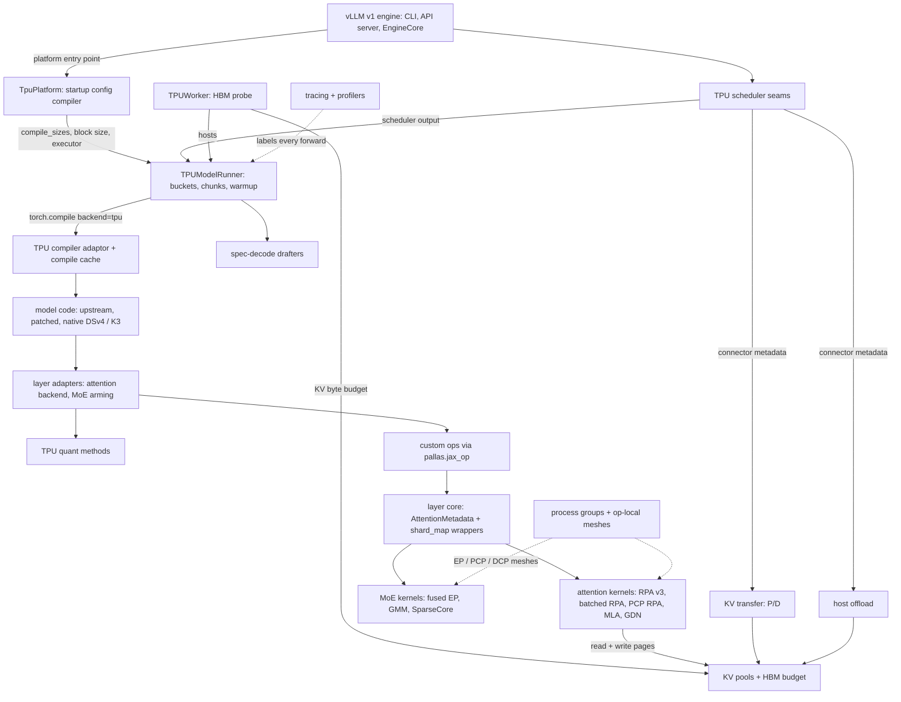

# vllm-torchtpu - what it is and how it fits together

## In one paragraph
vllm-torchtpu is a vLLM **platform plugin, not a fork**: vLLM is installed as a plain wheel, and TPU behavior comes in through two entry points and an ordered patch registry ([packaging](doc-concepts/plugin-packaging-and-registration.md), [patch registry](doc-concepts/tpu-patch-registry.md)). Models stay as vLLM's own torch code and run under `torch.compile(backend="tpu")`. The hot ops are JAX/Pallas kernels wrapped as opaque torch custom ops ([plugin architecture](doc-concepts/plugin-architecture-and-kernel-bridge.md)). The central design idea is **static shapes compiled before the first request**. At startup the platform rewrites vLLM's GPU-shaped config into a ladder of token buckets. Warmup compiles one TPU executable per bucket, and every engine step is padded to a bucket, so the batch can change every step without a recompile ([TPU platform](concepts/tpu-platform.md), [model runner](concepts/tpu-model-runner.md)). Around that core sit a KV-cache allocator that charges each page what the kernel layout really costs, a family of attention and MoE kernels selected mostly by env vars, op-local multi-device meshes for EP/PCP/DCP kernels, speculative-decoding drafters, and serving-topology features (P/D disaggregation, host offload, multihost).

## Performance-relevant surfaces
These are the knobs that move throughput, TTFT/TPOT and resident HBM on TPU, grouped by what they act on. Defaults are the code defaults stated on the linked pages. CI recipes often override them; the [v7x recipe matrix](doc-concepts/v7x-serving-recipe-matrix.md) shows what each benchmarked config actually sets, along with its measured baseline. Most kernel and layout choices can only be reached through env vars, and nearly all of those join the compile cache key ([env-var reference](doc-concepts/env-var-reference-by-subsystem.md)).

| Group | Surface (knob / API) | Default | Effect on perf | Page |
|---|---|---|---|---|
| Shapes | `compile_sizes` token buckets; `--max-num-batched-tokens` sets the largest; `TPU_TOKEN_BUCKET_EXTRA`, `TPU_TOKEN_BUCKET_LINEAR` | exponential from 16, doubling, last bucket = MBT exactly; linear off (adds at most 7 buckets above budget/4) | padding waste vs warmup time and resident program HBM; each bucket cost ~13 GB host memory per rank on a TP8 Qwen3.5-397B+MTP deployment | [token padding buckets](doc-concepts/token-padding-buckets.md), [TPU platform](concepts/tpu-platform.md) |
| Shapes | request buckets; per-forward request cap from the SMEM page-table budget; `VLLM_TPU_MOST_MODEL_LEN` | request ladder = powers of 2 from 8 to `max_num_seqs`; cap `1024*1024 // 2 // pages_per_req // 4` | a step with more requests than the cap runs as several forwards; a larger `max_model_len` (more pages per request) shrinks the cap | [model runner](concepts/tpu-model-runner.md), [layer adapters](concepts/vllm-layer-adapters.md) |
| Warmup | `TPU_PARALLEL_PRECOMPILE`, `TPU_PRECOMPILE_PEER_REPLAY` (+ `TPU_PRECOMPILE_PEER_WAIT_S`), `TPU_PRECOMPILE_TRACE_FIRST` | off, off (600 s), off | time-to-serve: ranks of a host split or replay the compiles of the biggest buckets | [compilation cache and warmup](doc-concepts/compilation-cache-and-warmup.md), [compilation and graph capture](concepts/compilation-and-graph-capture.md) |
| Compile cache | `TORCH_TPU_TIER3_COMPILATION_CACHE_ROOT` (PjRt executables) + `VLLM_CACHE_ROOT` (Dynamo/AOT artifacts); `profile_cache` on an in-memory volume | `""`; `~/.cache/vllm` | warm starts skip XLA compiles; a stale `profile_cache` skews the free-HBM probe | [compilation cache and warmup](doc-concepts/compilation-cache-and-warmup.md), [profile cache and HBM probe](doc-concepts/profile-cache-and-free-hbm-probe.md) |
| Recompiles | `VLLM_XLA_CHECK_RECOMPILATION`; `TPU_KERNEL_ITER_MODE` | off; off | the detector logs graphs compiled after warmup (a runtime compile stalls the engine loop); iter mode splits the graph at the RPA ops and runs them eagerly, so a kernel edit reuses the backbone (a development mode) | [compilation and graph capture](concepts/compilation-and-graph-capture.md) |
| HBM budget | `--gpu-memory-utilization`, `kv_cache_memory_bytes`, post-profile reserves (KV connector, LoRA, PP hand-off), min across EP/DP ranks | vLLM defaults | whatever is left after weights and reserves becomes KV blocks; resident-weight growth directly costs batch | [KV layout and HBM budget](concepts/kv-cache-layout-and-hbm-budget.md) |
| KV layout | `--block-size`; `--kv-cache-dtype fp8`; `VLLM_KV_CACHE_LAYOUT` (NHD/HND); `TPU_VLLM_ENABLE_UNIFIED_BLOCK_POOL`; `VLLM_TPU_BLOCK_MAJOR_KV` | batched RPA: multiple of 128, 256 auto; default backend: ~16 pages per `max_model_len`, clamped [16, 256], 16 above 8192 tokens; fp8 = e5m2 on v6e, e4m3fn elsewhere; unified pool per-architecture; block-major off | pages are padded to 128 lanes and 32-bit K/V packing; fp8 halves KV bytes; the unified pool hosts GDN state inside attention pages; block-major makes one block one DMA | [KV layout and HBM budget](concepts/kv-cache-layout-and-hbm-budget.md), [quantization formats](doc-concepts/tpu-quantization-formats.md) |
| Attention | `--attention-backend CUSTOM` (batched RPA) vs default RPA v3 (+ head_dim 64 variant); `USE_RPA_PIPELINED_DMA_STAGING` | RPA v3; CI recipes pass CUSTOM; staging off | without CUSTOM the recipes fall back to block 16 and regress ~12%; batched RPA runs 8 decode / 2 prefill tiles per pipeline step; RPA v3 is single-core sequential | [batched RPA](concepts/batched-ragged-paged-attention-kernel.md), [RPA v3](concepts/ragged-paged-attention-kernel.md) |
| Attention | tuned block-size tables (RPA hd64, MLA v2, flash, quantized matmul, Megablox GMM, all-gather-matmul) | table lookup | a miss logs `warning_once` with the key and runs a generic tile | [tuned block-size tables](doc-concepts/tuned-block-size-tables.md) |
| MLA / sparse | MLA backend (forced for MLA models); `TPU_MLA_MASKED_DENSE_ENABLED`; `TPU_SPARSE_MLA_NOPE_LAYOUT` / `_ROPE_LAYOUT`; DSv4 indexer cache mode | off; `sparsecore`; indexer `sal` (SEQ_ALONG_LANE) when block size is a multiple of 128 | sparse MLA gathers top-k rows on SparseCore (flat in context length); SEQ_ALONG_LANE indexer moves 1.94x fewer HBM bytes per token | [MLA kernels](concepts/mla-attention-kernels.md), [StreamIndex top-k](concepts/deepseek-v4-streamindex-topk-kernel.md) |
| Hybrid / linear attention | GDN v3 fused conv1d + recurrence; PCP-fused GDN prefill; KDA | on for GDN/KDA models | one kernel for decode/verify and prefill tiling; spec-decode needs one state checkpoint per window position | [GDN kernels](concepts/gated-deltanet-kernels.md), [GDN PCP fused](concepts/gdn-pcp-fused-kernel.md) |
| MoE kernel | `USE_MOE_SPARSE_CORE`; `ONEHOT_MOE_PERMUTE_THRESHOLD`; `USE_MOE_FUSED_EP_KERNEL` / `MOE_FUSED_EP_KERNEL_IMPL` (`v2` or `adaptive`); `MOE_FUSED_EP_ENABLE_W4A8`; `RAGGED_GATHER_REDUCE_VERSION` | sparse core 1; threshold auto (recipes force 32768); fused EP off, impl unset; W4A8 off; gather-reduce `v2` | the fused EP kernel pushes result rows by remote DMA instead of an exposed reduce-scatter (cited 33,304 vs 30,888 tok/s on Qwen3.5-397B DP8+EP); built for TPU v7 only | [fused MoE](concepts/fused-moe-kernels.md), [adaptive fused MoE](concepts/adaptive-fused-moe-kernel.md), [SparseCore gather/scatter](concepts/sparsecore-ragged-gather-scatter.md) |
| MoE layout | DP attention + EP experts; `TPU_MOE_HIERARCHICAL_EP`, `TPU_MOE_SEQUENCE_PARALLEL`, `TPU_ATTN_MOE_OVERLAP`, `TPU_MOE_FP8_ALL_GATHER`, `TPU_MOE_ROUTER_TOPK`; EP mesh device order | all off; router `rowmax` | DP+EP removes per-layer wide-TP all-reduces; rank-ordered vs device-id EP mesh changed one all-gather from 178 to 321 us (-4.5% end to end) | [DP + EP layouts](doc-concepts/dp-ep-moe-layouts.md), [parallelism and meshes](concepts/distributed-parallelism-and-meshes.md) |
| Quantization | `ENABLE_QUANTIZED_MATMUL_KERNEL` + `REQUANTIZE_WEIGHT_DTYPE` + `REQUANTIZE_BLOCK_SIZE`; `MOE_REQUANTIZE_WEIGHT_DTYPE` / `_BLOCK_SIZE`; `TPU_FP8_LINEAR_W8A16_MAX_ROWS` | off; `float8_e4m3fn`; none; W8A16 off | weights are converted once at load into kernel layouts; fp4/int8 buy bytes and bandwidth, not MXU FLOPs | [quantization methods](concepts/quantization-methods.md), [load-time requantization](doc-concepts/load-time-requantization.md) |
| Spec decode | `--speculative-config` method (`eagle3`, `mtp`, `dflash`, `dspark`, `ngram`), `num_speculative_tokens`, `draft_tensor_parallel_size` (1 or target TP) | none | the K+1 verify tokens ride in the decode stage; the MTP drafter runs steps 1..K-1 as one program; the spec config is hashed into the compile key | [speculative decoding](concepts/speculative-decoding.md), [methods](doc-concepts/speculative-decoding-methods.md), [Spec-Bench harness](doc-concepts/spec-bench-harness.md) |
| Parallelism | TP / DP / PP / EP / PCP / DCP flags (count logical devices: 2 per v7x chip); `TPU_PCP_TOPOLOGY_AWARE_MESH`; `TPU_DCP_LSE_MERGE_A2A`; `TPU_DCP_MLA_TOPK_CAP` | PCP topology order on; A2A merge off (64-token threshold) | PCP is the TTFT lever for long prompts, DCP shards decode KV; PCP and DCP cannot share an engine | [6D parallelism](doc-concepts/composable-6d-parallelism.md), [context parallelism](doc-concepts/context-parallelism-pcp-dcp.md), [PCP streaming RPA](concepts/pcp-streaming-rpa-kernel.md) |
| Pipeline / scheduling | `TPU_PP_HANDOFF` (`wave` / `ring`), `TPU_PP_DYNAMIC_CHUNKS`, `TPU_PP_CHUNK_SLACK`, `TPU_PP_RING_DEPTH`; `DP_SCHED_ENABLED`; SRPT admission knobs | `wave`, on, 0.1, 2; off; off | time-budgeted prefill chunks and lazy push keep stages busy; DP-aligned admission | [schedulers](concepts/tpu-schedulers.md), [PP stage hand-off](doc-concepts/pipeline-parallel-stage-handoff.md) |
| Disaggregation | `kv_role` producer/consumer; `TPU_KV_RESHARD_TRANSPORT` (`zmq` / `raiden`); `TPU_RAIDEN_RESHARD_IMPL` (`controller` / `store`); `TPU_RAIDEN_TRANSFER_PARALLELISM`; `TPU_USE_RAIDEN_KV_CACHE_MANAGER` | `zmq`, `controller`, 8, off | long prefills stop stalling decode; Raiden Stage-3 reshards byte spans between heterogeneous layouts | [KV transfer and P/D](concepts/kv-transfer-and-disaggregated-serving.md), [Raiden P/D](doc-concepts/raiden-pd-disaggregation.md) |
| Host offload | `--kv-offloading-size` (host bytes); `VLLM_TPU_BLOCK_MAJOR_KV`; optional storage tier | off | extends the prefix cache to host DRAM; block-major collapses a block's DMAs to one; saves are fenced on a TPU event, never a device sync | [host offload](concepts/host-offload.md) |
| Multihost | `TPU_MULTIHOST_BACKEND` (`mp` / `ray`) | `""`; the docs make `mp` the multi-host default; unknown values fall back to uniproc | executor and PjRt bootstrap are chosen at config time | [multihost backends](doc-concepts/multihost-execution-backends.md) |
| Profiling | `/start_profile` + tracer options; `USE_PHASED_PROFILER`; per-rank capture + merge; offline single-shape script | off | per-phase (prefill / decode / mixed) traces with request-id and KV-length labels on every forward | [server-side profiling](doc-concepts/server-side-profiling-and-trace-options.md), [phased profiler](doc-concepts/phased-profiler.md), [tracing annotations](concepts/tracing-annotations.md) |

Starting frontier: the CI-gated v7x configs and their baseline JSONs ([v7x recipe matrix](doc-concepts/v7x-serving-recipe-matrix.md), [benchmark harness](doc-concepts/benchmark-harness-and-regression-gates.md)). On Qwen3.5-397B, TP8 has the best latency at concurrency 64 and DP8 has the best throughput at 512. The Kimi-K3 baseline is deliberately regressed by the unified-pool default. That gap is open headroom, not a ceiling. To prove a change, follow the maintainers' [evidence standard](doc-concepts/perf-evidence-standard.md): a trace showing the mechanism, HLO evidence for any compiler claim, per-mode speedups, and A/Bs at a matched global token budget.

Traps that silently void a perf experiment:
- **Env values the docs list that the code rejects or ignores.** `VLLM_XLA_CACHE_PATH` (the README tip) is read by nothing; persist `TORCH_TPU_TIER3_COMPILATION_CACHE_ROOT` and `VLLM_CACHE_ROOT` instead. `MOE_FUSED_EP_KERNEL_IMPL=v1`, `TPU_SPARSE_MLA_*_LAYOUT=tc`, `TPU_RAIDEN_RESHARD_IMPL=host` and `TPU_KV_RESHARD_TRANSPORT=tcp` raise. `TPU_TOKEN_BUCKET_LINEAR` adds buckets rather than replacing them. Suffix speculative decoding raises `NotImplementedError` ([env-var reference](doc-concepts/env-var-reference-by-subsystem.md), [speculative decoding methods](doc-concepts/speculative-decoding-methods.md)).
- **Int-only booleans.** `USE_MOE_SPARSE_CORE`, `DP_SCHED_ENABLED`, `TPU_KERNEL_ITER_MODE` and `VLLM_XLA_CHECK_RECOMPILATION` accept only `0`/`1`, so `true` fails to parse. Setting `MOE_FUSED_EP_KERNEL_IMPL` alone already turns the fused kernel on ([env-var registry](doc-concepts/env-var-registry-and-compile-key.md)).
- **Things that change the compile key.** Any hashed TPU env var, `XLA_FLAGS` / `LIBTPU_INIT_ARGS`, `--gpu-memory-utilization`, `--max-model-len`, `--max-num-seqs`, `--max-num-batched-tokens`, the speculative config, or an edited kernel source each invalidate every cached executable. That includes the tracing knobs `HOST_TRACER_LEVEL`, `DEVICE_TRACER_LEVEL` and `TPU_TRACE_MODE`. An A/B on such a knob pays a cold compile per arm ([compilation and graph capture](concepts/compilation-and-graph-capture.md), [tracing annotations](concepts/tracing-annotations.md)).
- **Silent fallbacks to a slower path.** A tuned-table miss runs a generic tile. SparseCore combine drops to XLA for small inputs. A TP shard whose contracting dim is smaller than the requant block falls back to per-channel. The Kimi-K3 fused ring collectives are skipped for any non-matching shape or dtype. The diffusion flash backend falls back to SDPA ([tuned tables](doc-concepts/tuned-block-size-tables.md), [SparseCore](concepts/sparsecore-ragged-gather-scatter.md), [quantization methods](concepts/quantization-methods.md), [Kimi-K3 model](concepts/kimi-k3-model.md), [Omni diffusion](concepts/omni-diffusion-support.md)).
- **Shapes outside the ladder.** A token count above the largest bucket is a hard error, and any shape warmup missed compiles synchronously on the engine loop. Changing `max_model_len` changes pages per request and so the per-forward request cap. The MTP drafter compiles outside warmup ([model runner](concepts/tpu-model-runner.md), [compilation and graph capture](concepts/compilation-and-graph-capture.md)).
- **Recipe flags the doc commands omit.** The CI harness adds `--attention-backend CUSTOM`, `--async-scheduling`, `--no-enable-prefix-caching`, `--kv-cache-dtype fp8` and `--api-server-count=1` under DP. Several doc commands also disagree with the CI configs on `max-num-seqs`. Copy the config, not the doc command. MLA models ignore `--attention-backend` ([v7x recipe matrix](doc-concepts/v7x-serving-recipe-matrix.md)).
- **Doc-only connector names.** The P/D guide's `TpuRaidenConnector` module path does not exist; the class is `TPURaidenConnector` in `kv_transfer.tpu_connector` ([Raiden P/D](doc-concepts/raiden-pd-disaggregation.md)).

## Core architecture

Legend:
- `VLLM` - [plugin packaging and registration](doc-concepts/plugin-packaging-and-registration.md), [plugin architecture](doc-concepts/plugin-architecture-and-kernel-bridge.md)
- `PLAT` - [TPU platform](concepts/tpu-platform.md) ([platforms area](areas/platforms.md))
- `SCHED` - [TPU schedulers](concepts/tpu-schedulers.md) ([core area](areas/core.md))
- `WORKER` - [worker area](areas/worker.md), [profile cache and free-HBM probe](doc-concepts/profile-cache-and-free-hbm-probe.md)
- `RUNNER` - [TPU model runner](concepts/tpu-model-runner.md) ([runner area](areas/runner.md))
- `COMP` - [compilation and graph capture](concepts/compilation-and-graph-capture.md) ([compilation area](areas/compilation.md))
- `MODELS` - [vLLM model patches](concepts/vllm-model-patches.md), [DeepSeek-V4 model](concepts/deepseek-v4-model.md), [Kimi-K3 model](concepts/kimi-k3-model.md)
- `ADAPT` - [vLLM layer adapters](concepts/vllm-layer-adapters.md) ([layers area](areas/layers.md))
- `QUANT` - [quantization methods](concepts/quantization-methods.md)
- `OPS` - [custom ops](concepts/custom-ops.md)
- `CORE` - [attention and layer core](concepts/attention-and-layer-core.md)
- `ATTN` - [RPA v3](concepts/ragged-paged-attention-kernel.md), [batched RPA](concepts/batched-ragged-paged-attention-kernel.md), [PCP streaming RPA](concepts/pcp-streaming-rpa-kernel.md), [MLA kernels](concepts/mla-attention-kernels.md), [GDN kernels](concepts/gated-deltanet-kernels.md) ([kernels area](areas/kernels.md))
- `MOE` - [fused MoE](concepts/fused-moe-kernels.md), [adaptive fused MoE](concepts/adaptive-fused-moe-kernel.md), [SparseCore gather/scatter](concepts/sparsecore-ragged-gather-scatter.md)
- `KV` - [KV cache layout and HBM budget](concepts/kv-cache-layout-and-hbm-budget.md)
- `DIST` - [distributed parallelism and meshes](concepts/distributed-parallelism-and-meshes.md) ([distributed area](areas/distributed.md))
- `SPEC` - [speculative decoding](concepts/speculative-decoding.md) ([spec_decode area](areas/spec_decode.md))
- `KVX` - [KV transfer and disaggregated serving](concepts/kv-transfer-and-disaggregated-serving.md)
- `OFF` - [host offload](concepts/host-offload.md) ([offload area](areas/offload.md))
- `TRACE` - [tracing annotations](concepts/tracing-annotations.md) ([tracing area](areas/tracing.md))

## How one engine step flows

```mermaid
flowchart LR
  S1["scheduler emits step"]
  S2["execute_model: host input prep, split by request cap"]
  S3["pad to token + request bucket"]
  S4["AttentionMetadata build, one batched H2D"]
  S5["compiled backbone program, cache hit"]
  S6["attention kernels: decode + mixed passes, fused KV write"]
  S7["MoE kernels: route, dispatch, experts, combine"]
  S8["sample_tokens: compiled logits + sampler"]
  S9["verify 1+K draft tokens"]
  S10["drafter proposes next K"]
  S1 --> S2 --> S3 --> S4 --> S5 --> S6 --> S7 --> S8 --> S9 --> S10
  S10 -->|next step| S1
```

Legend:
- `S1` - [TPU schedulers](concepts/tpu-schedulers.md)
- `S2` - [TPU model runner](concepts/tpu-model-runner.md)
- `S3` - [token padding buckets](doc-concepts/token-padding-buckets.md), [TPU model runner](concepts/tpu-model-runner.md)
- `S4` - [attention and layer core](concepts/attention-and-layer-core.md)
- `S5` - [compilation and graph capture](concepts/compilation-and-graph-capture.md)
- `S6` - [RPA v3](concepts/ragged-paged-attention-kernel.md), [batched RPA](concepts/batched-ragged-paged-attention-kernel.md), [MLA kernels](concepts/mla-attention-kernels.md)
- `S7` - [fused MoE](concepts/fused-moe-kernels.md), [SparseCore gather/scatter](concepts/sparsecore-ragged-gather-scatter.md)
- `S8` - [TPU model runner](concepts/tpu-model-runner.md), [structured decoding area](areas/structured_decoding.md)
- `S9` - [vLLM layer adapters](concepts/vllm-layer-adapters.md) (rejection sampler), [speculative decoding](concepts/speculative-decoding.md)
- `S10` - [speculative decoding](concepts/speculative-decoding.md)

The order is load-bearing. All input preparation happens on the host into preallocated staging tensors, so the device only sees padded uploads. Request counts travel as data inside a fixed-shape metadata pytree, which is why a 3-decode step and a 200-decode step hit the same program. The attention kernel writes the step's new K/V into the cache inside the same launch, through donation plus `copy_`, which XLA aliases in place. A step with more requests than the SMEM cap simply loops S2-S8 over chunks.

## Main concepts

### A platform plugin that compiles the config at startup
`TpuPlatform` is a class of classmethods that vLLM calls at fixed points. Its `check_and_update_config` runs once per process and turns a GPU-shaped `VllmConfig` into a servable one. It forces whole-graph `VLLM_COMPILE` with no graph splitting, replaces CUDA-graph sizes with token buckets, forces bf16, derives the KV block size from the kernel geometry, picks the executor and seeds the `TORCH_TPU_*` bootstrap env. Most of the method is validation that raises with a remedy at launch rather than failing mid-serving. Every upstream behavior change is a monkey-patch declared in one ordered registry. See [TPU platform](concepts/tpu-platform.md), [patch registry](doc-concepts/tpu-patch-registry.md), [fail-fast policy](doc-concepts/fail-fast-and-fallback-policy.md).

### Every device program runs at a precompiled shape
`TPUModelRunner` subclasses vLLM's GPU runner but replaces dynamic shapes and CUDA graphs with three rules. Inputs are prepared on the CPU. The forward is split into a handful of compiled subgraphs: backbone, selected logits, sampling and structured decode, and logprobs. Warmup walks every bucket with a dummy forward before the first request. `profile_run` compiles one throwaway max-bucket program into an isolated cache, because every loaded program permanently reserves HBM. See [TPU model runner](concepts/tpu-model-runner.md), [token padding buckets](doc-concepts/token-padding-buckets.md).

### One executable per bucket, keyed by what Dynamo cannot see
The compiler adaptor lowers vLLM's captured FX graph through TorchTPU to one PjRt executable per bucket. It persists wrapper and executable as one bundled artifact, and it designs out anything that would load a second copy into another HBM program region. The cache key hashes what Dynamo cannot see: Pallas kernel sources behind custom-op boundaries, the TPU env registry, library versions and KV block count. Shape variants re-trace models that branch on token count, and peer replay or trace-first deferral spread the compile cost across a host's ranks. See [compilation and graph capture](concepts/compilation-and-graph-capture.md), [compilation cache and warmup](doc-concepts/compilation-cache-and-warmup.md), [env-var registry](doc-concepts/env-var-registry-and-compile-key.md).

### Torch models, Pallas kernels, everything resolved before tracing
The adapter layer registers replacements at vLLM's extension points: a Pallas attention backend in the `FLASH_ATTN` / `CUSTOM` / `FLASH_ATTN_MLA` slots, TPU quant configs, and custom ops for MLA, GDN, KDA, DeepSeek-V4 and the MoE runner. Each kernel is built once outside the compiled region under a name that encodes every baked-in constant, gets a fake implementation for Dynamo, and donates its cache operands. The JAX-side layer core owns the single `AttentionMetadata` pytree and the `shard_map` wrappers that place kernels on the mesh. Weight transposes, requantization and other heavy tensor work happen once at load. See [vLLM layer adapters](concepts/vllm-layer-adapters.md), [custom ops](concepts/custom-ops.md), [attention and layer core](concepts/attention-and-layer-core.md), [weight load-time preprocessing](doc-concepts/weight-load-time-preprocessing.md).

### A KV page costs what the kernel lays out, and free memory is not the budget
vLLM's abstract page arithmetic is wrong on TPU in two ways. The layout pads `head_size` to 128 lanes and packs K/V into 32-bit words. A hybrid model's GDN/KDA state must also fit inside an attention-shaped page. The normalizer publishes the real page bytes so vLLM's block math matches the allocator. `compute_hbm_budget` caps HBM at `gpu_memory_utilization` and subtracts resident bytes plus one shared set of post-profile reserves. The pages are then materialized as per-layer caches, a shared cache, the unified hybrid pool, or a block-major pool, and offload, P/D transfer and kernels all derive their geometry from that single source. See [KV cache layout and HBM budget](concepts/kv-cache-layout-and-hbm-budget.md).

### A kernel per attention regime
The default RPA v3 kernel serves mixed prefill/decode in one sequential double-buffered walk with the cache write fused in, plus a head_dim 64 variant. The batched RPA kernel, which recipes select with `CUSTOM`, hoists scheduling into a scalar pre-pass and batches (query-block, KV-block) tiles per step. PCP prefill streams KV pages around a ring instead of gathering them. MLA has a dense v2 kernel and a sparse gather-then-attend kernel over SparseCore-packed fp8 caches. Linear attention uses the fused GDN v3 kernel. DeepSeek-V4 adds a compressor and a TensorCore-score / SparseCore-top-k indexer. See [kernel library map](doc-concepts/tpu-kernel-library-map.md), [RPA v3](concepts/ragged-paged-attention-kernel.md), [batched RPA](concepts/batched-ragged-paged-attention-kernel.md), [PCP streaming RPA](concepts/pcp-streaming-rpa-kernel.md), [MLA kernels](concepts/mla-attention-kernels.md), [GDN kernels](concepts/gated-deltanet-kernels.md), [DSv4 compress-and-store](concepts/deepseek-v4-compress-and-store-kernel.md), [StreamIndex top-k](concepts/deepseek-v4-streamindex-topk-kernel.md), [kernel resource rules](doc-concepts/kernel-hardware-resource-rules.md).

### MoE: layout first, then kernel
The recommended layout for large MoE models is DP attention plus EP experts, which keeps attention chip-local and avoids 8- or 16-way all-reduces per layer. The default MoE path permutes tokens on the SparseCore (or one-hot matmuls below a row threshold) around grouped matmuls. The opt-in fused EP kernel runs route, push, FFN and combine as one SPMD program, sizing its VMEM weight ring from the shape. The `adaptive` fork splits that ring into asymmetric W1/W2 rings and refuses instead of falling back. See [DP + EP layouts](doc-concepts/dp-ep-moe-layouts.md), [fused MoE](concepts/fused-moe-kernels.md), [adaptive fused MoE](concepts/adaptive-fused-moe-kernel.md), [SparseCore gather/scatter](concepts/sparsecore-ragged-gather-scatter.md).

### Single-device runner, multi-device ops
Each worker process owns one device and a one-device mesh, and ranks talk through `torch.distributed`. A single op can still be an SPMD program. The package builds op-local JAX meshes over the EP, PCP and DCP groups, plus per-stage meshes under PP, so MoE dispatch and ring attention can fuse their transport into the kernel. Device order is a performance knob, and a misaligned group fails at build time rather than collecting over the wrong partners. See [distributed parallelism and meshes](concepts/distributed-parallelism-and-meshes.md), [6D parallelism](doc-concepts/composable-6d-parallelism.md), [TPU generations and logical devices](doc-concepts/tpu-generations-and-logical-devices.md).

### Fewer sequential decode steps: speculative decoding
The EAGLE-3/MTP proposer drafts autoregressively, and the DFlash/DSpark proposer drafts a block in one forward. Both draft at bucketed shapes and pin small eager ops into compiled regions, so drafting never recompiles. Under EP-DP lockstep they replay dummy chunks so collectives pair by emission order. See [speculative decoding](concepts/speculative-decoding.md), [methods](doc-concepts/speculative-decoding-methods.md).

### Serving topology: P/D, offload, multihost, pipelines
P/D disaggregation ships prompt KV from producer to consumer engines over three transports. The Raiden Stage-3 transport reshards raw byte spans between different parallel layouts. Host offload extends the prefix cache into host DRAM through a scheduler-owned store with passive workers. Pipeline parallelism adds a time-budgeted prefill chunk scheduler and wave or ring hand-off. Multihost runs over an `mp` rendezvous or Ray. See [KV transfer and P/D](concepts/kv-transfer-and-disaggregated-serving.md), [host offload](concepts/host-offload.md), [TPU schedulers](concepts/tpu-schedulers.md), [PP stage hand-off](doc-concepts/pipeline-parallel-stage-handoff.md), [multihost backends](doc-concepts/multihost-execution-backends.md).

### Model-specific stacks and libraries in waiting
DeepSeek-V4 and Kimi-K3 have native TPU implementations: deferred mHC fusion and one attention op per layer for DSv4, and fused ring collectives for K3 sequence-parallel prefill. Other families are patched in place. Some parts of the tree are not on the serving path at this commit. The megakernel and its pool are a framework-free library whose fused emitter is not in the tree. The exporter and Rust launcher produce Python-free StableHLO artifacts. Omni adds diffusion pipelines. See [DeepSeek-V4 model](concepts/deepseek-v4-model.md), [Kimi-K3 model](concepts/kimi-k3-model.md), [Kimi-K3 kernels](concepts/kimi-k3-kernels.md), [megakernel](concepts/megakernel.md), [megakernel pool](concepts/megakernel-pool.md), [model export and Rust launcher](concepts/model-export-and-rust-launcher.md), [Omni diffusion](concepts/omni-diffusion-support.md).

## Map of the wiki
Start from an area page for a directory, a concept page for a mechanism, or a doc-concept for something the repo's README and docs describe.

| Part of the repo | Start here | Concept pages |
|---|---|---|
| Platform, config rewrite, executors | [platforms area](areas/platforms.md), [executors area](areas/executors.md) | [TPU platform](concepts/tpu-platform.md) |
| Runner, worker, KV allocation | [runner area](areas/runner.md), [worker area](areas/worker.md) | [TPU model runner](concepts/tpu-model-runner.md), [KV layout and HBM budget](concepts/kv-cache-layout-and-hbm-budget.md) |
| Compilation and caches | [compilation area](areas/compilation.md) | [compilation and graph capture](concepts/compilation-and-graph-capture.md) |
| Scheduler seams | [core area](areas/core.md) | [TPU schedulers](concepts/tpu-schedulers.md) |
| Layers (adapters, quant, custom ops, layer core) | [layers area](areas/layers.md) | [layer adapters](concepts/vllm-layer-adapters.md), [quantization methods](concepts/quantization-methods.md), [custom ops](concepts/custom-ops.md), [attention and layer core](concepts/attention-and-layer-core.md) |
| Pallas kernels | [kernels area](areas/kernels.md) (small units such as Megablox GMM, quantized matmul, flash attention, collectives are sections there) | the attention, MoE, GDN, SparseCore, DSv4 and Kimi-K3 kernel pages linked above |
| Models | [models area](areas/models.md) | [vLLM model patches](concepts/vllm-model-patches.md), [DeepSeek-V4 model](concepts/deepseek-v4-model.md), [Kimi-K3 model](concepts/kimi-k3-model.md) |
| Distributed, P/D, offload | [distributed area](areas/distributed.md), [offload area](areas/offload.md) | [parallelism and meshes](concepts/distributed-parallelism-and-meshes.md), [KV transfer and P/D](concepts/kv-transfer-and-disaggregated-serving.md), [host offload](concepts/host-offload.md) |
| Spec decode, structured output, LoRA | [spec_decode area](areas/spec_decode.md), [structured decoding area](areas/structured_decoding.md), [lora area](areas/lora.md) | [speculative decoding](concepts/speculative-decoding.md); LoRA mechanism: [multi-LoRA inference](doc-concepts/multi-lora-inference.md) |
| Megakernel, export, Omni | [megakernel area](areas/megakernel.md), [experimental area](areas/experimental.md), [omni area](areas/omni.md) | [megakernel](concepts/megakernel.md), [megakernel pool](concepts/megakernel-pool.md), [model export](concepts/model-export-and-rust-launcher.md), [Omni diffusion](concepts/omni-diffusion-support.md) |
| Tracing and tools | [tracing area](areas/tracing.md), [tools area](areas/tools.md) | [tracing annotations](concepts/tracing-annotations.md); merge tool: [merge_xplane](doc-concepts/xplane-session-merge-tool.md) |

For "where is X / who calls X", use the module map [catalog/index.md](catalog/index.md) and grep the symbol index (`catalog/symbols/*.tsv`) by anchor. The silo's `index.md` lists every concept and doc-concept page.

How the repo README's topics route:
- **About / PyTorch-first plugin, TPU-tuned kernels**: [plugin architecture](doc-concepts/plugin-architecture-and-kernel-bridge.md), [kernel library map](doc-concepts/tpu-kernel-library-map.md).
- **Scale-out (TP, DP, PP, EP, PCP/DCP, disaggregated P/D)**: [6D parallelism](doc-concepts/composable-6d-parallelism.md), [context parallelism](doc-concepts/context-parallelism-pcp-dcp.md), [Raiden P/D](doc-concepts/raiden-pd-disaggregation.md).
- **Standard vLLM experience**: speculative decoding in [methods](doc-concepts/speculative-decoding-methods.md); prefix caching beyond HBM in [host offload](concepts/host-offload.md) (the HBM prefix cache itself is upstream vLLM); multi-LoRA in [multi-LoRA inference](doc-concepts/multi-lora-inference.md); structured output in the [structured decoding area](areas/structured_decoding.md); multimodal in [multimodal encoder inference](doc-concepts/multimodal-encoder-inference.md).
- **Supported hardware**: [TPU generations and logical devices](doc-concepts/tpu-generations-and-logical-devices.md).
- **Install / Docker**: [packaging and registration](doc-concepts/plugin-packaging-and-registration.md). **Serve a model / Quickstart**: [offline inference example](doc-concepts/offline-inference-example.md). **First-start compile tip**: [compilation cache and warmup](doc-concepts/compilation-cache-and-warmup.md) (the tip's env var is not read by the code).
- **Supported models and features**: [supported models and feature matrix](doc-concepts/supported-models-and-feature-matrix.md). The auto-generated nightly support matrices are not covered by this wiki.
- **Recipes and deployment**: [v7x recipes](doc-concepts/v7x-serving-recipe-matrix.md), [v6e recipes](doc-concepts/v6e-serving-recipe-matrix.md), [Kubernetes](doc-concepts/gke-multihost-jobset-deployment.md), [multihost](doc-concepts/multihost-execution-backends.md), [quantization](doc-concepts/tpu-quantization-formats.md).
- **Contribute / developer references**: testing and CI in [CI markers and pipelines](doc-concepts/ci-test-markers-and-pipelines.md) and [pyrefly baselines](doc-concepts/pyrefly-baseline-type-checking.md); profiling in [server-side profiling](doc-concepts/server-side-profiling-and-trace-options.md); benchmarking in the [benchmark harness](doc-concepts/benchmark-harness-and-regression-gates.md); coding guidance in [derive, don't declare](doc-concepts/derive-dont-declare.md) and [fail fast](doc-concepts/fail-fast-and-fallback-policy.md); optimization best practices in the [evidence standard](doc-concepts/perf-evidence-standard.md). Planned work: [Q4 2026 roadmap](doc-concepts/roadmap-q4-2026.md).
- **Not covered**: the JAX backend (`tpu-inference`, now "vLLM JAX") that the README points to, the DCO / PR-lifecycle details of `CONTRIBUTING.md`, and the contact channels.

## Where to go for a given task

| Task | Start here | Then |
|---|---|---|
| Serve a model on a v7x or v6e slice | [v7x recipe matrix](doc-concepts/v7x-serving-recipe-matrix.md) | [v6e recipes](doc-concepts/v6e-serving-recipe-matrix.md), [offline inference example](doc-concepts/offline-inference-example.md), [multihost backends](doc-concepts/multihost-execution-backends.md) |
| Cut cold start or hunt a serving-time recompile | [compilation cache and warmup](doc-concepts/compilation-cache-and-warmup.md) | [token padding buckets](doc-concepts/token-padding-buckets.md), [compilation and graph capture](concepts/compilation-and-graph-capture.md), [TPU model runner](concepts/tpu-model-runner.md) |
| Raise throughput of an MoE model | [DP + EP layouts](doc-concepts/dp-ep-moe-layouts.md) | [fused MoE](concepts/fused-moe-kernels.md), [SparseCore gather/scatter](concepts/sparsecore-ragged-gather-scatter.md), [adaptive fused MoE](concepts/adaptive-fused-moe-kernel.md) |
| Size KV capacity or debug a KV-init OOM | [KV layout and HBM budget](concepts/kv-cache-layout-and-hbm-budget.md) | [profile cache and HBM probe](doc-concepts/profile-cache-and-free-hbm-probe.md), [quantization formats](doc-concepts/tpu-quantization-formats.md) |
| Tune or add an attention / kernel path | [kernel library map](doc-concepts/tpu-kernel-library-map.md) | [batched RPA](concepts/batched-ragged-paged-attention-kernel.md), [tuned block-size tables](doc-concepts/tuned-block-size-tables.md), [kernel resource rules](doc-concepts/kernel-hardware-resource-rules.md), [custom ops](concepts/custom-ops.md) |
| Profile a serving run and prove a speedup | [evidence standard](doc-concepts/perf-evidence-standard.md) | [server-side profiling](doc-concepts/server-side-profiling-and-trace-options.md), [phased profiler](doc-concepts/phased-profiler.md), [multi-rank capture](doc-concepts/multi-rank-trace-capture.md), [benchmark harness](doc-concepts/benchmark-harness-and-regression-gates.md) |
| Deploy disaggregated prefill/decode or long context | [Raiden P/D](doc-concepts/raiden-pd-disaggregation.md) | [KV transfer and P/D](concepts/kv-transfer-and-disaggregated-serving.md), [context parallelism](doc-concepts/context-parallelism-pcp-dcp.md), [GKE JobSet deployment](doc-concepts/gke-multihost-jobset-deployment.md) |
| Add a model or a quantization format | [vLLM model patches](concepts/vllm-model-patches.md) | [patch registry](doc-concepts/tpu-patch-registry.md), [quantization methods](concepts/quantization-methods.md), [generic quantization machinery](doc-concepts/generic-quantization-machinery.md) |
